# Rushlight bible

This game's build bible. Moved from the [Rushlight Build Bible doc](https://claude.ai/artifact/57EcpKt21AqX87XfiwV8qw) on 2026-11-21; that doc is frozen.

- The house rules in `studio-bible/` (controls, art style, UI, saves) apply to every game and win where this file overlaps them.
- What's been built is in `changelog.md` next to this file.
- Keegan sends changes through the Design Inbox doc; the Designer edits this file.
- Reading level (set Nov 21): everything Claude writes for this project, in chat, in this bible and in the game, sits at an average reading level. Plain words over jargon, game or period. Game lines follow Voice's 9th grade rule.
- Art assets (set Nov 20): before making any art from scratch, Claude checks for premade pieces first, on the Shared Shelf and in Rushlight's Asset Library. Claude only draws something new when nothing fitting exists, and says what it checked. Free online sources are not used, since studio art is drawn in code (Keegan, Nov 21).
- Known export gaps: date chips, mentions and links to other docs became plain text, and pictures became placeholders. The 23 Art pictures were restored from the old doc on 2026-11-21 and live in `mockups/`.

## To do

One item per chat, in order, biggest open decisions first. Claude ticks the item when its task is done and adds new items where they belong.

- [x] Setup: create this Bible (Nov 19).
- [x] The run: what one run is (a region, a season, a set number of contracts?), how it ends besides a wipe, whether there's a win, and what a wipe carries into the next run.
- [x] Setting change: woodland creatures in the Knight of Pentacles Empire, very low magic (Nov 20).
- [x] The map: how the seeded region is laid out (nodes and roads, or a tile grid), its size, what travel costs (days, food, weather), and the first list of hand-made parts.
- [x] Contracts: the kinds of work (creature hunts, bounties, escorts, guard work, war work), who offers it, what it pays, and how a contract plays on the ground (a short Black Lantern-style case, or something lighter).
- [x] Money and hiring: what coin buys, what mercenaries cost, how the hire pool in towns works.
- [x] Ported rules, pass 1 (Sanity and the people around the mercs): SAN recovery with no psych care, Bonds, home scenes, motivations and personal arcs.
- [x] Ported rules, pass 2 (Mercenaries and skills): creator or hire-only, professions as 1400s trades, the 19-skill list remapped (Computers, Bureaucracy, Forensics, Science and the rest).
- [x] Progression: the standard XP system (set Nov 20). What earns XP (kills, contracts, surviving SAN hits?), what it buys (levels, skill points, perks), level cap, how it fits the percentile skills and the 40%, 75% and 90% unlocks, and whether hires come in at higher levels later in a run.
- [x] Ported rules, pass 3 (Combat and items): era weapons (bows, crossbows, hand cannons) and armor, people versus creatures, the item list for the era, what replaces Lantern Boxes and requisition.
- [x] Factions and the law: lords, church, towns, free companies, outlaws, and what replaces Black Lantern's overstepping escalation.
- [x] Magic: the bargains and folk rites, what each costs, how the party finds them, and where the Peddler fits.
- [x] Creatures: how cosmic and cryptid things stay wrong rather than storybook; the first few hand-made hunts.
- [x] Art direction: reuse Black Lantern's look or make a new one; first still mockup (the battle screen, Nov 20).
- [x] Mockup 2 (still image): a town street with townsfolk and the dialog box, at Wide scale (Brodek, Nov 20).
- [x] Mockup 3 (still image): the region map on a 375-wide screen, nodes, roads, wilds and the Hue and cry and faction steps (the Vrbno March, Nov 20).
- [x] Voice: how lines read in the 1400s without fake-old English; naming (Nov 20).
- [x] Cast: any recurring characters, including the rest of the Peddler's kind (Nov 20).
- [x] Tech: reuse Black Lantern's shell and code, seeded generation, saving a run (Nov 20).
- [x] Mockup rework 1 (still image): the battle screen redrawn inside the GBA shell (Nov 20).
- [x] Mockup rework 2 (still image): the town street redrawn inside the GBA shell, with the new names from Voice (Nov 20).
- [x] Mockup rework 3 (still image): the region map redrawn inside the GBA shell, including the Key on L, with the new names from Voice (Nov 20).
- [x] Review (()) comments (Nov 20).
- [x] Mockup 4 (still image): the merc gear and item menu inside the GBA shell: 2 weapons, body and head, 8 slots, wear steps, the shared pack with the purse and rations on the foot line, and swap or give. (Nov 20)
- [x] Item type icons (still images): the 13 type icons from Art's Item icons (premade check first), then swapped into Mockup 4 (Nov 20).
- [x] Art across games: a standalone Shared Shelf page any game reads, add-only with versions; Rushlight's own Asset Library; shared pieces on your OK, drawn with palette slots; naming; the six pieces leave project files (Nov 20).
- [x] Shared Shelf: make the standalone page, seeded as a read-only copy of Black Lantern's Shared and Seasonal shelves and redrawn with palette slots; offer the GBA shell, the dialog box and the item type icons as Rushlight's first additions for your OK (Nov 20).
- [x] Rushlight Asset Library: build the page, file the six project-file pieces in it by the Art across games naming, note which Shared Shelf versions Rushlight uses, then delete the project-file copies (Nov 20). Also redraw the GBA shell and the dialog box in palette slots and add them to the Shared Shelf as shared-ui-shell-v1 and shared-ui-dialog-v1 (approved Nov 20); the item type icons stay Rushlight-only.
- [x] Mockup 5 (still images, icon only): the company's marker on the region map, three options: a carved wooden game piece, a pin trailing red thread, the lead's head on a coin token (Nov 20; C, the coin token, picked).
- [x] Creature art study: Lovecraftian entity art, DeviantArt included (no chibi or sexual work), boiled down to drawing rules for Art; then test them on a second creature drawing (the Millrace Drowner, Nov 20).
- [x] Creature batch 1: 2 beast jobs, 1 false alarm, 3–4 roamer types and 4 Folk enemy types, so the 4 existing creatures fill one region (the Withy March, Nov 20).
- [x] Text Library and build storage: make the Rushlight Text Library Sheet (one row per line: ID, pool, text, conditions, draft or approved, where used) and move the in-game text already written in Voice, Creatures, and World and contracts into it, leaving rules and examples in the Bible; add a Tech line that art first drawn during a build is filed in the Asset Library before the build uses it; do the overdue Bible backup to Drive (picks set Nov 20: Text Library B, builds to Drive B). Done Nov 20: 97 rows; cards keep mechanics and Text IDs; Bible backups now per tab touched.
- [x] Quality of life read-through pass (Nov 21).
- [x] Balancing read-through pass (Nov 21).
- [x] Pre-development read-through, step 1: Claude finds holes (Nov 21). 19 found, listed under Read-through holes below.
- [x] Pre-development read-through, step 2: you check everything. Done Nov 21: you picked A on all eight of rows 1–8. The Drowner review (row 18) was done Nov 21: you picked A, and it's redrawn as v2.
- [x] Creature audit against Archives of Nethys (Nov 21): AoN names become the kind Identify reveals, the Corpse-candle replaces the Lent Pig, and AoN comes first for every batch.
- [x] Pre-development read-through, step 3: Claude polishes for building. Apply your picks and the fixes in rows 9–19, add any new To do items your picks call for, then clear the hole list.

  Done Nov 21: rows 2–19 applied in their tabs (see the Changelog); row 1 became its own item below, since it needs Black Lantern's Bible open; the hole list is cleared.
- [x] Carried rules sub-tab (read-through row 1, your pick A): copy each carried Black Lantern rule's text into a new Carried rules sub-tab under Systems (statuses, the SAN loss table, Breaking Points, disorders, Willpower, Steadying, Luck, the INT Hunch, Downed and the \~30 Carry unlocks), so the build never opens Black Lantern. Do it when Black Lantern's Bible isn't mid-run.

  Hold lifted Nov 21 (your pick A): do it next, before Voice pools. Black Lantern is read only.

  Done Nov 21: Carried rules sub-tab made under Systems, with Sanity, the SAN loss table, Disorders, Statuses, Stats and Luck, Combat, Lasting injuries, the 31 carried unlocks, Drugs and Addiction, Item display, map and choice rules, and the 16 carried quality-of-life items. Your picks: Leaning on a Bond carries (any Bond), road statuses tick once a travel day, Sleep disorder triggers on the first night of a contract, Career-ending retires the merc with no Hope and no hire-back.
- [x] People batch 1 (row 3, pick A): 3–4 people-job templates for the Withy March (bounty, escort, guard work), built on the Folk enemy cards; 2 go in the slice. Then set the name pool sizes (Voice).

  Done Nov 21: Pell the poacher and the wool buyer (slice), the tithe barn and the deserters (later); Folk contract targets use the Tough row; name pool sizes set in Voice.
- [x] Voice overhaul (Nov 21): the Voice tab rewritten to say what to do, not only what to avoid; Naming moved to its own sub-tab.

  Picks: the heart is the company as paid family, with room for each merc's own; texture bank plus recurring things; How dread arrives; regional tics; a sayings pool. Follow-up: darkness set at level 2 (bleak and flat) after a reaction round, with The Black Company, Darkest Dungeon and Kingdom Come as references; 9th grade reading level; vary the punch.
- [x] Voice pools: fill the Text Library's TX- (40), BR- (12), SY- (60) and RT- (24) rows set in Voice, all Draft for your OK.

  Done Nov 21: 136 Draft rows in the Text Library (TX 40, BR 12, SY 60, RT 24), waiting for your OK.
- [x] Medieval records (pick C, Nov 21): mine public-domain records (coroners' rolls, court rolls, the Paston Letters, saints' miracle stories) for the texture bank and for level-2 darkness, kept at a 9th grade reading level. Do it before Voice pools, since it feeds them.

  Skipped Nov 21, at your word: not needed. Voice pools no longer waits on it.
- [x] Name pools: fill the Text Library's NM- rows to the sizes set in Voice (90 given names, 30 trade by-names, place halves 30 + 30, House halves 20 + 20, inn signs 15 + 15, 12 regions, 20 beasts), all Draft for your OK.

  Done Nov 21: 271 Draft NM- rows in the Text Library (rows 238–508), waiting for your OK; the joining rule is in Naming.
- [x] Mockup 6 (still images, row 4, pick A): the three slice screens least like anything drawn: a walkable contract site, the notice board with a contract card, and Pick a company. The other slice screens are built in the shell's list-box style and reviewed in play.

  Done Nov 21: the charcoal camp (Pell's bounty), Harrowford's notice board with Pell's contract card, and Pick a company, in Art and the Asset Library; approved Nov 21 after the site redraw (no brackets, woodpile and fire pit).
- [x] Creature art for the slice, batch 1 (still images): battle sprites for the Noonwife (lifted), the Counter and the Hollow Monk, each checked in the battle frame (Nov 21; the Counter and the Monk redrawn in full color as v2 and approved). Picks: battle sprites only, two batches, Severa the owl is the slice's beast job, Folk enemies come from the folk sprite parts.
- [x] Creature art for the slice, batch 2 (still images): battle sprites for the Corpse-candle, the Lampwalkers, Severa the owl, the hedge cat, the rooks and the Withy Hag's willow-and-skull mask, premade check first, in full color like the v2s, each checked in the battle frame.

  Done Nov 21: all six drawn and filed in the Asset Library and approved Nov 21 as build references. Art has the write-up and three of the six battle images; the Corpse-candle, Severa and Withy Hag images were added to Art on Nov 22.
- [x] Set up the build in Claude Code (set Nov 21), before the vertical slice, so Rushlight's code starts there instead of in a chat. Do it after Black Lantern moves its build to Claude Code (its To do has the item). Design, mockups, the Bible and the Text Library stay where they are; the build copies from them. Steps: (1) fork Black Lantern's repo for the kept parts (input, shell, dialog box, portraits, battle engine, stat, roll and SAN code); (2) decide whether those parts stay forked (Tech's rule now, so neither game can break the other) or become shared files both games read; (3) copy the Tech and Process rules into the repo's CLAUDE.md (edit, never rewrite; the playtest checklist; backups; a Changelog line every task), the same protocol as Black Lantern; (4) set up the bundle step that joins the parts into one HTML file; (5) set up automatic checks for the playtest checklist, (320 × 480, 375 × 550 and 375 × 667, a run saved mid-way still loads, no errors, and new runs on 3 seeds); (6) builds reach the iPhone SE as Black Lantern's do (decided Nov 21): the bundle step's one HTML file is published to the same Rushlight artifact each time, so the link and saves stay.

  Done Nov 21: private repo KeeganMcClure/rushlight, a clean copy with no history; your picks, all A: stays forked, clean copy, set up in this chat. CLAUDE.md lists what is still Black Lantern's for the slice to replace. Not published yet; the Rushlight artifact is made at the slice's first build.
- [x] Development readiness (set Nov 22): the paper work that lets the Developer build the vertical slice below. In order, since each step unblocks the ones after it; tick this when all five are done
  - [x] Ready 1 of 5: tidy this bible for the studio repo. Tech (Code, Builds) and Process still describe the old setup: code forked and never shared, a changelog kept inside the bible, and bible tab backups to Drive. Point them at `changelog.md`, `engine/` and Dev on the launcher; add the Corpse-candle, Severa and Withy Hag battle images to Art (they're in the Asset Library); fix the Text Library line in Bugs. Also tell the Developer that `src/CLAUDE.md` still names the frozen Build Bible doc as the source of truth
    Done Nov 22: Tech, Process and Ported rules now describe the studio repo (shared engine, builds on the launcher's Dev shelf, `changelog.md`, git history as the backup); the three creature pictures are in Art; VO-BOARD-2 is fixed in the Text Library. The note for the Developer went to you in the project thread.
  - [x] Ready 2 of 5: shared engine catch-up spec. Rushlight moves onto the studio's shared battle frame, party menu, rolls, night light, patrols and cursor (`engine/battle.js`, `party.js`, `roll.js`, `light.js`, `patrol.js`, `nearest.js`), which Black Lantern already uses, before the slice is built on its own old copies. The spec says where Rushlight's rules differ (two weapons, era arms, the Hunch and the rest of Combat)
    Done Nov 22: spec 002 (`specs/002-shared-engine-catch-up.md`), which also adds a shared seeded dice stream to `engine/`. Its build is the Shared engine catch-up item below the Development readiness list.
  - [x] Ready 3 of 5: species sheet mockup: the slice's 6 species (mouse, rat, hare, hedgehog, badger, fox), each as a map sprite, a battle back view and a portrait head part, at their heights in Art, Scale. Premade check first
    Done Nov 22: species sheet approved at v3 (`mockups/29-species-sheet-rough-v3`) and filed in the Asset Library as rushlight-sprites-species-v1.
  - [ ] Ready 4 of 5: slice specs, one per part, each citing the bible sections it uses, with a rough mockup only where a place or screen has no art yet, and the tuning check for each fight it adds. The Developer can build each part once its spec merges
    - [x] Part A: new run: Pick a company, the creator for the 6 species and trades, starting kit, run seeds and the dice stream, and the move to the save keys in Tech, Saving (`rl.run`, `rl.ledger`, `rl.draft`) with a save version number
      Done Nov 22: spec 003 (`specs/003-slice-a-new-run.md`). Face parts set in Art, Faces; 33 Draft lines added to the Text Library.
    - [x] Part B: the Withy March: the 8-point cut (which points, the second town, roads and days), the region map and the coin marker, travel and rations, camp and inn, road events
      Done Nov 22: spec 004 (`specs/004-slice-b-withy-march.md`); your pick, a hand-placed map the seed varies, for the slice only. The slice's March and the Road events table are in World and contracts; 20 Draft lines added to the Text Library.
    - [x] Part C: towns: the street, the notice board and givers, the contract pool, hiring, shops and the smith, church and rumors, Hue and cry
      Done Nov 22: spec 005 (`specs/005-slice-c-towns.md`). The slice's towns are in World and contracts; 18 Draft lines added to the Text Library.
    - [x] Part D: contracts on the ground: site maps from room chunks, the 6 slice jobs, battle with Rushlight's numbers, Identify and prep, the pay screen, XP and level picks, trophies and the bestiary
      Done Nov 22: spec 006 (`specs/006-slice-d-contracts.md`; two builds: D1 the rules, proved on Pell's camp; D2 the six jobs), 30 Draft text lines, and rough mockups of the four other contract sites, approved Nov 22.
    - [x] Part E: the end: the Hollow Monk's signs and den, the kill, the ledger screen, the death screen, and what a wipe carries into the next run
      Done Nov 22: spec 007 (`specs/007-slice-e-the-end.md`). The den at Lowmoor Pit, the kill and the slice's end, burial, the death and ledger screens, and the wipe; 23 Draft lines added to the Text Library.
  - [x] Ready 5 of 5: Text Library sign-off: approve the rows the slice uses (all are Draft today). Drafts work as placeholders while it's built, but the slice's lines are approved before you playtest it
    Done Nov 22: you read all 631 lines and approved them as written; every row in the Text Library is now Approved.
  Done Nov 22: all five steps done. Specs 002–007 are ready for the Developer, starting with the shared engine catch-up below.
- [x] Shared engine catch-up (spec 002): Rushlight onto the shared battle frame, party menu, rolls and night light, plus the new seeded dice stream in `engine/`. Before slice part A
  Done Nov 22: Rushlight's battle, party menu, dice and night light now use the shared pieces in `engine/`, and the new shared seeded dice stream rerolls nothing after a reload. Black Lantern plays the same.
- [x] Vertical slice: one short seeded run, start to finish.
  Done Nov 23: built from specs 002–007. A run goes from a new company through the Withy March, its two towns and six jobs to the Hollow Monk's death or a wipe, and ends on the ledger. Tuning results and the calls made along the way are in `dev-notes.md`.

  Scope (set Nov 21, lean): the Withy March cut to about 8 points and 2 towns; a pool of 6 (the Noonwife hunt, the Counter hunt, one beast job (Severa the owl, set Nov 21), the Withy Hag, 2 people jobs (Pell the poacher, the wool buyer)) and the Hollow Monk. In: food, camp and inn, Hue and cry, XP, hiring, trophies, the bestiary. Out: the feud and war contracts, magic, bargainers, debt, the Crown's people, retiring, Quarters, arcs. The run ends at the Monk's death on a ledger screen.

- [x] Look pass (spec 008, `specs/008-look-pass.md`): every screen and sprite brought up to the studio's Screen craft and Quality bar, in four builds. Build the look bug batch first (project files, `handoffs/rushlight-look-bugs-dev-prompt.md`).
  - [x] 8A Sprites: the six species from the reference code, folk enemies front-on, five creatures redrawn and four touched up, the animation rig and the contact sheet
    Done Nov 24: the six species, folk front views and all nine creatures redrawn to the Quality bar and filed in the Asset Library; the battle screen at the new sizes with a backdrop for each kind of place; the shared animation rig; the contact sheet in every check.
  - [x] 8B Streets, sites and the HUD cards
    Done Nov 24: both streets, every site, the den and the region map lit and dressed to the look mockups, with the lead and place HUD cards and the camera raised on the street.
  - [x] 8C Menus: parchment panels and Pick a company in two steps
    Done Nov 24: every menu outside battle on aged parchment with the wax-seal cursor, Pick a company in two steps, and the last screens redone to their mockups.
  - [x] 8D The check against Screen craft and the Quality bar
    Done Nov 24: every screen checked at 320 × 480, 375 × 550 and 375 × 667 with a new look check (no cut-off words, no dim body text), the contact sheet reviewed, and the few misfits fixed.
  Done Nov 24: all four builds (8A to 8D) done; spec 008 is built.
- [ ] Retune the slice's missed fights (`dev-notes.md`, spec 006 D2) to spec 006's own pass marks, then re-run every check on the same 3 seeds (set Nov 25: retune the fights, keep the targets). The Noonwife and the Counter get harder, so a hunt lasts 8 to 12 rounds and skipping the prep can lose; a careful company with the prep loses no one to the Counter. The Withy Hag fight kills no one. Severa holds on longer at night, so the night fight Downs a merc more often than the day fight, with no deaths.

### Bugs

- [x] Text Library: VO-BOARD-2 and any PJ-PELL row that says alive pays double should say alive pays more; bounties pay +50% alive (set Nov 21). Fix when the Text Library is next opened.
  Fixed Nov 22: VO-BOARD-2 now reads "Alive pays more." No PJ-PELL row said double.

### Ideas inbox

Copied word for word from Medieval spin-off notes (Nov 19). The (( )) here are your original notes, not open comments.

Moved word for word from the Black Lantern Build Bible's Ideas inbox, for a separate project later.

((It might be a good idea to develop in a way that the core gameplay components can be taken and applied to other things. Like maybe a medieval game about mercenaries. Quick flesh out of this idea, just high thoughts that probably should get put in a separate artifact, or even separate project for me to work on next. Ok so im thinking medieval dark lantern where you start with a group of 3 mercenaries that travel around primarily trying to hunt cosmic/cryptid type creatures but end up fighting people a decent bit just taking jobs they can to survive. Im imagining a grittier and harsher aesthetic. Almost like a non-fantasy The Witcher ))

((

i am just gonna word vomit about the other game:

I am thinking that I want it to be a procedurally generated rogue like where you explore a map that has a bunch of towns and stuff for you to get contracts to do stuff. I want it to use as many of the rules from dark lantern as possible.

))

**Bestiary reference (Nov 19):** [Archives of Nethys](https://2e.aonprd.com/), the open Pathfinder 2e rules site, as a creature source for the Creatures task. Since Nov 21 it's the first source for every batch (Creatures: Archives of Nethys). It's a d20 system, so stats get converted to Rushlight's percentile rules rather than copied, and only creatures that can read as non-fantasy (cryptid, cosmic, folklore) are candidates.

## Screens

Every screen you can see, in play order (studio rule: `studio-bible/studio.md`, Screen list, set Nov 23, 2026). A spec that adds a screen adds its row here. Specs are in `specs/`.

| Screen | What you do there | Spec |
| --- | --- | --- |
| Title | New run, Continue, Import, Game shelf; a typed seed | 003 (1, 2) |
| Pick a company | Pick a company template, roll or build each seat | 003 (3, 4) |
| Merc creator | Build one merc step by step, faces included | 003 (5, 6) |
| Muster roll | The whole merc on one page, then Sign on | 003 (7) |
| Region map | The chart, road card, Key on L, Contracts on R | 004 (3) |
| Travel, camp and inn | Days on the road, rations, a night's rest | 004 (4, 5) |
| Road events | Events rolled on each travel day | 004 (6) |
| Town streets | Walk Harrowford and Saint Ebbe's | 005 (1) |
| Notice board, givers and the contract card | Read and take contracts | 005 (2, 3), 006 |
| Hiring, shops and services | Hire mercs, buy, rest, heal | 005 (4, 5) |
| Map menu | Start: Party and its merc cards, items and the rest of the bible's rows | 002 (4), 004 (3); rows: Skills and menus → Map menu |
| Dialog box | Talk, signs, narration, questions | 001, `studio-bible/ui.md` |
| Contract site | Walk a job's site, hotspots, signs, caches | 006 (D1 1, 4, 5, 6) |
| Battle | Fight in the shell | 002 (3), 006 (D1 2) |
| Pay screen | Pay, XP and trophies after a job | 006 (D1 7, 8) |
| Bestiary | What the company knows about each creature | 006 (D1 9) |
| Lowmoor Pit | The great creature's den and fight | 007 (1, 2) |
| Burial | Bury a dead merc, or leave them in a ditch | 007 (4) |
| Death screen | A wipe ends the run, with its seed | 007 (6) |
| Ledger | One line per merc, one entry per company | 007 (5, 6) |

## Overview

**Pitch.** Rushlight is a procedurally generated roguelike for the phone. You run a party of 3 mercenaries across the Empire, a fictional land of woodland creatures with a 1400s Central Europe feel, taking contracts in towns to hunt the things in the dark: cosmic and cryptid creatures most people won't believe in. The pay is never enough, so the party takes what work it can get, and as often as not the fight is with people. Each run crosses a chain of new regions, each with one great creature at its heart; when the whole party is dead, the run is over. The Witcher, with woodland creatures and almost no magic.

**At a glance**

- Personal use, not for sale.
- Phone-first for an iPhone SE: Black Lantern's GBA-style shell with on-screen buttons, no audio (set Nov 20).
- Built on Black Lantern's rules wherever they fit; the Ported rules tab tracks each one.
- Title (set Nov 19): Rushlight. A rushlight is a reed dipped in tallow, the poor man's candle: Black Lantern's light, made cheap.

**Design pillars**

1. **Grounded, barely fantasy.** Magic is very, very rare, folk and cosmic in root, and always costs something. No chosen ones. The unnatural is rare, wrong and never fully explained; people are the everyday danger.
2. **Work to survive.** Every contract is weighed against pay, risk and what shape the party is in.
3. **Losses stick.** Dead mercenaries stay dead and runs end, so every choice is made knowing that.
4. **Every system has a stake.** No mechanics for mechanics' sake.
5. **Short phone sittings.** Any piece of a run can be picked up and put down in a few minutes.
6. **Black Lantern's bones.** Reuse a rule before inventing one; invent only where the setting demands it.

**Mature content**

Rushlight sits at Delta Green's level. Violence, gore, body horror, plague, war, cruelty, addiction and moral compromise are on the table, shown plainly and never lingered on for shock. Hard line: nothing sexual involving minors, ever.

**Era notes (set Nov 20).** Black Lantern's line is the base, not copied word for word. These are the 1400s cases, shown the same way: plainly, never lingered on.

- **Witch trials:** the stake, the smoke and the crowd are shown; the questioning is told in text.
- **War on villages:** burned hamlets and hanged villagers are shown as aftermath. A war contract can ask the company to do it, and refusing is always possible.
- **Plague:** body carts, shut gates and the sick left behind.
- **Judicial torture:** told, never shown.
- **Children:** harm only as aftermath or threat, never on screen.
- **Predators among prey:** stoats and foxes eating folk is fear and slur, never shown.

**Open questions**

None open.

## Ported rules

Every Black Lantern system and what happens to it here, grouped by the Black Lantern tab it comes from. **Carry** = as is. **Change** = kept but reworked (the reason says how). **Drop** = gone. **Undecided** = a later To do item settles it. When a task settles a row, Claude updates it here and records the rule in its own tab. Every Carry rule, and the carried parts of Change rules, are written out in full in Carried rules (under Systems), so the build never opens Black Lantern.

### Systems

| Black Lantern rule | Verdict | Why |
| --- | --- | --- |
| Case structure: 1–2 hour case, 2–3 placed fights plus a boss | Change | Set Nov 20: cases become contracts, and each template picks its shape (quick job, short case, hunt, road job, faction war contract). |
| No random encounters | Drop | Set Nov 20: road events are rolled once per travel day, more on longer roads. Sites still show their threats before you go in. |
| Danger zones and roamers that guard something (fight, sneak or go around) | Carry | Wilds and contract sites still need visible threats with a choice attached. |
| Fleeing: roll against roamers; story fights and bosses are committed | Carry | Same stake: retreat costs a roll, big fights are committed. |
| Clues and deduction, never a dead end | Change | Set Nov 20: clues live in hunts, where they lead to prep that weakens the creature. Never a dead end still holds. Clues also sort a creature's tales into true and legend (see Creatures). |
| Time: story beats turn day to night | Change | Set Nov 20: no day clock in a region; days exist only as travel time (1–3 per road), each eating one ration per merc. Each region gets a seeded season. |
| Choices that branch and rejoin, remembered for the boss and debrief | Carry | Choices that weaken a target or change the pay keep contracts meaningful. |
| Healing: meds, First Aid once per wound, full rest at safe spots | Change | Towns and camps become the safe spots. Set Nov 20: a full rest at an inn costs coin (camping is free but rougher: 1d4 HP, WP refilled, no SAN; see Camp and inn), and barber-surgeons treat wounds for a fee. |
| Saving: one slot, autosaves, deaths stick | Carry | Already roguelike. |
| Game over: team falls, new team, case reopens, arc keeps progress | Change | Set Nov 19: a full wipe ends the run; only bestiary knowledge and the ledger carry over; a run is an endless chain of regions with no win. |
| Motivations: 2 per agent, motivation moments, Breaking Point shield | Carry | Set Nov 20: as is; every contract template carries 1–2 motivation tags, so generated jobs plant moments. |
| Personal arcs: 3 beats a season, built from the Main motivation | Change | Set Nov 20: one beat per region survived, at Quarters; 9 arcs written once, no seasons. |
| Sanity: SAN, Breaking Points, lasting disorders | Carry | The core of hunting the unnatural. Set Nov 21: Leaning on a Bond, added to Black Lantern on Nov 20, carries too (any Bond, kin or comrade), and Sleep disorder triggers on the first camp or inn night after taking a contract, since Rushlight camps every night. |
| SAN hits, who rolls, bracing, Willpower Points, Steadying | Carry | Same horror, same defenses. |
| Adapted traits | Carry | Fits mercenaries who kill for pay; costs every Bond 1, kin and comrade alike (set Nov 20). |
| Recovery: Bonds and Sabbatical | Change | Set Nov 20: Sabbatical becomes retiring, which heals a merc while away; retiring at 30+ SAN gives each merc who stays 1d6 SAN. Bonds become 1 kin Bond plus comrade Bonds. |
| 0 SAN or dead: lost for good, a recruit replaces them | Change | Set Nov 19: still gone for good, but replacements are hired in towns for coin. |
| Statuses: Bleeding, Poisoned, Sickened, Drunk, High, Exhausted, Shaken, Stunned, Exposed | Carry | All fit the era; only their causes and cures become era items. Set Nov 21: on the road, each travel day counts as a tick. |
| Lasting injuries | Carry | Harsh and grounded. Set Nov 21: Career-ending retires the merc at once with a cut, no Hope SAN and no hire-back. |
| Home scenes and Bond moods | Change | Set Nov 19: a home scene comes between regions, after each great creature dies. Set Nov 20: called Quarters, in the next region's first town. Moods carry for both Bond kinds; Therapy becomes Confession; Improve Skill, Special Training and Sabbatical drop. |
| Between cases: carry-over, failure growth, Improve Skill | Change | Happens between contracts within a run; only bestiary knowledge survives a wipe. Set Nov 20: failure growth and Improve Skill give way to a standard XP system: XP from finished contracts, levels to 10, each level two +5% skill picks and +1 max HP (see Progression in Systems). |
| Party menu open anytime on the map | Carry | Same need. |

### Agents and items

| Black Lantern rule | Verdict | Why |
| --- | --- | --- |
| Creation flow: pick a team template, then keep, tweak or rebuild each seat | Carry | Set Nov 20: as is. Pick a company template, then Keep, Tweak or Rebuild each seat, so you have a say in how a run starts. |
| Full creator: profession, stats, skills, identity, Bonds, motivations | Change | Set Nov 20: the 7 steps carry; identity adds species, Bonds become 1 kin Bond, and the Dossier becomes the Muster roll. Used only for the starting company. |
| Stats and derived numbers (Delta Green) | Carry | Same engine. |
| Stat jobs: STR melee bonus, CON shrug-off, INT Hunch | Carry | Hunch needs deductions; if clues go, Hunch changes. |
| Luck: flat 50% | Carry | Pure-chance moments still need it. |
| Recruits: pick 1 of 3 made by Claude, or build one | Change | Set Nov 19: hired in towns for coin. |
| Roster and agent code export | Change | Set Nov 20: becomes a whole-save code (the run plus the ledger and bestiary) on the Start menu, since hires are generated and the ledger is what a Safari wipe would cost (see Tech). |
| 18 professions with strong and backup skills | Change | Set Nov 20: 13 trades of the Empire; the strong and backup pattern carries. |
| Starting kit: a handgun for everyone plus a kit item | Change | Set Nov 20: each trade's weapon, a knife, trade armor and one kit item (see Starting kit). |
| Kit items are active, never plain skill bonuses | Carry | Same design rule. |
| Weapons: 2 carried, swapping takes a turn, no ammo tracked | Carry | Set Nov 20: as is; reloads are weapon traits, not ammo. |
| Kit refills each case | Drop | Set Nov 20: no refills; used items are bought again, cheapest at town markets. |
| Carrying: 8 slots each plus a shared backpack | Carry | Works the same on the road. |
| No shops or money | Drop | Set Nov 19: hires cost coin, so money exists. Set Nov 20: one shared purse buys hires, food, gear, healing, rest, bribes and more (see Systems). |
| Item list | Change | Set Nov 20: remade for the era; mechanical effects carry where they fit (see Item list). |
| Drugs and Addiction | Carry | Era drugs, same rules; sold by apothecaries (set Nov 20). |
| Lantern Boxes (stash sites) | Change | Set Nov 20: caches at contract sites, 0–2 each; robbing a shrine costs church standing. |
| Lantern Box catalog, Clerk's hotline, requisition | Drop | All three depend on Black Lantern's agency. |
| Case-only items and the debrief sort | Change | Set Nov 20: trophies; a hunt pays half without proof, and unnatural trophies go to the church, the witch or Peddler, or are kept. |
| Loot: 20% roamer drop from a loot table | Change | Set Nov 20: 30% roamer drop, plus coin and rations on bodies (Folk about 70% and 40%, Beasts meat about 30%); robbing someone who yielded is a crime. |
| Item display | Carry | Same screens. |
| Team templates | Change | Set Nov 20: 6 company templates of era trades, each with a clear weakness. |

### Skills and menus

| Black Lantern rule | Verdict | Why |
| --- | --- | --- |
| 19-skill list | Change | Set Nov 20: 18 skills. Firearms, Forensics, Science and Bureaucracy become Shooting, Butchery, Alchemy and Letters; Computers is cut; Beasts is new. |
| Using skills: lead agent, hotspots, greyed-out options | Carry | Same. |
| Unlocks at 40%, 75% and 90% | Carry | Renamed and new skills get new unlocks (drafted Nov 20); once per case becomes once per rest (any camp, inn night or Quarters). |
| Map menu | Change | Set Nov 20: the Case file becomes Contracts, a Bestiary row is added, Settings gains a Controls page, and R on the region map opens Contracts (see Map menu). |
| Quality of life set | Change | Set Nov 20: 16 carry; Confirm what sticks, Last time and the wrap-up card change (the card becomes the pay screen); Skip replays drops; a rations-days line is new (see Quality of life). |
| Branching skill choices | Carry | Same. |
| Overstepping escalation: Luck roll, local chief, agency, feds | Change | Set Nov 20: becomes Hue and cry, per region. Same Luck roll and witness penalties; steps Noticed, Wanted, Outlawed; blood-money, a Writ or the reeve settles it, and a clean contract drops it a step (see Factions and the law in World and contracts). |
| Conflicted choices | Carry | Core to the tone. |

### Combat

| Black Lantern rule | Verdict | Why |
| --- | --- | --- |
| Head-on layout, big sprites | Carry | Same screen. |
| 3 in the field, DEX turn order, percentile hits with a result line | Carry | Same engine. |
| Command menu: Fight, Skills, Items, Guard | Carry | Same. |
| Willpower cost for special moves | Carry | Same stake. |
| 0 HP: Downed, bleeds out after 3 turns | Carry | Permadeath makes it bite harder. |
| Battle moves for Firearms, Melee and Dodge | Change | Firearms becomes Shooting (bow, crossbow, hand cannon), set Nov 20. Burst and Dead eye become Volley and Through the eye. |
| Status moves | Change | Set Nov 20: follow the skill remap; Flash the badge, Lantern flare and Caustic mix become Show the seal, Rushlight brand and Quicklime; Alarm is cut. |
| Enemies: health bars, threat skulls, fight length, damage, horror on sight, enemy card | Change | Set Nov 20: all carry, and every enemy also shows a level beside its name and on its card; threat skulls compare it to the party's average level; enemies come in three kinds (Folk, Beast, Unnatural) with hand-made cards (each with a build and a Nerve), and about 3 in 4 roll a quirk; unnatural ones carry folk tales instead, some of them legend (see Combat). |
| Bosses: weakening choices, a weakness Identify finds, tuning check | Change | Set Nov 20: contract targets replace case bosses; in hunts, each prep step either weakens the target or strengthens the party, per hunt. |
| Combat numbers: dice, STR bonus, crits, skill bases, fight floor, damage over time | Carry | Era weapons get their own dice (set Nov 20, see Item list); enemy numbers scale by level. |
| Body armor: −1 per hit | Change | Set Nov 20: padded −1, mail −2, plate −3, heavier costs Dodge and Stealth; a headwear slot; a hit never drops below 1; gear wears in three steps. |

### Tech

| Black Lantern rule | Verdict | Why |
| --- | --- | --- |
| Screen and controls: D-pad, A, B, L/R, Start; fits 375 × 550 and 320 × 480 | Carry | Same phone; the GBA shell carries too, reversing the first full-screen plan (set Nov 20). |
| Code: one self-contained file, window.BL and window.BLG | Change | Set Nov 20: Rushlight's own parts (window.RL and window.RLG) in the studio repo; since Nov 21 anything both games use is shared with Black Lantern through the studio's engine/ (spec 001 first), with both games' checks run on every engine change; the parts are bundled into one self-contained HTML. Seeded generation is new (see Tech). |
| Game file split into parts | Carry | Same reason. |
| Saving: one slot, autosave, save on close | Carry | Already roguelike. Set Nov 20: also autosaves every screen and battle round, saves the dice position, and keeps the ledger and bestiary in a save of their own that survives a wipe. |
| Asset Library | Change | Rushlight keeps its own library. Black Lantern's Shared shelf sat inside its own library; generic art now goes on a standalone Shared Shelf page any game reads, add-only with numbered versions, so no game can break another (set Nov 20, see Art across games in Art). |

### Art, Voice and Story

| Black Lantern rule | Verdict | Why |
| --- | --- | --- |
| Art direction: look, palette, faces, sprites | Change | Set Nov 20: the pixel craft, scale, camera, portraits, talk flap and dialog box carry so the shell and Shared shelf reuse. Zany townsfolk drop (the weird belongs to the unnatural), Storybook faces become grounded animal faces with a species head part, and the palette becomes an earth palette keeping SAN pink and cyan (see Art). |
| Voice rules | Change | Set Nov 20: only the dialog box rules carry (3 lines a box, people lie and dodge, animals notice first), with era texture in place of present-day texture. The rest of Black Lantern's voice is modern and comic, and the Empire already has a canon voice, so Rushlight's guide is drawn from the Knight of Pentacles draft instead (see Voice). Changed Nov 21: three more carry, adapted. How dread arrives carries for the era and the hunt (beasts first, Church and Crown paperwork after), with the possessed tempter voice dropped since the Peddler's kind fill that role. The borrowed narrator voice carries but follows the lead merc's trade, not a home region. Joke pacing (mundane setup, specific punch, box break as the beat) carries as is. |
| Story, agency arc, Big Hat, seasons, case board | Drop | Black Lantern's own story; never opened or ported. |

### Process

| Black Lantern rule | Verdict | Why |
| --- | --- | --- |
| The road, every-chat steps, backups, playtest checklist, Changelog | Change | Ported to the Process tab with a run in place of a case. Since Nov 22 the changelog is `changelog.md` and git history is the backup (see Process). |

## Art

Mockups are still images by default; something playable only when you approve it. Every screen gets a still mockup before any live build (set Nov 20).

**Look (set Nov 20).** Black Lantern's craft carries, played in a grim key. Its detailed pixel art, Stardew proportions, dark outlines, hard shading, 3/4 top-down maps, Wide scale (about 14 × 26 px sprites on 16 px tiles), 64 × 64 portraits, two-frame talk flap and typewriter text all carry, so the shell, the sprite-drawing method and the shared art (now on the Shared Shelf page, see Art across games) reuse. What changes: no zany Earthbound townsfolk (the weird belongs to the unnatural, so ordinary folk stay ordinary), harder woodcut-style shading, and muted earth colors.

**Faces (set Nov 20).** Black Lantern's Storybook faces drop for grounded animal faces, Mouse Guard realism: small dark eyes, real muzzles, no glints or rosy cheeks. Species reads by silhouette first (ears, snout, stripes, tail), so a hare, a badger and a rat tell apart at sprite size. Black Lantern's face parts system gains a species head part. Portrait size, the talk flap and the dialog box layout carry. Face parts for the slice (set Nov 22, your pick): the species head plus a coat shade (3 per species), a mark (none, scar, torn ear, grey muzzle) and neckwear (none, kerchief, hood), so 36 looks per species.

**Scale (set Nov 20).** Folk come in three heights inside the 14 × 26 px frame, so species read at a glance on one tile grid: small (mouse, rat, vole) about 18 px, middle (hare, hedgehog, squirrel, stoat) about 22 px, tall (badger, fox, otter, beaver) the full 26 px. These 11 species fill the first towns; more come with content batches. Stoats and foxes are predators living among the folk they could eat, and nobody quite trusts one. Ordinary beasts are at Mouse Guard scale: an owl, a cat or an adder is huge, 2 to 4 tiles, so beast jobs are dangerous and a beast fills the battle scene.

**Gore (set Nov 20).** The aftermath is shown plainly: bodies, gibbets, the pillory, plague dead, wounds in dark Blood on sprites and portraits. No open wounds or severed parts on screen; the worst is told in text, as Delta Green does. The act itself happens in a cut or off frame.

**Art across games (set Nov 20).** Finished art and its drawing code live in library pages, not project files, which load into every chat.

- **Shared Shelf.** A standalone page that belongs to no game; every game's Asset Library reads from it: [Shared Shelf](https://claude.ai/artifact/Jmv2FBeGHXczqy7juZW8dL). Seeded Nov 20 with 21 pieces copied from Black Lantern's Shared and Seasonal shelves and redrawn with palette slots; a switch on the page paints them in Black Lantern's or Rushlight's palette; Rushlight's shell and dialog box joined as shared-ui-shell-v1 and shared-ui-dialog-v1 (Nov 20). Switching Black Lantern over to it is for Black Lantern's own project to do, since this project never edits Black Lantern.
- **Rushlight's Asset Library.** Rushlight's own page, for art made for this game only: [Rushlight Asset Library](https://claude.ai/artifact/WYgm7Gn8afLE51Pce94ynt). It also lists which version of each shared piece Rushlight uses (shared-ui-shell-v1 and shared-ui-dialog-v1 as of Nov 20), and the build reads its art from here.
- **Writing to the Shared Shelf.** Any game's project may add to it; nothing on it is ever changed or deleted. A fix goes in as a new version beside the old one (shared-ui-shell-v2 beside v1), and each game names the version it uses, so a fix for one game never breaks another.
- **Moving a piece to shared.** When a finished piece fits any game (Black Lantern's generic test: it works in any setting and nothing ties it to one game's theme), Claude flags it at the end of the task and you approve. Shared pieces are drawn with palette slots instead of hex codes, so each game paints them in its own palette: five core slots (outline, panel, text, light, accent) plus 20 world slots (shade targets, night, dusk tint, glow, mouth, blush, wood, wood dark, earth, stone, warm stone, grass, cream, brick, brass, cloth, glass, straw, pumpkin). The Shared Shelf lists them with Black Lantern's and Rushlight's values; a new slot is added only when a new piece needs one. Character specs and the colors a game passes in (a wall, a roof) stay game data.
- **Naming and filing.** Files are named game-kind-name-vN (rushlight-icons-items-v1, shared-ui-shell-v1) and shelved by kind: UI, sprites, portraits, icons, tiles, props, effects (lighting and weather drawn over a scene, added Nov 20), mockups; seasonal pieces keep their kind and sit together by season. Each piece keeps its drawing code, size, state (draft or approved) and where it's used.
- **Art so far.** Filed in Rushlight's Asset Library on Nov 20: rushlight-mockups-battle-v1, rushlight-mockups-town-v1, rushlight-mockups-map-v1 and rushlight-mockups-mapkey-v1 (approved), rushlight-mockups-items-v1 and rushlight-icons-items-v1 (drafts). Each card shows the piece live with its drawing code; the project-file copies are deleted. The GBA shell and the dialog box were approved for the Shared Shelf (Nov 20) and are on it, redrawn in slots, as shared-ui-shell-v1 and shared-ui-dialog-v1; the item type icons stay Rushlight-only. Mockup 6's three slice screens are filed as rushlight-mockups-site-v1, rushlight-mockups-board-v1 and rushlight-mockups-company-v1 (approved Nov 21). Creature batch 1's battle sprites (the Noonwife, the Counter, the Hollow Monk) and two battle checks are filed as rushlight-sprites-noonwife-v1, -counter-v1, -monk-v1 and rushlight-mockups-battle-counter-v1 and -monk-v1 (drafts, Nov 21). Batch 2's six battle sprites and their battle checks are filed as rushlight-sprites-candle-v1, -lampwalkers-v1, -severa-v1, -hedgecat-v1, -rooks-v1 and -hag-v1, with a rushlight-mockups-battle-…-v1 for each (approved Nov 21). Mockup 5's three marker options are filed as rushlight-mockups-marker-v1 (approved Nov 20, option C picked). The four rough contract sites (Hollin, Sallow End, the osier causeway, Crookback) are filed as rushlight-mockups-site-hollin-v1, -site-sallowend-v1, -site-causeway-v1 and -site-crookback-v1 (approved Nov 22).

**Palette (set Nov 20).** Black Lantern's base palette drops for an earth palette; its SAN pink and cyan carry, so low SAN still reads at a glance. Each region adds a few accent colors.

| Name | Hex | Use |
| --- | --- | --- |
| Peat | #1c1814 | Outlines, darkest shadow, UI backdrop |
| Soot | #2c2621 | Panels, bars' empty track |
| Dusk | #3b4757 / #5c6c7c | Night, distance, WP |
| Moss | #56623a | Woods, hoods, cloth |
| Rust | #9a4528 | HP, warnings, blood-red gear |
| Tallow | #d9b45a | Rushlight and lamp light, selection, SAN bars |
| Straw | #c8a552 | Fields, thatch, timber |
| Bone | #e6dcc4 | Text, linen, the unnatural |
| Ash | #857e72 | Stone, labels, distant hills |
| Blood | #5e1a18 | Wounds, always dark, never bright red |
| SAN pink | #ff4fa3 | Low-SAN warp; a SAN bar under 40 |
| SAN cyan | #3ff0e8 | Low-SAN warp |

**Battle screen (first mockup, Nov 20).** Top to bottom: a turn strip with the fight's countdown (the Noonwife's noon bell); the enemy nameplate with level, threat skulls and HP (hatched and marked ??? until Identified); the scene, with the party seen from behind in the foreground; a log box; one row per merc (portrait, HP, WP, SAN, status); a 6-command menu; the on-screen controls. Mockup choices: the unnatural is bone-white and outlined like everything else, and breaks one rule of the picture (the Noonwife casts no shadow at noon, her face is a void); a body is shown plainly with no pooled blood. The mockup's text uses a stand-in font; the game uses VT323 as Black Lantern does.

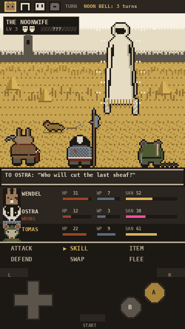

**Battle feedback (Nov 20).** The Noonwife's look works for her; other unnatural things can be wrong in their own ways, not copies of hers. The noon mood is right; night fights carry the darker end. Mercs are drawn bigger and more detailed from behind, with their weapons, armor and wear showing, so they read as sellswords, not critters. Sizes set Nov 24 (spec 008, mockup `39-battle-look-rough-v4`): the party's back views at 2× the species sheet's 30 × 40 back view, and the foes at 1.5× their battle sprites, each drawn natively at that size so its pixels match the backdrop (was about 16–20 × 20–24 px, Nov 20). The scene gets more height: the log box drops to one line and the party rows tighten. Portraits must read at a glance: each species leads with its one strongest mark, drawn high-contrast against the dark backdrop (a badger's eye stripes and white blaze, a rat's big round ears outside the hood, a hare's long ears). The v3 image carries these changes.

**Battle in the GBA shell (rework 1, Nov 20).** The Noonwife fight redrawn on the layout of Black Lantern's "Battle in the GBA shell" mockup; it replaces the full-screen layout above. In the screen, top to bottom: the turn faces run down the left edge (the Noonwife's face there is blank, one of her rule breaks), a one-line log across the top, and the noon bell countdown under it; her nameplate sits under her sprite with level, threat skulls and a hatched HP bar marked ??? until Identified; the party is seen from behind, waist up, with gear showing (Ostra the badger halberdier, Wendel the hare crossbowman in the middle with the rushlight on his pack, Tomas the rat barber-surgeon); then a one-row party strip (HP, WP, SAN, status) and the 4-command menu with an info line for the merc whose turn it is. She still casts no shadow while every stook and the dead reaper does. The shell is reskinned in the earth palette: a dark leather body, a Rust A button, a Blood B button and RUSHLIGHT on the label. Stand-in font; VT323 in the game. Approved Nov 20 as the reference for building the battle screen; its code (every sprite, color and position) is in Rushlight's Asset Library as rushlight-mockups-battle-v1.

**Battle menu (set Nov 20, carried from Black Lantern).** Fight, Skills, Items, Guard. Swapping weapons lives in Items: the list opens with the merc's 2 weapons, the equipped one marked, and picking the other swaps and ends the turn. Flee lives in Guard with Defend, for roamers only, so it shows greyed out against a contract target like the Noonwife.

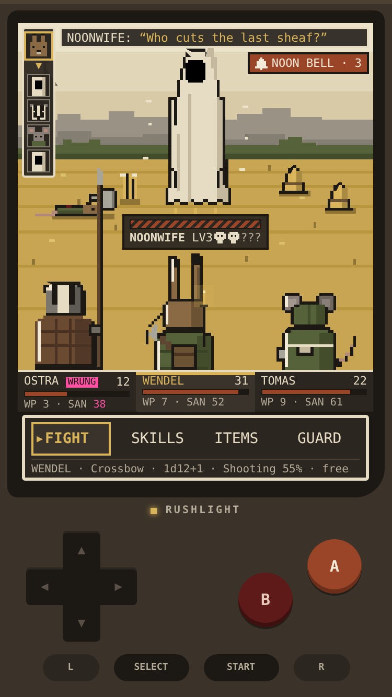

**Town street (second mockup, Nov 20).** Harrowford, a river-crossing town, at Wide scale: 16 px tiles and the 14 × 26 folk frame, drawn at 2× so about 11½ tiles show across a 375-wide screen. Top to bottom: a slim strip (party heads with the lead marked in Tallow, town name and type, purse, day; set Nov 20 as the town strip, so you can judge what you can afford without a menu, while the Hue and cry stays on the region map); the street in 3/4 top-down with house fronts across the top; the dialog box over the bottom of the map; the on-screen controls, as in the battle mockup. Only the lead walks, as in Black Lantern: Wendel the hare, seen from behind, the rushlight on his pack.

Townsfolk at all three heights: a vole fishwife at her eel stall and a mouse passer-by (small), a stoat at the notice board and a hedgehog at a handcart (middle), a badger watchman with a halberd and a fox walking off (tall). The notice board is the contract board, out in the street where you walk to it. Grim dressing per the gore rule, shown plainly: a shrouded body on the handcart outside the chapel, a chalk plague cross on a door, a rat in the pillory with rotten food thrown at it.

Dialog box: Black Lantern's Lantern Bust layout in the earth palette. A Soot box with a Bone border and 3 lines of text; the 64 × 64 portrait stands on the box at the map's 2× size; the speaker's name sits in Tallow on a tab beside it; a Tallow ▼ marks advance. The portrait follows the face rules: small dark eyes with no glints, a blunt vole muzzle, whiskers, a linen kerchief, a light rim on the lit side. Two accent browns (mud, timber) are this region's accents, per the palette rule. Her name is now Hester and the town Harrowford (set in Voice, Nov 20); the first image keeps the old placeholders, and the GBA-shell redraw below uses the new names and her Voice line; the text uses a stand-in font, VT323 in the game.

**Your review (Nov 20).** Mood, portrait direction and the town strip approved. The stoat and hedgehog were hard to read, so both were redrawn: the stoat is now dark brown with small round ears, a cream bib and a black tail tip, so it never passes for a fox; the hedgehog has a spiny crown and a pale face. Rule: every species needs at least one silhouette mark a neighbor in its height class lacks.

**Street dressing (set Nov 20).** Every town has a notice board and market stalls, out in the street where you walk to them. The pillory or gibbet, plague signs and the like depend on the town type and its state (a town hit by plague shows chalk crosses and body carts; one under a hard lord shows the gibbet).

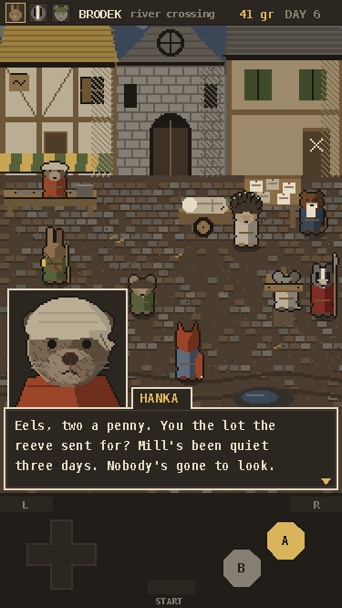

**Town street in the GBA shell (rework 2, Nov 20).** Harrowford redrawn inside the battle mockup's shell, so both screens share one frame; the image above stays as the record of Mockup 2. The screen is 340 × 442, so about 10½ tiles show across at 2×. In the screen, top to bottom: the town strip (party heads with Wendel marked in Tallow, HARROWFORD and its type, purse, day); house fronts across the top (a timber house with Hester's eel stall under a striped awning, the chapel, a plastered house with a chalk plague cross on its door); the street, with the notice board and the stoat reading it, the handcart with a shrouded body outside the chapel and the hedgehog at its handle, the badger watchman with his halberd, the mouse passer-by, the fox walking off, and the rat in the pillory with rotten food thrown at it; Wendel, the lead, seen from behind at the stall with the rushlight on his pack. Hester's portrait stands on the dialog box at 2× with her name on a Tallow tab, and her line from Voice fills the 3 lines: "Eels are a groat. The ones from the millrace are free, and you can guess why." Same shell as the battle screen (dark leather body, Rust A, Blood B, RUSHLIGHT label). Stand-in font; VT323 in the game. Approved Nov 20 as the reference for building the town screen; its code (every sprite, color and position) is in Rushlight's Asset Library as rushlight-mockups-town-v1.

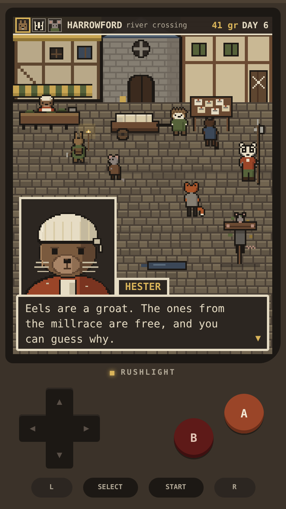

**Region map (third mockup, Nov 20).** Set: a hand-drawn chart, a view that pans with the cursor, standing in the top strip, and a road card at the bottom. The map is the company's own chart on parchment, inked at 2×, with Moss-tinted woods and a washed river; like any chart drawn from rumor, it can be wrong (see Surprises in World and contracts). Top to bottom:

- **Top strip, two rows.** Row 1: party heads (the lead in Tallow), where the company is, purse, day. Row 2: the Hue and cry as 4 pips with its step named, then the four factions, each an icon and its step as a word (WARY, TRUSTED), colored from Hated (Rust) to Sworn (Tallow). The region's two feuding factions sit side by side, joined by a Rust cross.
- **The chart.** Towns are walled-town glyphs named in caps; wild sites are small glyphs named in italic. Known roads are solid ink, side roads found by rumor or scouting are dashed, and a rumored point is a faint pencil circle with a ?. Each road carries 1–3 ticks, one per day. Threats show before the party goes in: a Rust hatch over a danger zone, Rust claw prints where a roamer was seen. Signs are margin notes in the company's hand ("dead cattle, downriver"; "tracks, big"). A brass coin token struck with the lead's head marks the company (set Nov 20, Mockup 5 option C), a paper square a town's notice board, a wax seal a taken contract. The region's name and season sit in a cartouche, and an inset in the top right sketches the whole region with the current view boxed in Tallow. Known points off screen show as edge tabs (◂ HOLLIN, KRNOV ▸, ▾ 2 MORE).
- **Cursor.** The D-pad hops point to point inside Tallow brackets, and the road the company would take lights up in Tallow dots.
- **Road card.** The point's name and type, days, rations carried against rations needed, how many road-event rolls the trip makes, any contract there, and the threat (??? until known) with the signs seen. A travels.

Names set in Voice (Nov 20): the Withy March, Harrowford, Saint Ebbe's, Withy Mill, Hollin, Crookback; the v2 images keep the old placeholders (Vrbno March, Brodek, Kostel, Vrba Mill, Krnov), and the GBA-shell redraw below uses the new names. Food stays a placeholder at 3 gr a day until Prices. The taken contract is the mill hunt Hester hints at in Mockup 2.

**Your review (Nov 20).** The bright parchment stays: the map is a paper you unfold, set apart from the dark screens. Changes in v2: town and site icons drawn 1.5× larger, so each type reads without its label, with labels on a clear parchment backing; the faction row shows a word per faction instead of pips; the whole-region inset added; a Key on L, opened over a dimmed map, lists every mark (town, wild site, road kinds, rumor, day ticks, danger, roamer, sign, the company, board and taken job, off-screen tab).

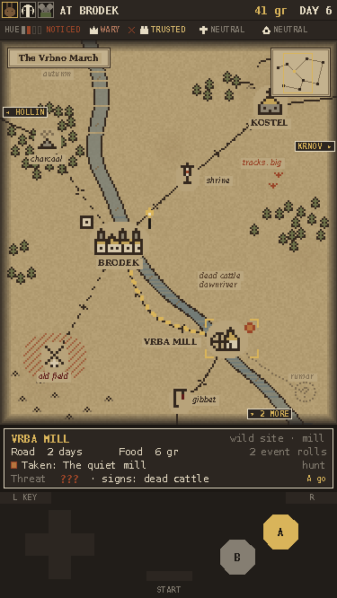

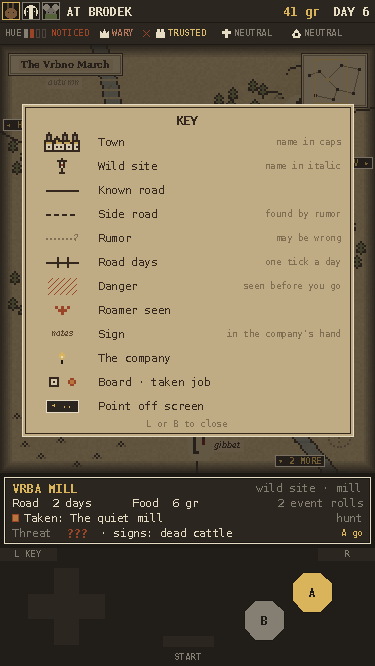

**Region map in the GBA shell (rework 3, Nov 20).** The Withy March redrawn inside the battle mockup's shell, so all three screens share one frame; the two v2 images above stay as the record of Mockup 3. The screen is 340 × 442. In the screen, top to bottom: the two-row strip (row 1: party heads with Wendel marked in Tallow, AT HARROWFORD, purse, day; row 2: the Hue and cry at NOTICED, then the four factions as icon and word, WARY and TRUSTED joined by the Rust cross as the feuding pair); the chart, about 312 px tall, with the company at Harrowford and the cursor on Withy Mill; the road card at the bottom. On the chart, with the Voice names: the Withy March cartouche (autumn), the whole-region inset top right, HARROWFORD (walled town, notice board, the company's rushlight on its pole), SAINT EBBE'S, *charcoal*, *shrine*, *old field* under a Rust danger hatch, *gibbet*, *Withy Mill* with its wax seal inside the Tallow brackets, the Tallow-dotted road there with its 2 day ticks, a pencil rumor, the margin notes "dead cattle, downriver" and "tracks, big" with roamer claws, and edge tabs ◂ HOLLIN, CROOKBACK ▸ and ▾ 2 MORE. The road card reads WITHY MILL (wild site · mill), 2 days, food 6 gr, 2 event rolls, Taken: The quiet mill (hunt), threat ??? with signs: dead cattle, A go. The second image is the Key on L, opened over the dimmed chart with the strip and road card still showing. The shell's L button is labelled L KEY; R opens Contracts and gets its label in the build (set Nov 20, see Map menu in Skills and menus). Same shell as the other two (dark leather body, Rust A, Blood B, RUSHLIGHT label). Stand-in font; VT323 in the game. Approved Nov 20 as the reference for building the region map screen and its Key; their code (every glyph, color and position) is in Rushlight's Asset Library as rushlight-mockups-map-v1 and rushlight-mockups-mapkey-v1.

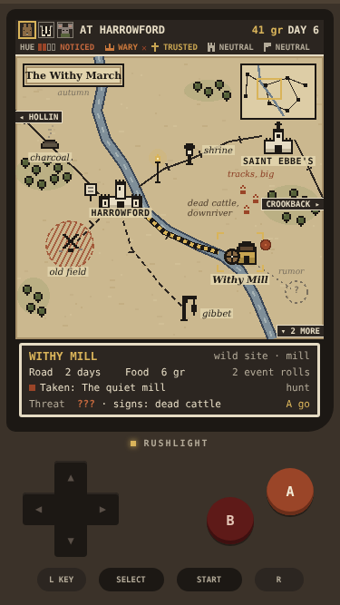

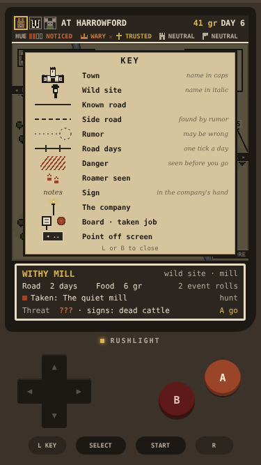

**Items menu in the GBA shell (Mockup 4, Nov 20).** The map menu's Items screen, in the same shell as the other three. The screen is 340 × 442. Top to bottom: a header (ITEMS, then a tab per merc with their head, the open one boxed in Tallow; L and R flip between mercs); the merc line (WENDEL in Tallow, hare · crossbowman · lead, SLOTS 6/8); the gear block, one row each for WPN 1, WPN 2, BODY and HEAD, with the weapon in hand marked by a Tallow dot, its numbers after wear (Knife 1d6−1) and wear as a word and three pips (Sound in Bone and greyed, Worn in Tallow, Cracked in Rust, Broken with no pips); the 8 slots in a 4 × 2 grid, the kit item tagged KIT, uses as a Tallow count, empty slots dashed; an info line naming the item under the cursor; the shared pack as a scrolling list with no slots; and a fixed foot line: PURSE 41 gr, RATIONS 9/15 · 3 days, MEAT 2 · rots 1d. In the pack, trophies carry the tooth mark and a TROPHY tag, an unnatural one also an UNNATURAL tag in Bone, spare parts a PART tag, and pack gear shows its wear (the Mail shirt, Cracked). Shown: A on Wendel's Bodkin bolts opens USE, GIVE, SWAP, TO PACK, DROP; GIVE opens the other mercs with their slots used, Tomas greyed as FULL. Stand-in font; VT323 in the game. Premade check: the shell, strip faces and heads were reused from claude/town-mockup-shell.html; the item icons are new 12 px marks, as no premade set matches the palette and outline rules. Code in Rushlight's Asset Library as rushlight-mockups-items-v1.

**Item icons (set Nov 20).** One icon per item type, not per item: the name and info line tell items apart, and a new item needs no new art. 13 types: Med; Drug (drugs, drink and chewing root); Throwable; Tool; Gear; Charm and folk remedy; Melee (thrown hatchet included); Shooting; Body armor; Headwear; Shield; Trophy (the tooth); Part. Each is a 12 px mark in the earth palette with a Peat outline, the same in slots, the pack, shops and loot. Rations, meat and the purse are counters, so they get words, not icons.

**Item type icons drawn (Nov 20).** Med is a mortar and pestle with a sprig of herb; Drug a stoppered glass vial with a dark Rust draught; Throwable a clay fire pot with a Straw band and a lit fuse; Tool an iron hammer; Gear a coil of Straw rope with a loose end; Charm and folk remedy a hag stone on a cord; Melee an arming sword; Shooting a crossbow seen from above; Body armor the padded jack; Headwear the kettle hat; Shield a Rust heater with a Straw cross; Trophy the tooth; Part a flayed hide. Premade check: Black Lantern's Art and Shared shelf hold no item icons, and the free sets on OpenGameArt are 16 px or larger and don't fit the palette and outline rules, so 8 are drawn new; Body armor, Headwear, Trophy and Part are Mockup 4's stand-ins kept as is. Swapped into Mockup 4 (second image below): every item now shows its type's icon, so the Adder fang shows Part, not the tooth, and the Torch shows Melee. Code in Rushlight's Asset Library as rushlight-icons-items-v1 (the icon set) and rushlight-mockups-items-v1 (Mockup 4, updated).

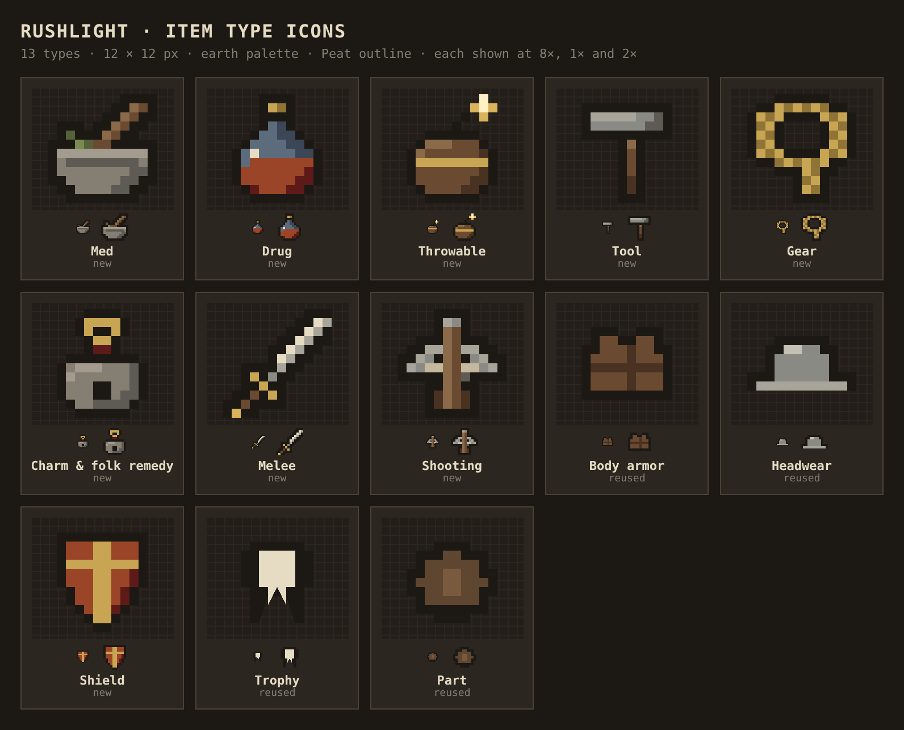

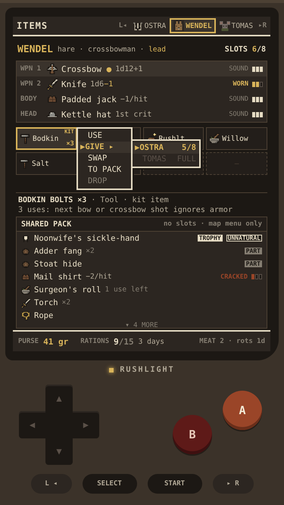

**Company marker options (Mockup 5, Nov 20).** The rushlight on a pole is replaced by one of three tokens standing on the chart where the company is, drawn on the chart's 2× grid with Peat outlines and a soft shadow on the parchment. **A, carved wooden piece:** a 7 × 11 px pawn in wood browns with knife facets and a Tallow-painted collar, like a piece set down on a campaign map. It's the quietest of the three and adds no new rule. **B, pin and red thread:** a 5 × 9 px brass-headed pin with a Rust thread that runs back along the roads the company came by, with a tiny pin at each night's stop, so the run's path stays on the chart. It's the smallest mark, and the thread shares Rust with danger hatches, claws and the wax seal, so a long trail could crowd the chart; a cap on how many days it shows would be needed. **C, coin token:** a 15 × 16 px brass coin seen a little from above, struck with the lead's head in Peat as a silhouette, each species with its one strongest mark (the hare's ears, the badger's Bone blaze, the rat's round ears). It changes when the lead changes, so the map shows who's leading. It's the biggest mark, about the width of a town glyph. Each option is shown at 8× and 2× and in the approved region map screen standing at Harrowford, with nothing else changed. Premade check: nothing on the Shared Shelf or in Rushlight's Asset Library fits, and the free map markers on OpenGameArt are modern pins and flags, so all three were drawn new. Code is in Rushlight's Asset Library as rushlight-mockups-marker-v1 (approved). Picked Nov 20: C, the coin token. It replaces the rushlight on a pole, and the map Key's entry for the company changes to match in the build.

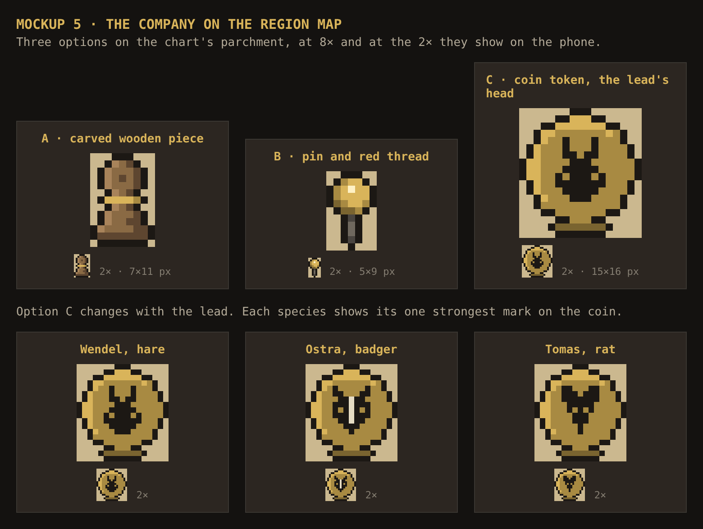

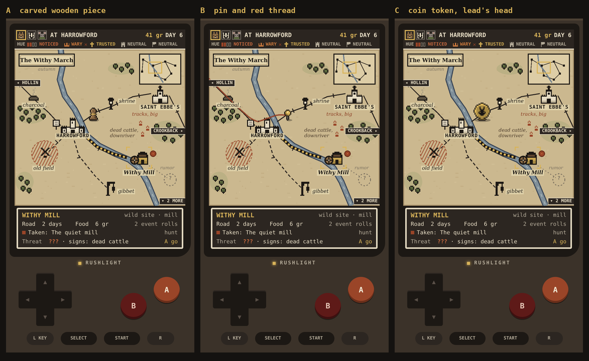

**Slice screens in the GBA shell (Mockup 6, Nov 21; approved Nov 21 as the references for building these three screens).** The three vertical-slice screens least like anything drawn before, in the same shell as the others (340 × 442 screen, stand-in font, VT323 in the game). The other slice screens are built in the shell's list-box style and reviewed in play. Premade check: the shell, the strip heads and the dialog box style are reused from the approved town mockup; the camp's sprites, the board and the bills are new, since nothing on the Shared Shelf or in the Asset Library fits a wild site or a notice board, and free sets on OpenGameArt don't match the palette and outline rules.

- **Contract site:** Pell the poacher's charcoal camp at dusk. Top: a site strip (party heads, the site's name, the contract's kind and shape, day) and under it the contract's NEXT line, so a phone sitting picks up where it left off. The map: a cord of cut wood, an open fire pit with banked embers and a poker in it, a burned-out heap with a rake in it, the burners' hut, Pell's catch of frogs strung on a line, a woodpile, and his two cousins at the fire with a plate over them (name, level, threat skull, count), so a placed fight can be weighed before walking into it. Hotspots are small Tallow diamonds; a used one is dimmed in Ash. Wendel, the lead, stands at the active hotspot, whose diamond brightens and glows when the lead is close enough to use it (no brackets, your pick Nov 21), the rushlight glowing on his pack. The bottom box is the A prompt, not a dialog: the action and what's there (SEARCH, the ground's been dug here), who rolls and the odds (Wendel 55%), and the best other merc's odds on SELECT, which swaps the lead before rolling.
- **Notice board:** Harrowford's board, opened from the street, with the town strip on top. Bills are pinned on oak boards: Pell's WANTED bill with a crude woodcut head under the cursor, a sheep job from Hollin with a dark smear, a torn-down scrap where another job was taken, and a church notice that isn't a job. Under it, the contract card: title and position (1/2), kind, shape and board job, no haggling; the bill's own words; WHERE (place, days, rations needed against rations carried); PAYS (dead and alive, and what alive needs); XP; THREAT (kind, level, skulls, not alone); MOMENT (which merc's motivation has a moment here). A takes, B backs out.
- **Pick a company:** the new-run screen. A list of the 6 templates and Blank, each with its three trades; the picked one's weakness in one line; then three seat cards, each with a 40 px head, name, species and trade, the three best skills, Main motivation and kin, and the one-line backstory. The seat under the cursor opens Keep, Reroll, Tweak, Rebuild. The run seed shows at top right; START at the foot signs them on, with the starting 30 gr and 9 rations.

Code in Rushlight's Asset Library as rushlight-mockups-site-v1, rushlight-mockups-board-v1 and rushlight-mockups-company-v1 (approved).

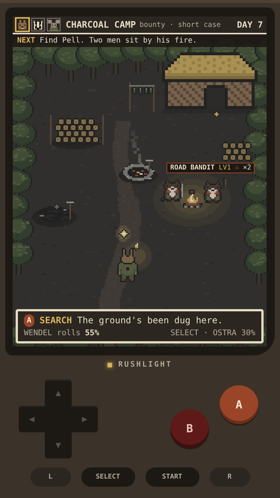

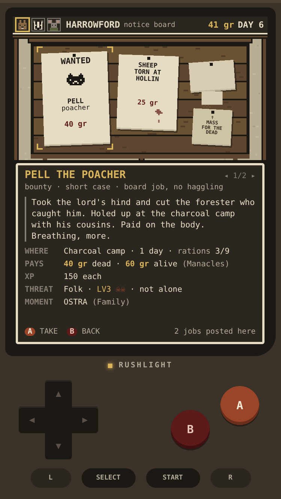

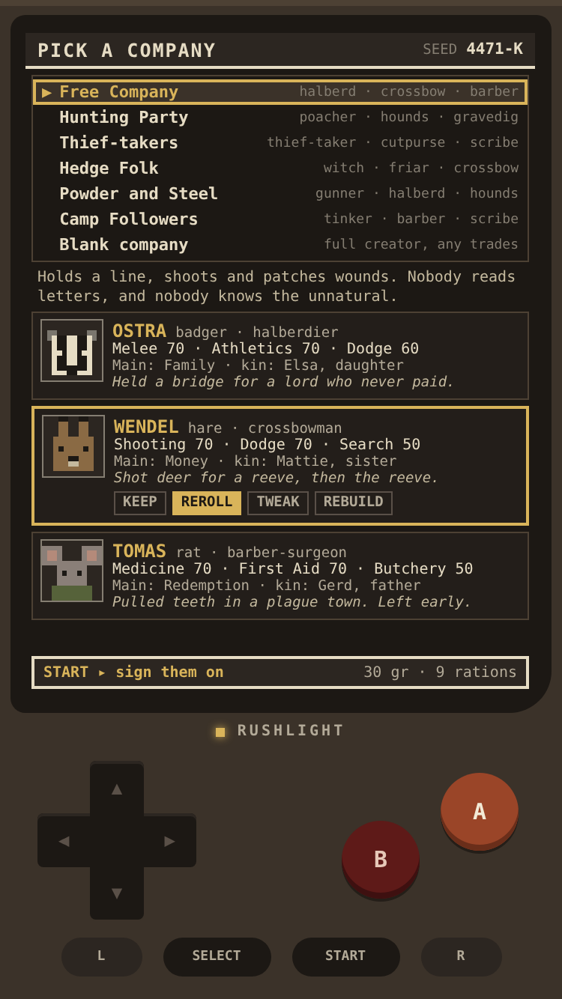

**The slice's other contract sites, rough (Nov 22; approved Nov 22 as the references for building these four sites).** Your pick on spec 006's site art card: rough mockups of all four sites with no art yet, before D2 is built. Same layout as the approved charcoal camp (site strip, NEXT line, Tallow hotspot diamonds, Ash once used, the lit one by the lead, the A prompt), reusing its Wendel sprite and diamonds; everything else is drawn new and rough, to settle each site's layout and mood rather than its final art.

- **Hollin at noon:** stubble and stooks in hard light, the bell tower with the sexton, the reapers' cottages with the surviving reaper at a door, the hedge at the field edge, crows, the shimmer out in the field, and the dead reaper face down by a sickle. Wendel would roll Examine at 20%, so SELECT offers Tomas at 60%.
- **Sallow End at dusk:** fenced yards, hens, the parents at their cottage with a child's smock on the line, and the church with its open loft door, the ladder and fallen feathers under it (the Athletics climb).
- **The osier causeway at night:** a plank causeway on piles across black water, the osier beds on the left, upturned boats on the mud with salt sacks under one, the heron skull on a pole, claw marks on the planks by the rushlight, and the Withy Hag half in the withies with a plate marked LV?. The strip shows the posting's kind (hunt), not false alarm, since the posting reads like a creature job.
- **Crookback, overcast:** shut cottages with chalk crosses, the bakehouse and its oven, the apothecary's fallen timbers, a shrouded body in the street, the bone rows by the plague ditch, and the churchyard with every grave open.

Claude's calls, approved with them: the time of day for each site, where the Hag stands before she walks out, and the NEXT and A prompt lines (stand-ins until the Text Library rows are approved). Code in Rushlight's Asset Library as rushlight-mockups-site-hollin-v1, -site-sallowend-v1, -site-causeway-v1 and -site-crookback-v1 (approved).

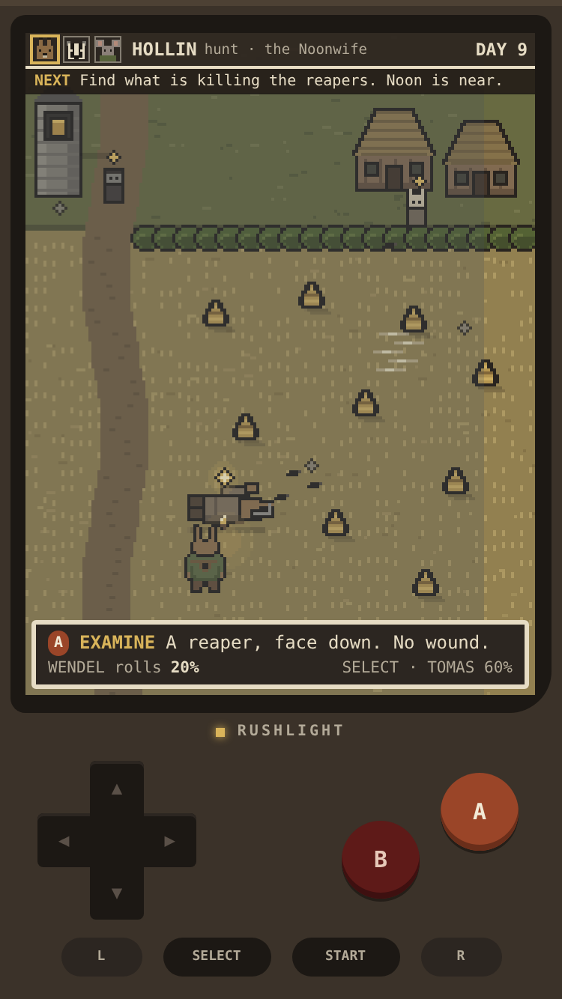

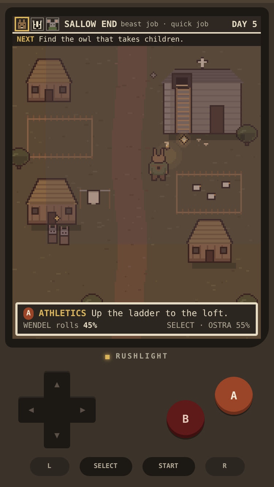

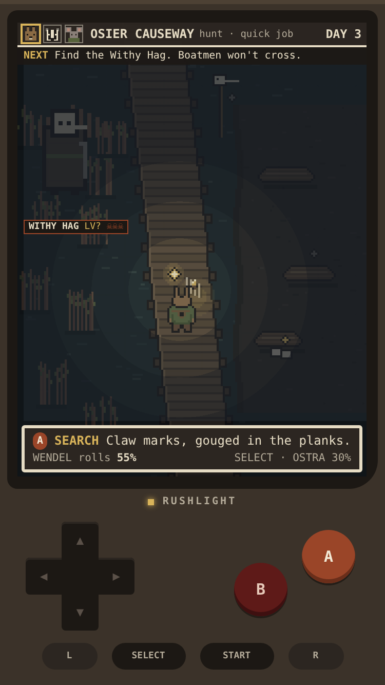

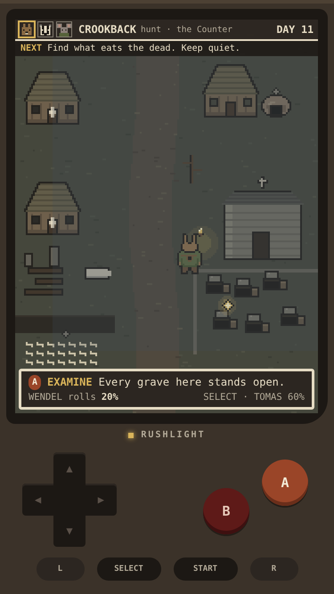

**Species sheet (Ready 3 of 5, Nov 22; approved at v3).** The vertical slice's six species (Mercenaries and items, First to ship) at the three sizes they're built in: a 64 × 64 portrait head, a map sprite in the 14 × 26 frame at the species' height (Art, Scale: mouse and rat 18 px, hare and hedgehog 22 px, badger and fox 26 px), and a waist-up battle back view, plus all six on one street row at the phone's 2× scale. Premade check: the town, battle and Pick a company mockups in the Asset Library already show a hare, rat, badger, hedgehog and fox at map scale, and a badger, hare and rat from behind. This sheet follows their look (dark outlines, flat two-tone shading, coats in the palette) and adds the mouse, the missing back views and every portrait head. Faces follow Art, Faces: small dark eyes with no glints, real muzzles, and species read by silhouette first (ears, snout, stripes, spines). The drawing code is in `mockups/27-species-sheet-rough-v1.html`. Approved at v3 and filed in the Asset Library as rushlight-sprites-species-v1 (Sprites shelf).

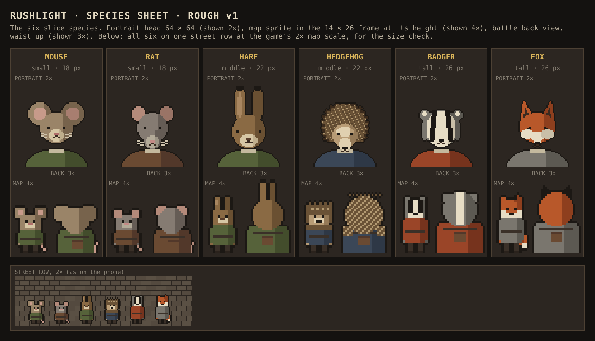

**Your review (Nov 22): v2.** The badger and fox faces looked odd, the back of the hedgehog's head was odd, and the portraits had no necks. In v2, every portrait has a neck under the jaw going down into the collar. The badger has a white wedge face, and its two dark stripes run from the ears down through the eyes and narrow toward the snout. The fox has a narrower head with an orange bridge down the snout and white cheeks below the eyes. The hedgehog's back view is a round head of streaked spines with dark tips, ending in a short collar of spines over the shoulders. Drawing code: `mockups/28-species-sheet-rough-v2.html`.

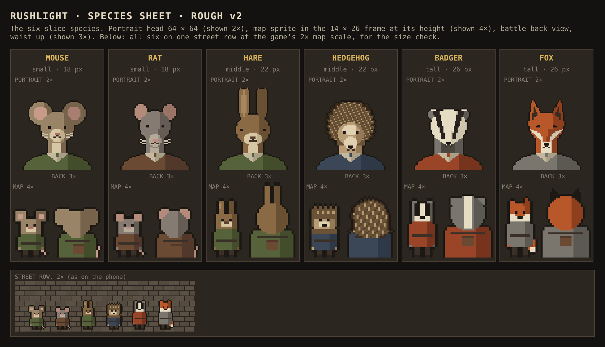

**Your review (Nov 22): v3.** The faces were better, but the necks were too long and looked unnerving. In v3 the heads sit low on the shoulders, so only a short, wider neck shows above the collar. Drawing code: `mockups/29-species-sheet-rough-v3.html`.

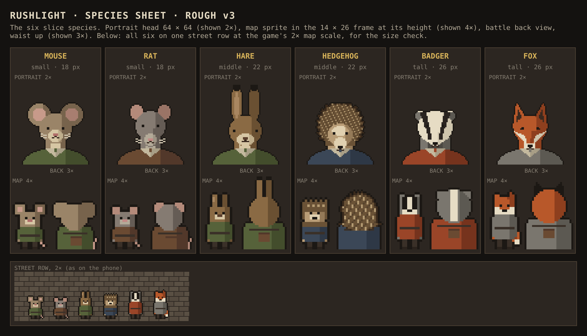

**Mockups to come:** none. The battle screen, town street and region map are all redrawn inside the GBA shell (set Nov 20, see Tech and To do). Every new screen still gets a still mockup before it's built.

**Drawing the unnatural (set Nov 20, from the creature art study).** Each unnatural thing uses 2–4 of these rules, and no two creatures use the same pair, so no two are wrong in the same way. They replace the first draft.

- **Familiar body, one thing broken:** start from a shape the eye knows (a person, a beast, a hunched back with a neck and head) and break one part of it, or put a familiar part where it doesn't belong (a folk hand where a mouth should be, eyes along a spine). Too strange and it reads as a blob; too familiar and it reads as a costume.
- **No readable eyes:** no eyes, or eyes that never look at the company. Eyes give away intent.
- **No stock monster parts:** no fangs and claws, angry brows, glowing eyes, tentacles or squid heads. Where a creature's thing is teeth (the Counter), they come too many and too even, like grain, never as fangs.
- **Silhouette first:** its outline reads against the scene at phone size before any detail goes in. That's an outline check, not a color: creatures are drawn like the mercs, in full color with real texture and hard woodcut shading (light side, shade side, hide, cloth, wet sheen), and the wrongness comes from the body, not from darkness. A creature that reads as a dark blob fails (set Nov 21, after the first slice sprites came out as dark shapes).
- **One part drawn too well:** one passage (a hand, a jar's glaze) gets more detail than anything around it, so it looks more real than the picture it's in.
- **Too many of one thing:** one motif repeated past reason (jars, hands, teeth, rows of bones), each copy the same.
- **Never shown whole:** less than half is in view; the rest sits past the frame, under water or in the dark.
- **Wrong scale:** too big for where it stands, or too tall among small folk.
- **Wrong physics:** no shadow, light that falls the wrong way or lights nothing, drips that fall up, a wheel turning against the water.
- **Something missing:** no face, no sound in the log, no reflection.
- **Stillness:** it holds still while everything else on screen moves (animated screens only; a still can't show it).
- **Bone marks the underneath:** Bone goes on the part that isn't from this world (the Noonwife's robe), not on the whole creature by habit. Outlined in Peat like everything else.

**What the study found (Nov 20).** Most Lovecraftian art on DeviantArt and ArtStation leans on tentacles, squid heads and eyes everywhere; one DeviantArt artist says he "added all the eyes as an afterthought because it needed something else." That reads as Cthulhu fan art, not as wrong. The better work does the opposite. Trevor Henderson leaves eyes off because "any time something has eyes, you can read intent," and avoids "sharp teeth, angry brows, claws." Gerard Gibson's study of Lovecraft imagery argues monsters work best low-definition, on a familiar body plan the viewer fills in: too strange and they lose their threat, too familiar and they look clownish. A Mi-Go concept on ArtStation aims "not to define the Mi-Go, but to suggest it." Mignola treats black as a shape, not a shadow. Junji Ito repeats one motif past reason and draws the horror in more detail than the scene around it. Sources: [Henderson on Siren Head](https://reactormag.com/artist-trevor-henderson-siren-head-interview/), [Henderson on monster cues](https://dailydead.com/?p=237182), [Gibson, Malign by Design](https://www.progressiveconnexions.net/wp-content/uploads/2021/04/Gerard-Gibson-website-paper.pdf), [Mi-Go concept](https://dantartes.artstation.com/projects/98Lx0o), [Mignola's shadows](https://mycomicscollection.com/en/blog/shadow-mignola-not-shadow-form/), [Junji Ito's techniques](https://japan-clothing.com/blogs/japan/junji-ito), [the eyes-as-afterthought quote](https://www.deviantart.com/the-viscount-of-art/art/Spookysona-Viscount-859431776), [JeffRussell's Lovecraftian entities on DeviantArt](https://www.deviantart.com/jeffrussell/art/Shoggoth-519263303).

**Lesson from the first test drawing (Nov 21).** Check the silhouette first, at phone size, before any detail goes in, and keep to 4 rules or fewer. A body drawn in hatching on a dark ground reads as a hedge, not a creature, and the part drawn too well has to be big enough to read. The creature it was drawn for was scrapped Nov 21, and its drawings with it.

**Creature sprites for the slice, batch 1 (Nov 21; drafts).** Battle sprites only, one still per creature, each also shown in the battle frame to check it reads at phone size. Your picks: battle sprites only, two batches, the beast job is Severa the owl, and Folk enemies are built from the folk sprite parts (only the Withy Hag's costume gets its own art). Premade check: nothing on the Shared Shelf or in the Asset Library fits, and free creature sets on OpenGameArt use other palettes and stock monster parts, so all were drawn new. Each keeps to its own set of the Drawing the unnatural rules, and no two share a pair.

- **The Noonwife:** lifted unchanged from the approved battle mockup so the build reads her on her own (something missing, wrong physics, Bone on the robe).
- **The Counter (52 × 29 px):** a starved hound shape, head hung low, haunches high, ribs showing, no eyes. One mouth runs from the snout tip back past the throat and along the belly, lined with even teeth like grain. Rules: familiar body with one thing broken, too many of one thing, no readable eyes, silhouette first. Scene: the emptied plague village, overcast, shut doors with chalk crosses, a shrouded body and its nest of picked bones. Its turn-strip face is blank (its rule break); its HP bar shows.
- **The Hollow Monk (60 × 66 px):** waist up out of black water, bowed under the cap beam, a dark hole for a face, one drowned grey hand holding out a brass lamp drawn in more detail than anything near it. Rules: never shown whole, one part drawn too well, wrong physics: the lamp burns but lights nothing around it, and drips fall up toward it. The screen shows a PUMPS · OFF chip (he rises at half HP unless they run) and Ostra DARK from Lamp out.

Code in Rushlight's Asset Library as rushlight-sprites-noonwife-v1, rushlight-sprites-counter-v1, rushlight-sprites-monk-v1, rushlight-mockups-battle-counter-v1 and rushlight-mockups-battle-monk-v1 (drafts). Batch 2 (the Corpse-candle, Lampwalkers, Severa, the hedge cat, rooks and the Withy Hag's mask) is its own To do item.

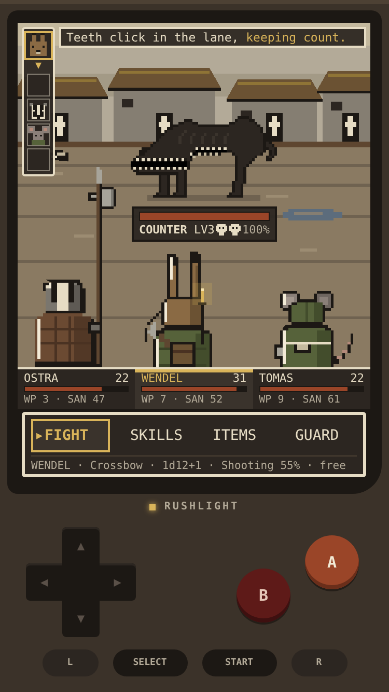

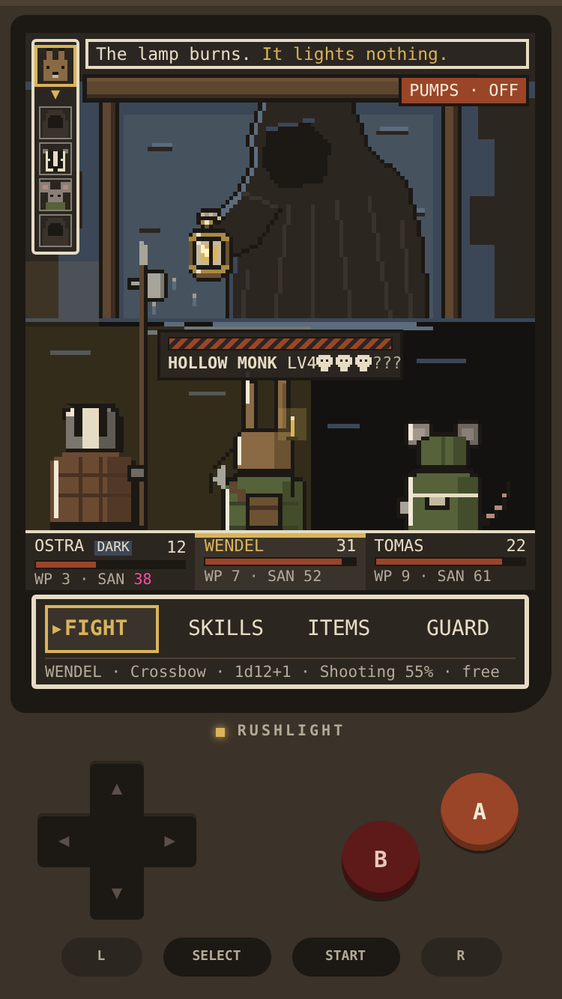

**Your review (Nov 21): v2 in full color.** The v1s leaned on dark blobs and didn't read. Your picks: draw creatures in full color with real texture, like the mercs, and redraw both. Silhouette first is now an outline check only (see Drawing the unnatural). The Counter v2 has bare grey skin stretched over ribs, mange, spine knuckles, pink gums and bone teeth, lit from the upper left; the cottage walls behind it are now daub brown so it stands off them. The Monk v2 is in wet brown wool with hard folds, a warm rim from the party's rushlight, water running down the cloth, weed hanging from the sleeves and a drowned blue-grey hand on the lamp. Same bodies and drawing rules. Code in the Asset Library as rushlight-sprites-counter-v2, rushlight-sprites-monk-v2, rushlight-mockups-battle-counter-v2 and rushlight-mockups-battle-monk-v2, approved Nov 21 as the references for building both creatures; the v1 images above stay as the record.

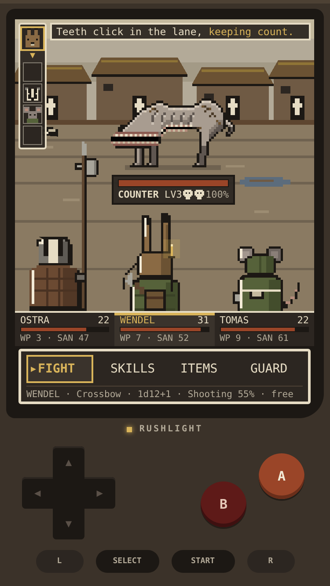

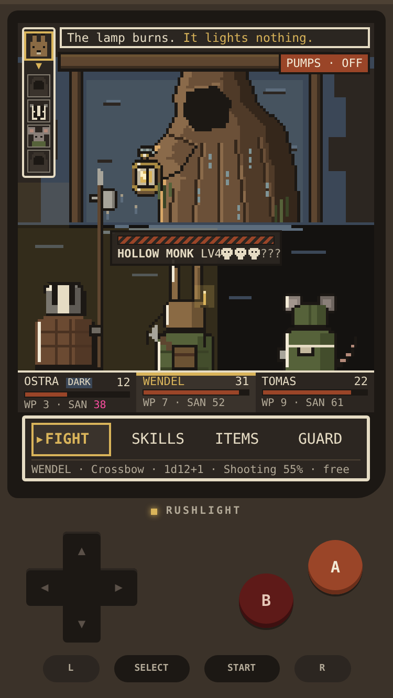

**Creature sprites for the slice, batch 2 (Nov 21; approved Nov 21 as the references for building all six).** Battle sprites only, in full color from the start like the v2s, each shown in the battle frame to check it reads at phone size. Premade check: nothing on the Shared Shelf or in the Asset Library fits, and the free sets on OpenGameArt (Tiny Creatures, Nighthawking battlers) are 16 px or front-view battlers in other palettes, so all six were drawn new. The two unnatural ones keep to their own pairs of the Drawing the unnatural rules; no pair repeats the Noonwife's, the Counter's or the Monk's.

- **The Corpse-candle (40 × 66 px):** a hanged stoat walking, carried by the thing inside it. The rope has stretched its neck far past a stoat's length and the head lolls on its shoulder; legs dangle with the toes pointed down; arms hang past the knee. The chest is torn open over a cold blue light that tints the cloth and fur near it. Rules: familiar body with one thing broken, wrong physics: at the gibbet at dusk, the gibbet's shadow falls right, away from the sun, and the corpse's falls left, toward it.
- **Lampwalkers (26 × 48 px, three exact copies):** hooded miners in grey smocks, heads tipped the same few degrees, mouths open on a number, one splash of mud in the same spot on each. Each holds out an unlit brass lamp drawn finer than anything near it, the same kind as the Monk's. Rules: too many of one thing, one part drawn too well. Scene: the mine road, trodden every which way except one straight band, their line.
- **Severa the owl (72 × 58 px):** a barn owl at Mouse Guard scale, mantling on the loft's tie beam: golden-buff back with feather rows, grey veil and pearl spots, white heart face with a rust rim, big black eyes, talons hooked over the beam. Scene: the church loft by day (the roost fight), daylight through the boards, the bell rope, and the small shoes from the roost lined up on the beam.
- **Hedge cat (86 × 42 px):** a feral mackerel tabby flat in a stalking crouch, shoulders up, head low, ears flattened with a torn notch, white muzzle and bib, amber eyes with black slits, claws in the turf, tail up. Scene: a hawthorn hedge at dusk, a gatepost, a dropped folk hood in the grass.
- **Rooks (112 × 83 px sheet, 4 bodies):** two in flight, two on the ground, one with a ration bundle in its beak. Glossy black with blue-purple sheen and the bare pale face patch that tells a rook from a crow. Scene: a ploughed field on a grey morning with the company's pack tipped over. The plate reads ROOKS ×4.
- **The Withy Hag's costume (52 × 74 px):** a cage of bent willow rods bound with twine rising from the shoulders, a rook skull for a face with a furred face and real eyes behind the sockets, a sacking cloak with willow leaves, a billhook in a furred hand, and hobnailed boots under the hem: unnatural at a glance, folk on a second look. Scene: the causeway at night, salt sacks, a shuttered lantern lighting the cloak from the left; the HP bar shows and the log asks "Boots on the stones?"

Claude's calls, for your review: the Corpse-candle's cold blue light (new colors outside the palette, kept to that one creature); the Lampwalkers' faces carry no species marks; the Hag's real eyes and boots as the visual tells; and the six log lines. Code in Rushlight's Asset Library as rushlight-sprites-candle-v1, -lampwalkers-v1, -severa-v1, -hedgecat-v1, -rooks-v1 and -hag-v1, and rushlight-mockups-battle-candle-v1, -lampwalkers-v1, -severa-v1, -hedgecat-v1, -rooks-v1 and -hag-v1 (approved, 31 pieces). The Corpse-candle, Severa and Withy Hag battle images still need adding here; they're in the Asset Library.

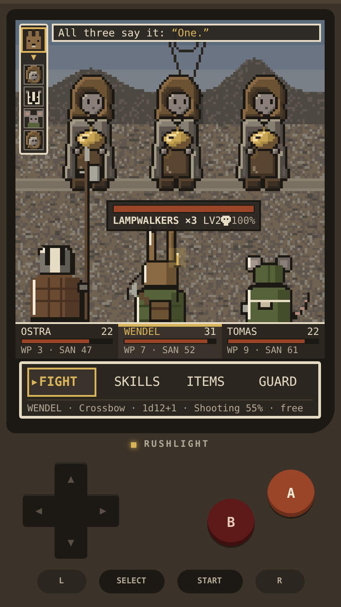

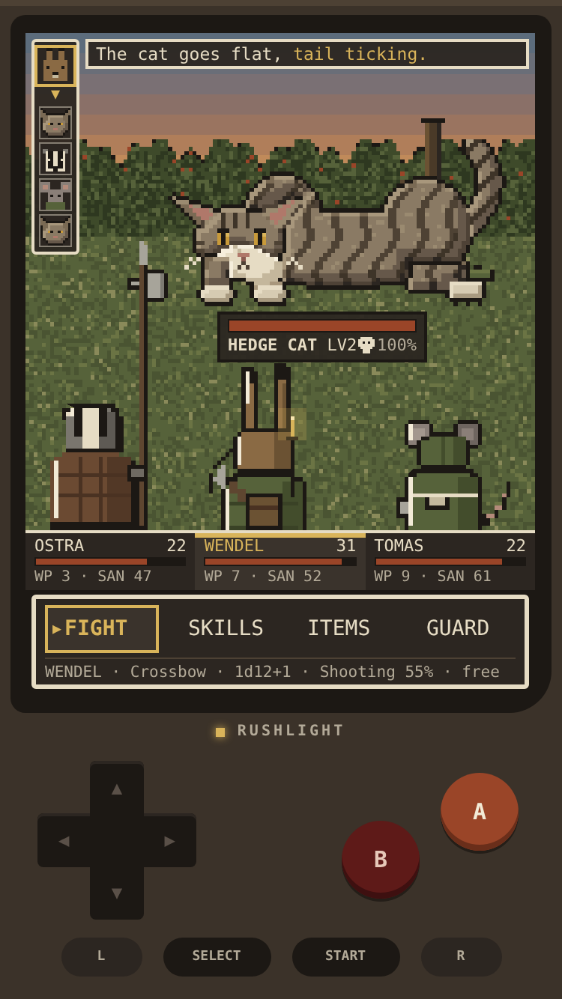

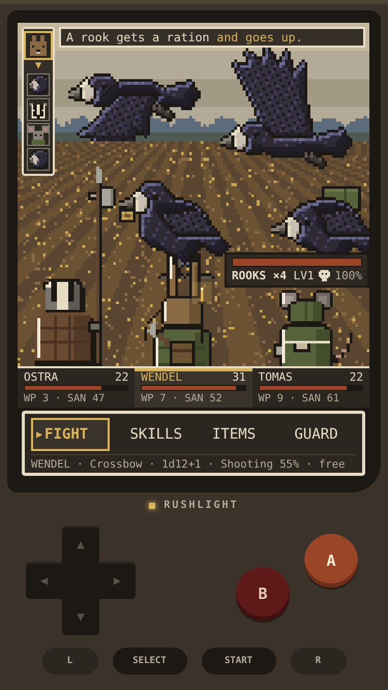

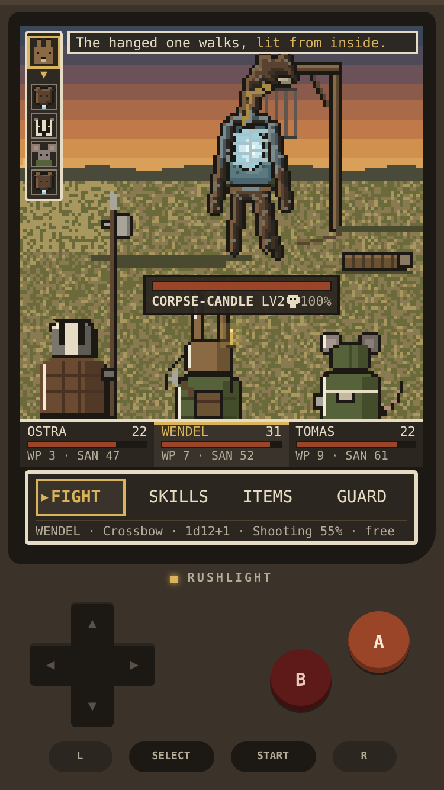

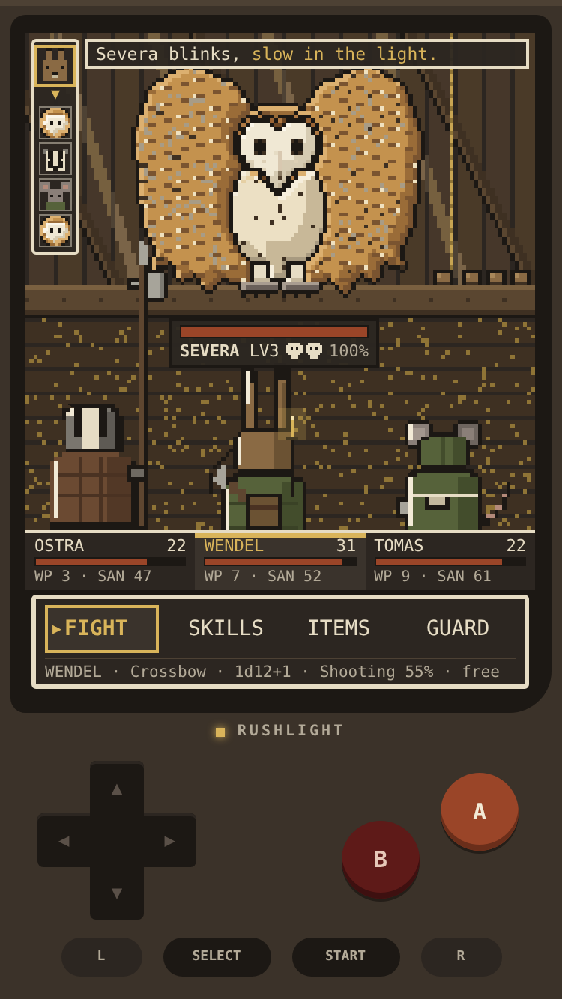

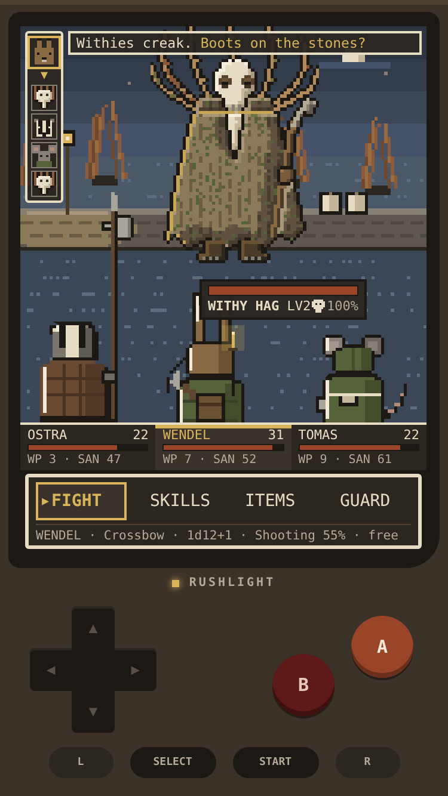

References: from the era, Bosch's hell panels, Bruegel's Triumph of Death, Schongauer's Temptation of Saint Anthony, Dürer's woodcuts, danse macabre prints and manuscript marginalia; modern, Beksiński, Mignola, Junji Ito, Trevor Henderson, and the games Darkwood, Fear & Hunger, Pathologic 2 and Inscryption. Added by the study: Lovecraft fan art on DeviantArt and ArtStation, as the clichés to avoid.

**Open questions**

- How do cosmic and cryptid creatures look wrong without looking like fantasy monsters? Answered by the creature art study (Nov 20): see Drawing the unnatural. The test creature it was tried on was scrapped Nov 21. Set Nov 20: not every unnatural thing wears a folk shape; a cosmic being can be a danger all its own.

**Look pass (set Nov 23, from Keegan's slice playtest).** The slice looked far below Black Lantern, so the look was redone at the style level; spec 008 builds it. Keegan's picks, each on a rough mockup in `mockups/`:

- **Streets** (`34-look-town-rough-v2`): late autumn sun from the upper left, roofs from the 3/4 view with chimneys and smoke, jettied upper floors, hanging signs, a mud lane with puddles and leaves, dressing by every door, a hedge and pollard willows on the bottom edge, more townsfolk, crows and a dog. Only the lead walks.
- **HUD:** two framed cards, the lead (portrait, name, HP, WP, SAN) and the place (name, purse, day), in place of the one-line town and site strips. The site's NEXT line stays under them.
- **Menus** (`35-look-company-rough-v3`): aged parchment like the region map, with an ink border, stained edges and a wax-seal cursor. No ruled lines: Keegan turned down a ruled ledger as notebook paper. Pick a company becomes two steps like Black Lantern's: the company cards with a text tag each (Keegan kept text over icons), then the three seat cards with Keep, Reroll, Tweak and Rebuild buttons. Kin, motivations and backstory move to Tweak and the Merc card.
- **Sprites** (`36-sprite-upgrade-rough-v3`): the six species redrawn to the studio Quality bar (four-tone volume, tufted fur, selective outline, rim, real clothes, a lit backing). This replaces the species sheet's flat two-tone shading; the species' shapes, colors and face rules stay. Keegan asked that every sprite in the game meets it, so the folk enemies and the creatures are redrawn too, keeping their approved designs.

## World and contracts

**Set (Nov 19)**

- **Setting:** the Empire, a fictional land of woodland creatures modeled on 1400s Central Europe (Hussite-era Bohemia and Poland): plague, church against lords, free companies, crossbows and early hand cannons. Invented names, so no history homework.
- **Map:** each region in a run's chain is laid out from its own seed, built from hand-made parts (town types, wild tiles, creature dens, contract templates).
- **The run (set Nov 19):** a chain of seeded regions, each harder than the last. Each region holds one great creature that its contracts, rumors and signs all point toward.
- **No win:** the run goes on until the whole party is dead. A ledger scores how far the company got (regions crossed, contracts done, great creatures killed).
- **Length:** a strong run crosses 2–3 regions, about 15–20 contracts and 5–7 hours of play across many short sittings. Region 3's danger is what ends most runs (set Nov 21).
- **Between regions (set Nov 19):** killing a region's great creature leads to a home scene, then the road to the next region opens. The home scene is Quarters, taken in the next region's first town (set Nov 20; see Systems). Leaving early is allowed (set Nov 21): the road out is always open, but a company that leaves with the great creature alive skips Quarters and its arc beat, and the next region's great creature is +1 level and its road events +10%.
- **Pressure (set Nov 19):** money only. No season or day clock inside a region; daily food and upkeep are the squeeze (no wages, set Nov 20), on top of danger rising region by region.
- **Map shape (set Nov 20):** nodes and roads. Towns, wild sites and the den are points joined by roads, and each point opens a small walkable map. How a contract plays on that walkable map is set in Contracts.
- **Region size (set Nov 20):** large, 14+ points. Only 3–4 points hold contracts at a time; the rest (hamlets, shrines, camps, ruins) hold small scenes, loot or rumors, so the run length above holds.
- **Visibility (set Nov 20):** on arrival the party knows the towns and main roads. Wild sites and side roads appear through rumors, contracts and scouting; the den is found by following its signs.
- **Travel (set Nov 20):** each road takes 1–3 days, and every day on the road eats one ration per merc (see Food in Systems). Each region gets a seeded season: winter roads take longer.
- **Road events (set Nov 20):** rolled, once per travel day (about 25%), so longer roads bring more. Season and region danger raise the odds. Sites still show their threats (danger zones, roamers) before the party goes in. Road events with travelers offer Rob them (see Fighting by choice in Combat).
- **Surprises (set Nov 20):** the map can be wrong. Some points aren't what a rumor said, some aren't on the map at all, and a few hide a sign of something worse.
- **The Empire (set Nov 20):** Rushlight is set in the world of the [Knight of Pentacles](https://docs.google.com/document/d/174qr3WSj63Cj-KDutZHtxlHz4cVmep6h4QSBF0Nf1XY/edit) tarot story: the Empire, ruled by the Crown from its great walled cities, with lawless backwaters far from its eye. Every seeded region is a region of the Empire. The Peddler is canon.
- **People (set Nov 20):** woodland creatures from rat to raccoon size are people, plus a hodgepodge of others (some birds, some lizards). The smaller species are the people; bigger animals are beasts (in the story, a dog is a knight's mount).
- **Species by region (set Nov 20):** each region has a primary species; others turn up from time to time. It shapes the hire pools and townsfolk only, not towns or contracts (set Nov 21).
- **Magic (set Nov 20):** very, very low. It is folk and cosmic in root, and it always has consequences. A hedge witch at a wild site or two per region, and 0–1 of the Peddler's kind in about half of regions. Details in Systems.

### First hand-made parts

The first batch covers all five kinds below (set Nov 20). Names and picks are Claude's first draft; comment in (( )) to change any.

| Kind | First batch |
| --- | --- |
| Town types | Market town, mining town, monastery town, river crossing, fortified war camp |
| Wild sites | Hamlet, wayside shrine, charcoal burners' camp, ruined keep, old battlefield, mine, mill, gibbet crossroads |
| Dens | Flooded mine, sunken church crypt, peat bog, emptied plague village |
| Road events | Bandits at a felled tree, a lord's toll, refugees, a wounded traveler, a flagellant procession, a storm or snow (+1 day), a broken axle, a strange sign pointing toward the den |
| Surprises | A site off the map found by leaving the road; a hamlet empty on arrival; a rumor that's an ambush; a town that shuts its gates (plague or a lord's order); a sign of next region's great creature, too early |

### The slice's Withy March

Set Nov 22 (spec 004; your pick: hand-placed for the slice only, while the full game generates each region from its seed). The vertical slice cuts the Withy March to 8 hand-placed points and 10 roads; the seed varies which side road is hidden, where the roamers are, the regional tic and every roll. The slice is always autumn, since the Noonwife needs a harvest. The mockup's shrine, old field, gibbet and Withy Mill come back with the full region.

- **Points:** HARROWFORD (river-crossing town, the start), SAINT EBBE'S (monastery town), Hollin (hamlet with fields and a bell tower: the Noonwife), Sallow End (hamlet: Severa), the charcoal camp (Pell), the osier causeway (the Withy Hag), Crookback (emptied plague village: the Counter), Lowmoor Pit (flooded mine: the Hollow Monk's den). The wool buyer's escort runs the main road between the two towns.
- **Roads, in days:** Harrowford to Saint Ebbe's 2 and to Hollin 1 (both main); Harrowford to the charcoal camp 1 and to the osier causeway 1; Saint Ebbe's to Sallow End 1 and to Crookback 2; Hollin to Crookback 2; Sallow End to Hollin 3; Crookback to Lowmoor Pit 1; the osier causeway to Lowmoor Pit 2. One of Hollin–Crookback or Sallow End–Hollin is hidden by the seed; the two den roads show when the den is found.
- **Known at start:** the two towns, Hollin and the main roads. Arriving anywhere shows every road leaving it.
- **Roamers meet the company on roads** in the slice: the hedge cat and the rooks on two side roads, the Corpse-candle on a road touching Crookback, and the Lampwalkers on a road one step from a den road. Sneak past (Stealth), fight or turn back; the Lampwalkers are waited out or fought.

**The slice's towns (set Nov 22, spec 005; Claude's first draft, tuned in playtest).**

- **Harrowford:** the guild master (Town) gives the wool buyer; the board posts Pell and the Withy Hag. Market, smith, barber-surgeon, the Drowned Goose inn, a tavern, the chapel, a brothel, the reeve. A hire pool of 3, any trades.
- **Saint Ebbe's:** the prior (Church) gives the Noonwife; the board posts Severa and the Counter. Market, the infirmarer's apothecary, the guesthouse inn, an alehouse, the priory church, the reeve. A hire pool of 2, learned trades first.
- **Posting:** 4 of the 6 jobs are up at the start, at least one per town; the next goes up as one is taken. The company hires only into an empty seat.

**Road events (set Nov 22, spec 004; Claude's first draft, tuned in playtest).** One roll per travel day (25% in region 1), then the table. Night attacks at camp are rooks or two road bandits.

| d100 | Event | Choices |
| --- | --- | --- |
| 1–25 | Bandits at a felled tree | Pay 2 per merc, or fight 3 road bandits (Ambushed unless On guard or a mouse) |
| 26–40 | A lord's toll | Pay 1 per merc; Persuade to pass free (fail: pay double); or go round, +1 day |
| 41–55 | Refugees | Give 2 rations (a Protect the innocent moment) or pass by; Rob them where crimes apply |
| 56–70 | A wounded traveler | First Aid: he shows a hidden road or point; fail, he dies. Or pass by |
| 71–80 | A flagellant procession | Wait, +1 day; or walk through, each merc CON × 5 or Sickened (a Faith moment if one walks with them) |
| 81–95 | Storm or snow | +1 day |
| 96–100 | A strange sign | Within 2 roads of the den, one of the great creature's signs, once per region; else reroll |

A broken axle needs a cart, so it waits for mules and carts.

### Contracts

Set Nov 20. Each contract template picks its own shape, and the work splits evenly between creatures and people.

- **Mix:** about half creature jobs, half people jobs (bounties, escorts, guard work, war work). Some creature jobs are minor (a beast job or a false alarm; see Creatures) and cost no SAN; the rest cost SAN and can point toward the region's great creature.
- **Who offers:** each town has a notice board of generated jobs plus 1–2 named givers (a reeve, a priest, a guild master and the like). Giver jobs pay more and move faction standing (details in Factions). Each town's board shows the posted jobs set in that town, at least 1 a town (set Nov 21).
- **Pay:** board jobs pay the posted fee only on finish, with no haggling, and nothing is paid up front. A giver job can be haggled once with a Persuade roll: pass, +25% on the fee; fail, haggling on that job is closed; fumble, closed and −1 favor with the giver's faction (set Nov 21).
- **Shapes:** each template uses one of these:
  - **Quick job:** a short scene and one fight.
  - **Short case:** a walkable site, 1–2 placed fights, then the target.
  - **Hunt:** a short case plus clues and prep that weaken the creature.
  - **Road job:** spans two points (an escort, a supply run), with road events on the way.
  - **Faction war contract:** work in a faction's war (details in Factions).
- **Site maps:** hand-made room chunks per site type (a mine shaft, a keep hall, a bog path). The seed picks and joins 3–5 of them into a site, then places enemies, loot and clues.
- **Finding the great creature:** about 3 contracts' worth of signs lead to its den, but only if the party is chasing it. Signs come from hunts, rumors and leads the party follows up, not from unrelated work. Every region's pool holds at least 2 sign-bearing creature jobs, so with the den roamer and tavern rumors, 3 signs are always reachable (set Nov 21).
- **Work runs out (set Nov 21):** each region's seed holds a fixed pool of 6–8 contracts across its towns, board, giver and war contracts alike, with enough war contracts for one side to win the feud. The great creature isn't one of them. 3–4 are posted at a time, and a new one goes up as one is taken, until the pool is empty; after that only the great creature's trail is left. This caps a region's XP and coin without adding a clock, so a company can't grind a safe region to level 10. Robbing travelers still pays coin, but never XP.

### People jobs: the Withy March

Set Nov 21 (People batch 1). Four templates built on the Folk enemy cards in Combat; the seed dresses each with names from the region's pools. Pell and the wool buyer go in the vertical slice; the tithe barn and the deserters wait for the full region. Lines are PJ- rows in the Text Library. Numbers are Claude's first draft, tuned in playtest; comment in (( )) to change any.

**Bounty: Pell the poacher** (short case; slice)

- **Board:** VO-BOARD-2. Posted fee from Prices; brought in alive pays +50%, as every bounty does (set Nov 21; was double).
- **Site:** a charcoal burners' camp. One placed fight with 2 road bandits (his cousins), then Pell with whoever is left.
- **Pell:** the road bandit card raised to a Folk contract target (see Contract targets in Combat): level 3 · Tough row · Skirmisher · Nerve Skittish, on purpose, since he knows alive pays more. HP 22 · DEX 16 · attack 50% · 1d4+1 (short bow or knife). Move: Snare line (the first merc to close on him rolls Search or is Stunned; a merc who passed Search on the site spots it first).
- **When he yields:** Bind (Manacles) for +50% pay; Kill for the posted fee, no crime on a bounty target but still the violence SAN roll for the merc who does it; Rob as usual; or let him go, which pays nothing and gives 1 Outlaw favor. An Empathy roll at the camp finds his kits in the hut, so the choice is made knowing.

**Escort: the wool buyer** (road job; slice)

- **Giver:** the guild master (Town). A giver job, so it can be haggled once and pays 1 Town favor on finish.
- **The road:** from one slice town to the other. Day 1 always brings the felled-tree road event (3 road bandits): pay the toll or fight. Other days roll road events as normal.
- **The client:** a Folk non-fighter, HP 12. In a fight 1 in 4 enemy attacks go at him. He eats a ration a day from the company's pack, a fourth mouth. If he dies, no pay and −1 Town favor.
- **The second purse:** one Search roll at camp finds 20 coin he's skimming from the guild. Return it to the guild master: +1 more Town favor. Keep it: a crime, with the witness penalty while he lives. Take his offer to split it: 10 coin, no roll, and he owes you his silence.

**Guard work: the tithe barn** (two nights at a hamlet; full region, not the slice)

- **Giver:** the priest (Church). Pays on the second morning.
- **Each night:** hungry hamlet folk come for the grain, 3 the first night and 4 the second. The road bandit card at level 1, unarmed (1d3), forced quirk Starving, Nerve Skittish. Before the fight, a Persuade or Empathy roll turns that night's group away.
- **The stake:** killing them is a SAN roll each, like any person, but no crime on a guard job. Sparing a group lets them take a sack, and the priest docks a third of the pay for each sack gone.

**Bounty: the deserters** (short case; full region, not the slice)

- **Board:** posted by a free company sergeant, so no faction and no favor. Pays the posted fee for the pay chest (30 coin inside) and the same again for the men, alive or dead.
- **Site:** the old battlefield. Two free company crossbowmen, as their card in Combat, behind their pavise.
- **The stake:** a spared one turns up in the next town's hire pool at half price (his card's rule), so it's the bounty now or a cheap hire later. Keeping the chest is robbery for the Hue and cry, with the witness penalty only if a deserter lives to talk.

### Factions and the law

Set Nov 20. Four factions keep a standing with the company, each region seeds one feud between two of them, and Hue and cry tracks trouble with the region's law. Numbers are Claude's first draft, tuned in playtest; comment in (( )) to change any.

| Faction | Who they are | Trusted | Sworn adds (once per region) | Hated |
| --- | --- | --- | --- | --- |
| Lord | The region's lord and his men, who keep the Crown's law there | Tolls waived; the lord's giver offers work | His writ clears the Hue and cry to Quiet | His men attack on sight in his holdings; his gates and tolls refuse the company |
| Church | Priests, monasteries and shrines; one Church across the Empire | Rites and burial at half price; trophies sell for 50% more at the church (an unnatural trophy's 5 becomes 8) | Sanctuary: a church is a safe spot the Hue and cry can't enter, plus one free Confession | No Confession, rites or burial; flagellant processions turn on the company |
| Town | Burghers, guilds and reeves of the region's towns | −10% at market; one extra hire in each pool | Free inn nights in its towns | Town gates shut without a bribe or a Writ |
| Outlaws | Bandits, poachers, deserters and hedge preachers in the wilds | Bandit road events let the company pass for a toll; fences buy stolen goods and trophies | A guide: one road is taken in half the days with no road events | Bandit road events come twice as often |

Free companies have no track. They are rival companies hired by one side of a feud, met as Folk enemies, and their deserters turn up in hire pools.

**Standing**

- **Steps:** Hated, Wary, Neutral, Trusted, Sworn. Each faction's step shows on the region map and on giver cards. Wary means +25% prices with that faction and no work from its givers.
- **Climbing is slow:** 2 favors climb one step. A giver job done is 1 favor with the giver's faction; an indulgence is 1 Church favor; a war contract moves a full step (see The feud).
- **Falling is fast:** an offense drops a full step at once (a crime against them, robbing a shrine, killing their people, a war contract against them). A failed giver job or a Confession fumble costs 1 favor.
- **Across regions:** the Church carries as is. Lords and Outlaws carry the company's name: ending a region at Trusted or Sworn starts the next at Trusted, ending at Wary or Hated starts it at Wary. Towns know only extremes: Sworn starts the next at Trusted, Hated starts it at Wary, anything else starts Neutral. Favors toward the next step never carry.

**Hue and cry** (replaces Black Lantern's overstepping)

Mercs carry no badge, so every region starts on Black Lantern's quiet-case path. Each contract and site marks which choices are crimes (breaking in, robbing, killing someone who yielded, a fight inside a town).

- **The roll:** a crime calls for a Luck roll: no penalty if nobody saw, −20% if someone saw, −40% inside a town or on a busy road. Pass: nothing. Fail: the Hue and cry climbs one step. Steps never skip.
- **Fights:** a step can arrive as a fight instead (the reeve's men at Wanted, bounty hunters at Outlawed). Killing them costs SAN like any person, and Persuade's Lean on them can stop it before it starts. The step still counts.
- **Settling it** (replaces the cover story): in any town not shut to them, the company can bring it down one step. Pay blood-money (no roll; the price rises with each step). Show a Writ (Letters 75%, once per rest, Letters roll; a fumble climbs one step). Talk to the reeve (Persuade roll; a fail climbs one step).
- **Fading:** a contract finished without a climb drops it one step, as Black Lantern's clean case did.
- **Leaving the region:** the Hue and cry ends there. Outlawed leaves that lord at Hated, which carries as Wary.
- **On screen:** the region map shows the step, and each climb plays one line.

| Step | What happens |
| --- | --- |
| Quiet | Nothing. |
| Noticed | Word of armed strangers spreads. A few townsfolk the region picks clam up. |
| Wanted | The reeve and the lord's men are looking. Lord standing drops a step, the lord's giver closes, gates need a bribe, a Writ or Persuade, and the reeve turns up for one scene in the next town. |
| Outlawed | A price on the company's heads. Lord standing drops to Hated, the lord's men attack on sight in his towns, bounty hunters join the road events, and a Lord or Town giver's contract in progress is void (no pay). Outlaws give 1 favor. |

The Crown's debt collectors stay separate (see Debt in Systems).

**The feud**

- **One per region:** the seed picks a feud template that sets two factions against each other. First batch: lord against town (a charter and its taxes), church against lord (tithes and land), church against outlaws (a hedge preacher's following), lord against outlaws (a bandit war), town against outlaws (a smuggling ring).
- **Taking sides:** war contracts come only from the two sides' givers. Each one done raises that side a full step and drops the other a full step. Working both sides is allowed and costs both.
- **Deciding it:** the first side to win 3 war contracts wins the feud. Its standing rises a step, and the loser is broken in that region for the rest of the company's stay there: Lord broken, tolls and gates are gone and the Hue and cry can't climb past Noticed. Church broken, no rites, Confession or burial. Town broken, market prices +25% and each hire pool drops to 1. Outlaws broken, no bandit road events, fences or hideouts.
- **Free companies** fight for whichever side hired them.

**Faction war contracts** (each template picks one shape)

- **Skirmish:** a quick job; one hard fight against the other side's men or a hired free company.
- **Raid:** a short case at the other side's site (a toll house, a tithe barn, a hideout); take or burn the target, with Stealth routes through. Crimes in a raid count toward the Hue and cry only when the target is the lord.
- **Hold:** guard a bridge, church or mill through 2–3 waves. No fleeing; Craft's Rig works between waves.
- **Assassination (set Nov 20):** a short case to kill one named figure on the other side: a reeve, a tithe priest, a guild master, a bandit captain. The way in is quiet (Stealth, an Alchemy poison, Blend in at a market or feast) or loud (a straight fight through the guards). A quiet kill nobody saw counts as 2 war contracts toward the feud; a loud one counts as 1. It is always a crime for the Hue and cry, and if the company is linked to it (a failed Luck roll), the target's faction drops to Hated at once; a priest's death follows the company through the Church. Killing someone who never saw it coming is a violence SAN roll, as with a yielded enemy.

Sieges are cut: too big for 3 mercs.

**Open questions**

- What's the Empire's shape (cities, borders, the war)? Stays open; the build doesn't need it.
- Road event tuning: is 25% a day right, and how much do winter and region danger add? Settled in playtesting.
- Feud tuning: is 3 war contracts the right length, and do some feuds start already leaning one way? Settled in playtesting.

## Cast

Claude doesn't design every character: for each one, Claude asks whether you want to design it or leave it to Claude.

**Who's hand-made (set Nov 20)**

- **Mostly generated:** mercs, givers and townsfolk are generated. A small hand-made cast recurs: the Peddler and five more of his kind, and four of the Crown's people. Their portraits follow the Art assets rule in Start here.
- **Starting mercenaries:** company templates with rolled mercs, as set in Mercenaries and items.
- **Givers and townsfolk:** generated from hand-made archetypes (see Givers below).
- **Across runs:** the hand-made cast are the same people in every run, and they remember. On the first meeting in a run, each one names a dead merc from the ledger and how they ended, if it can. Remembering gives no edge, so Carry-over holds: the next company is no stronger, only better informed.
- **Sir Gallian and Maxima:** rumor only. Tavern talk and songs, never met, and a tavern rumor about them never points anywhere real.

**The Peddler's kind (set Nov 20; Claude's first draft, comment in (( )) to change any)**

The Bargainers rules in Systems hold for all six. Each takes one coin, and each coin hits a different system, so every meeting is a different choice: the Peddler costs a merc's body, the Lamplighter their mind, the Widow their family, the Ferryman a comrade, the Tallyman their growth, the Candlewife their life. Their wares answer different needs too, so who turns up in a region changes what's worth risking. The region's seed picks at most one, never the same one two regions running, and each keeps to its own kind of place.

| Bargainer | Looks | Found at | Coin |
| --- | --- | --- | --- |
| The Peddler | A squat rat with a ruby for an eye and a bag that holds your heart's wish | Markets, crossroads | Flesh: stats, a sense, max HP |
| The Lamplighter | A stooped heron with a lantern on a pole; something in the lantern moves | Wayside shrines, ruined keeps, after dark | SAN from the top: max SAN drops for good |
| The Widow | A mole in mourning lace with a sewing basket full of letters | Hamlets, emptied villages | Kin: the payer's kin dies |
| The Ferryman | An otter in a punt with a coin on each eye | River crossings, mills, fords | A comrade: one merc goes with him |
| The Tallyman | A magpie in a clerk's black, ink to the elbows, a ledger under one wing | Monastery and market towns | Memory: levels lost |
| The Candlewife | A hedgehog crone with a notched taper burning in her quills | Charcoal burners' camps, old battlefields | Years: a death set in contracts |

**The Lamplighter.** What he takes he keeps lit. Lost max SAN never comes back, so the stake is how close the merc stands to breaking for good.

| Ware | Named price |
| --- | --- |
| The region's den shown on the map now | −10 max SAN |
| One disorder lifted for good | −8 max SAN |
| Any rite learned at once, with no learning roll or night (the 2-rite cap holds) | −5 max SAN |
| For the rest of the run, every crooked offer from any bargainer shows as crooked | −12 max SAN |

Crooked: at the merc's next Breaking Point the light goes out, and they take a disorder no motivation can shield.

**The Widow.** She settles the Empire's hold on the company. Only a merc with a kin Bond can ask, and the asker pays: their kin dies, and the last letter comes in the Widow's hand. The kin Bond breaks, a Family motivation is lost, and reading it is a Severe SAN roll. The empty slot can be filled at Quarters by New Bond.

| Ware | Named price |
| --- | --- |
| The Hue and cry back to Quiet, and it can't climb for the rest of the region | Kin |
| The Crown's debt struck from the books; collectors stop coming | Kin |
| One faction raised to Sworn in this region | Kin |
| One hire of your pick from any pool, free, two levels above the region's usual | Kin |

Crooked: at the next Quarters she takes a second kin, from the comrade the asker is Closest with.

**The Ferryman.** He carries things across. The asker picks which comrade pays. That merc walks down to the water and is gone: it counts as seeing a comrade die (a Close comrade steps the roll up a tier), and there's no body, so no burial can be bought and the unburied SAN cost applies.

| Ware | Named price |
| --- | --- |
| A ferry token (one kit slot): once, when the company would be wiped, the fight ends and every living merc wakes in the nearest town at 1 HP | A comrade |
| The company carried to any known point in the region at once (no days, food or road events) | A comrade |
| Very rare (about 1 of his offers in 10): the region's great creature taken across; it's gone and the road opens, but there's no trophy, fee or XP for it | A comrade |

Crooked: he chooses who goes, not you, and he takes the highest-level merc in the company.

**The Tallyman.** He keeps the ledger of every company that came before, and he buys with what a merc has learned. The payer drops the named number of levels, losing those levels' skill picks and max HP, and their XP falls to that level's floor.

| Ware | Named price |
| --- | --- |
| One creature's full bestiary entry (signs, tales sorted true or legend, weakness); it survives a wipe like any entry | −2 levels |
| One disorder forgotten, with what caused it | −1 level |
| Two levels given to another merc in the company | −3 levels |
| Every rumor bought in this region shows whether it's true or a lie | −1 level |

Crooked: the payer forgets their kin too, and the kin Bond falls to 0 at the next Quarters (a letter from someone they don't remember).

**The Candlewife.** She sells power now for life later. She cuts notches in a taper: the merc lives for that many more finished contracts, then dies quietly where they stand when the last one ends. Comrades take it as a comrade's death, and a burial can be bought. The candle shows on the merc card. Retiring doesn't stop it: a retired merc's candle burns 3 notches a region.

| Ware | Named price |
| --- | --- |
| Fearless: no SAN loss of any kind until the candle gutters | 3 notches |
| All four trade skills to 90% at once | 4 notches |
| Made whole: full HP and SAN, every lasting injury and disorder gone | 5 notches |
| The region's great creature starts its fight at half HP, and this merc acts first | 2 notches |

Crooked: the taper was short, and it gutters 1–2 notches early, with no warning.

**The Crown's people (set Nov 20; Claude's first draft, comment in (( )) to change any)**

Four named figures of the Empire who recur in every run. Each puts a face on a system that already exists: Debt, the top of the Debt ladder, magic and the law, and the hunt itself.

- **Dame Aurelie of House Coldwater, the Crown's Receiver** (a vixen in good grey wool). The only lender. Every region's biggest town has a Crown counting house, and the loan scene is always with her: she names the sum and the daily interest up front, and she's perfectly polite about what comes after. Stake: she makes Debt a person, and her lines get colder as it grows, so the player can hear the collectors coming before they arrive.
- **Sir Corvin of House Ironwreath, Knight of the Crown's Guard** (a badger in plate on a war-hound named Tiberia). He leads the last collector tier, the royal guard. A named, hard Folk fight at the region's enemy level +3 (kept Nov 21). He can't be bribed and Persuade's Lean on him doesn't work. Beaten to a quarter HP, he yields and rides off; the debt stands, and he comes back in a later region one level higher. Killing him once he's yielded is a violence SAN roll, the Lord drops to Hated and the Hue and cry goes straight to Outlawed. If he's dead, the guard comes without him for the rest of the run, and he's back in the next run.
- **Mother Wendeline of House Saltmarsh, the Witch-finder** (a hare abbess in grey, an iron hook for a hand). She tours the Empire hunting witchcraft. She comes to a region when the company has lost Church favor to witchcraft, and otherwise to about 1 region in 4. She posts a Church giver contract to burn the region's hedge witch: it pays well and counts 2 Church favors, but the witch's charms, rites and trophy buying are gone for the region. She also questions the company once: any merc carrying a charm or knowing a rite must pass Persuade (or Stealth to hide a charm), or the Church drops a step and the Hue and cry climbs. A Hedge-witch merc always gets questioned. Stake: magic and the Church can't both stay friends with the company.
- **Lord Huntsman Bertram of House Greymantle and the King's Hounds** (a stoat in hunting green with two great hounds, Ferox and Livia, and four Crown huntsmen). The Crown's own hunters, riding through about 1 region in 3 after whatever creature the Crown wants dead there. They don't compete with the company. They're met in a town or as a road event, and they bring three things. A Crown bounty: a giver card bearing House Greymantle, a hunt that pays well and counts 1 Lord favor. A joint hunt: with a Persuade roll, the company rides with them on one hunt, the hounds give one free sign toward the target, and the Hounds join the fights as one background ally: a banner above the battle scene, with no sprites in the line, no HP and no orders, that can't be targeted. Once per round, after the mercs act, they take one action on their own: a volley of 2d6 at the weakest enemy, or the hounds pin one Beast or Folk enemy (Stunned). In return, the fee is split. Their bad end: if the company never rides with them, there's a seeded chance they're found dead at a later site, their kit left as a cache and the way they died a sign of what killed them. Attacking them is a crime against the Crown, and the Lord drops to Hated. If fought, the huntsmen are Folk at the region's enemy level +2 (set Nov 21). Stake: a strong but costly ally, and a warning when they fail.

**Givers and townsfolk (set Nov 20)**

Givers are generated from hand-made archetypes, one pool per faction, so a giver's card tells you who they answer to and what work they have. Each also rolls one quirk that changes how dealing with them goes. Some quirks show on the card; the hidden ones show with Empathy's Read.

| Faction | Archetypes |
| --- | --- |
| Lord | Steward, castellan, bailiff, the lord's huntsman |
| Church | Parish priest, prior or abbess, tithe-collector, pardoner |
| Town | Reeve, guild master, alewife, burgher |
| Outlaws | Bandit captain, fence, hedge preacher, poacher king |

| Quirk | Shows? | Effect |
| --- | --- | --- |
| Tight-fisted | Yes | Haggles at −20% |
| Desperate | Yes | Pays +25%, won't haggle |
| Pious | Yes | Pays extra if the trophy goes to the church |
| Grieving | Yes | Their job plants a Family motivation moment |
| Two-faced | Hidden | The job secretly serves the other side of the feud: it counts for that side, not theirs |
| Lying | Hidden | The job is worse than posted: more enemies, or a creature where they said bandits |

Townsfolk use the same archetype idea at the street level (smith, beggar, bathhouse keeper, gravedigger and the like), with lines from Voice.

**Open questions**

- Bargainer prices and wares against contract pay, and the odds the King's Hounds die when left alone: settled in playtesting.

## Voice

Every line reads like the Knight of Pentacles draft (set Nov 20): plain modern English, told straight and grim, with gallows humor from people getting through a bad day. The era lives in things, sayings and titles, never in grammar. Rewritten Nov 21 so the tab says what to do, not only what to avoid. Names and nicknames: Naming.

**Darkness and references** (set Nov 21)

- The baseline is level 2, bleak and flat: horrible things said plainly, with the humor dry and half-buried. Set by a reaction round on Nov 21, where you picked level 2 for all six moments.
- It shifts with the character and the beat. Townsfolk coping and merc banter can drift lighter; the worst beats (a slow death, low SAN, a great creature) can go harsher. It is never cozy. If a line would fit a children's book once the swearing is taken out, it's too light.
- References, read for voice and never copied: The Black Company (the flat voice of a company's annals, death kept like bookkeeping), Darkest Dungeon (short grim lines you remember), Kingdom Come: Deliverance (mud-level realism, crude, plain folk).
- Even at its darkest, every line stays at about a 9th grade reading level. That means plain words and short sentences, not tame content: M-rated swearing, sex and violence stay on the table, as under Swearing and harsh talk (set Nov 21).

| Moment | Level 2, the baseline |
| --- | --- |
| Banter after a fight | We split the dead man's boots. Nobody wanted the left one. He'd shit in it. |
| Arriving in town | Harrowford has a church, a well and a gallows. Only the gallows gets used. |
| A death | We buried Frampton in his good cloak. That night Wendel dug him up for it. Nobody stopped him. |
| A creature sign | Every dog in the village sat facing the woods all night. None of them barked. |
| A giver at the board | It took my husband. Bring back his ring. I don't need the rest of him. |
| Low SAN | You wake with dirt under your nails and the shovel by your bed. The others don't ask. |

**The heart** (set Nov 21)

- The company is a family that gets paid. They insult each other, split the coin to the groat and carry each other home, or don't.
- The ledger is how they grieve. A dead merc gets one line: their nicknames and what they were owed. Nobody makes a speech.
- Each merc can carry a second heart of their own, set by their arc: coin and what they'll do for it, faith going sour, a home they can't go back to. It shows in their banter and Breaking Points, never in narration.
- Stake: banter and ledger lines draw on Bonds and arcs, so who you keep alive changes what the game says to you.

**How lines read**

- About a 9th grade reading level (set Nov 21). Common words, short sentences. If a period word needs a gloss, use a plainer one instead (the wool buyer, not the wool factor).
- Plain modern English. No thee, thou, -eth or 'tis. Era words are nouns and titles: Aye, sir knight, my lord, the Crown, warden, reeve, tithe, groat, ale.
- No modern idiom: no okay, guys, deal with it, minutes on a clock. People say "by noon", "a day's walk", "the price of a goose". Sayings fill the gap (see Sayings).
- Narration stays close and plain and lets the animal body do the feeling: ears pull forward, whiskers twitch, a tail thwaps the boards, a nose shrivels.
- Gallows humor belongs to people coping ("the big show" for a hanging). The narration itself never jokes at a victim or the grieving.

**Who's talking** (set Nov 21)

- Narration sits on the lead merc's shoulder and borrows their trade. A soldier measures in days' march, a poacher prices things in rabbits, a priest's son counts in saints' days. Ported from Black Lantern's borrowed mouth, changed: it follows the merc's trade, not a home region.
- Rank talks formally and the formality slips. Commonfolk ramble, bow too much and get the facts half right.
- The Peddler's kind are polite, chatty and sweet. They call everyone "friend", tell stories and never threaten. The price is said plainly, as if it were small.
- Each region has a tic. At run start each March draws one set from the regional tic pool: a saying, an oath, a way of counting and a word for strangers. Everyone there uses it, so you hear which March you're in. Example, the Withy March: counts in eels ("a three-eel walk"), swears by Saint Ebbe's teeth, calls strangers "upriver".
- Stake: someone using the wrong March's tic is a tell. A lying giver, a deserter far from home or a lord's spy gives himself away by how he talks.

**Things people know** (set Nov 21)

Black Lantern's punchlines land on brands everyone knows. Rushlight gets that from two places.

- **Texture bank:** about 40 everyday details the world takes for granted. Prices in goods (a goose, a day's wage, a candle-end), saints' days and what you can't do on them, petty laws (no pigs inside the walls after the evening bell), trades and their smells, food on the turn.
- **Recurring things:** about 12 in-world names fixed across every run, so the player learns them like a real brand. An ale (Breakstick Brown), a ballad everyone half-knows and sings wrong (The Miller's Three Daughters), a travelling troupe (Mother Gaunt's Players), a saint whose relics turn up everywhere (Saint Ebbe), a cure-all sold by quacks (Widow Pellam's Draught).
- Stake: the ballad and the players' play change per region and can carry one sign toward that region's great creature, so knowing the songs pays.
- Joke pacing carries from Black Lantern as is: the setup is mundane, the punch is the most specific detail. Two normal things, then a wrong one; the box break is the beat. Vary the punch (set Nov 21): a number carries at most one line in four. Other punches: someone caring about the wrong thing, the wrong object, a body tell, a broken custom, a saying gone wrong.

**Sayings** (set Nov 21)

- Folk sayings fill the space modern idiom left. Short and concrete, about beasts, weather, money and God: "Pay the ferryman before he's wet." "The owl doesn't knock."
- People use them wrong, mash two together or use one to dodge a question.
- Sayings are tagged by species and rank, so a fox lord and a mouse miller don't share them.

**How dread arrives** (set Nov 21)

Ported from Black Lantern, changed for the era and for hunting. The possessed good ol' boy voice is dropped: the Peddler's kind already hold the friendly-tempter role.

- Sideways, during the job you came for: buying rope, a tithe count, a wedding. Never announced.
- Beasts know first. Mounts balk, dogs won't cross a sill, hens stop laying, milk turns. A dog looks at its rider with fear before the rider admits anything. Then the folk explain it away ("bad hay").
- Rumors disagree. Three townsfolk give three versions, and each holds part of a true sign. The player works out which part.
- A rite done wrong: salt on the wrong sill, a saint's day kept a day late, a charm hung upside down. One wrong detail, stated flatly and never explained. It must read as wrong at once: if the reader has to puzzle out what's wrong, it's confusing, not ominous (set Nov 21).
- Compared to plain fears, not dressed in adjectives: like hearing the lord's horses on your road at night. No "eldritch", "unholy" or "unspeakable".
- A refrain comes back changed across a region: a child's rhyme, a toll-keeper's greeting, a verse of the ballad.
- People do terrible things for what they want, or because duty says so. The horror is how ordinary the choice feels from inside.
- Violence is sudden and gets one flat sentence. Then the world carries on: the cheering goes on, the soup gets eaten.
- After the worst, cut to paperwork: the priest's burial fee, the reeve's count of the dead, the lord's men taking the trophy as tax. The worst news gets the flattest sentence.
- Small graces stand beside it: the dog still gets fed.

**In the dialog box** (carried from Black Lantern)

- One thought per box, 3 short lines at most. Long speeches split where the breath would.
- Era texture, not present-day, drawn from the texture bank and recurring things.
- Characters lie, ramble and dodge. Clues hide inside what people want to talk about, not in what they're asked.
- Animals and children notice the unnatural first and understand it least.
- Backwaters can be nameless or barely named ("North of nowhere and South of nothing").

**Swearing and harsh talk** (set Nov 20)

- Blunt, harsh and era-plausible: shit, piss, arse, bastard, whoreson, cunt, fuck, swive, pox, poxy, and oaths on God's wounds and the saints' bones. Nothing that sounds modern.
- Invented slurs between species and ranks are fair game: curr, bald-tail for a rat, hen-eater for a fox or stoat, dirt-foot for a peasant. Never a real-world slur.
- How hard someone swears tells you who they are: soldiers, outlaws and free companies worst; townsfolk middling; priests and the ranked stick to oaths, and a priest who swears is a sign something is wrong.

**Generated text** (set Nov 20)

Every notice-board and town template carries one specific slot, a number, an object or a petty detail, so generated text lands like a joke or a wrong note.

- "Something's taking geese at Withy Mill. Eleven so far. The miller pays for the twelfth."
- "Wanted: Pell the poacher, for the lord's deer. Alive pays double. He knows it."
- Giver lines name the region's feud and the giver's side of it, so the board tells you the politics before a menu does. Board lines in play are board.line rows in the Text Library.

**Text Library pools** (set Nov 21)

TX- texture bank 40, BR- recurring things 12, SY- sayings 60, RT- regional tic sets 24 (so 12 regions don't repeat across runs). Filled Nov 21: 136 rows; approved Nov 22.

**Sample lines** (rewritten Nov 21 at level 2, with no Black Lantern echoes and a number in no more than one line in four)

| Who | Line |
| --- | --- |
| Hester, eel seller | Eels are a groat. The ones from the millrace are free, and you can guess why. |
| Reeve, at Wanted | You lot again. Gate's shut. Gate's always shut, for you. |
| Priest | Bury your own. The sexton's got the flux and I'm not digging. |
| Free company soldier | Fuck the Crown, fuck its tithe, and fuck you for asking. |
| Bandit, felled tree | Toll's your boots. Don't look at me like that, they're nice boots. |
| Giver at the board | It took my husband. Bring back his ring. I don't need the rest of him. |
| Withy March local | That's a three-eel walk, upriver. Longer if you stop to pray. |
| Townsfolk, a saying | Pay the ferryman before he's wet, my mother said. She drowned, mind. |
| One of the Peddler's kind | Whatever you need, friend. I only ask for what you won't miss. Mostly. |
| Narration, arriving | Harrowford has a church, a well and a gallows. Only the gallows gets used. |
| Narration, market | Rope, tallow, salt pork, and a pardoner selling Saint Ebbe's thumb. He sold it here last spring too. |
| Narration, rumors | Ask about the Noonwife and you get a woman in white, a heat-sickness and a goat. |
| Narration, a creature sign | Every dog in the village sat facing the woods all night. None of them barked. |
| Narration, a refrain | They sang The Miller's Three Daughters again. Someone added a fourth. |
| Narration, low SAN | You wake with dirt under your nails and the shovel by your bed. The others don't ask. |
| Narration, a death | We buried Frampton in his good cloak. That night Wendel dug him up for it. Nobody stopped him. |
| Narration, after the hunt | The reeve counts the dead. The priest counts more, and bills for all of them. |
| Ledger | Frampton Tanner, called Half-Ear. Buried in his good cloak, briefly. |
| Merc banter | We split the dead man's boots. Nobody wanted the left one. He'd shit in it. |
| Hue and cry climbs | Word's out: armed strangers on the road, one with a hare's ears. |
| Nickname earned | From here on, the company calls her Half-Ear. She allows it. |

**Open questions**

- None.

## Naming

Everything uses the Knight of Pentacles style (set Nov 20): Gallian, Cheermin, Leland, Frampton, Maxima, House Breakstick, the Drunken Rat. Moved here from Voice on Nov 21, unchanged.

- **People:** soft English and Latin-sounding given names. Commonfolk add a trade or place by-name (Hester of Withy Mill, Frampton Tanner). The ranked add a House with a two-part name (House Breakstick, House Ashgrave), so a House on a giver card marks a lord's or the Crown's people at a glance.
- **Places:** plain English compounds that say what the place is or was (Harrowford, Withy Mill, Gallows Cross). Regions are "the \_\_\_ March". Inns are named for their signs (the Drunken Rat, the Drowned Goose).
- **Species:** one shared name pool. Species shows in the portrait and description, never in the name.
- **Beasts and mounts:** grand Latin names (Maxima).
- **Generation:** names come from part pools (given names, by-names, House halves, place halves), seeded per region, never repeating inside a run. The pools themselves are NM- rows in the Text Library (see Tech); names here are examples.
- **Who gets a name (set Nov 21):** only people the company talks to or hunts: givers, clients, hires, townsfolk with lines, contract targets and anyone who yields. Fight grunts show their card name ("Road bandit").
- **Pool sizes (set Nov 21):** sized so a 3-region run never repeats. 90 given names, 30 trade by-names (place by-names come from the region's own places), place halves 30 + 30, House halves 20 + 20, inn signs 15 + 15, 12 region names, 20 beast names. Nicknames stay event-led. Filled Nov 21 as NM- rows, all Draft until you OK them. Joining: a place's halves make one word (Fenford) unless either half is marked own word (Fen Cross, Dead Man's Ford); a House is one word and skips any pair that spells an everyday word (House Ashgrave, never House Gallstone); an inn is "the" plus both halves (the Blind Heron). Left out of the pools so nothing clashes: halves that would rebuild the Withy March's hand-made names, Break (Breakstick Brown), the Crown's people's Houses and names, the recurring names and the saints in the regional tics.

| Placeholder (mockups) | Name now |
| --- | --- |
| Vrbno March | the Withy March |
| Brodek | Harrowford |
| Kostel | Saint Ebbe's |
| Vrba Mill | Withy Mill |
| Hollin | Hollin |
| Krnov | Crookback |
| Hanka (eel seller) | Hester |
| Wendel (hare merc) | Wendel |

### Nicknames

Mercs earn nicknames from the run, and the name records what they survived (set Nov 20).

- Earned from a lasting injury (Half-Ear), a bargain paid (Six-Finger, after the seventh went in the bag), or a great creature killed (Millbane).
- One nickname at a time, shown on the merc card. A bigger event replaces a smaller one: great creature over bargain over injury.
- The ledger keeps every nickname a merc ever carried, so a dead merc's line reads like a life.

## Systems

**Set (Nov 19)**

- **Permadeath:** a mercenary who dies or hits 0 SAN is gone for good. Replacements are hired in towns for coin. A full wipe ends the run, and only knowledge carries into the next one (see Carry-over).
- **Carry-over (set Nov 19):** a wipe carries only bestiary knowledge into the next run (every piece of each entry: signs, tales sorted true or legend, weaknesses; see Creatures) plus the ledger of past companies and their dead. No gear, coin or unlocks: the next company is no stronger, only better informed.
- **Difficulty (set Nov 19):** rises region by region along the chain. The run's shape is in World and contracts.
- **Retiring (set Nov 19):** on the road out of a region, whether Quarters follows or the company left early, any mercenary can retire and leave with a cut of the coin. A retired merc turns up in the hire pool of one random town in each later region and can be hired back there, even in the same run (set Nov 21). The company can never retire as a whole: at least one mercenary stays on, so a run ends only in a wipe. The cut is an equal share of the purse, plus their own weapon (set Nov 20). Retiring is also how a merc heals, and a hopeful exit lifts the rest (see Recovery).
- **Progression (set Nov 20):** a standard XP system replaces Black Lantern's Delta Green failure growth, Improve Skill and Special Training. XP comes from contracts, and levels run to 10 (see Progression below). XP never survives a wipe (see Carry-over).
- **Magic (set Nov 20):** very, very low, folk and cosmic in root. Three kinds: a witch's charms, folk rites a merc learns, and bargains with the Peddler and his kind. Each has a real upside and a price, paid in flesh, SAN, kin or worse (see Magic below).
- **Money (set Nov 20):** the company keeps one shared purse. A mercenary costs a one-time hire fee, scaled by quality: higher skills and level cost more. After that there are no wages; they're part of the company and share its kit. Food is carried as rations, one per mercenary per day (see Food below).
- **Going hungry (set Nov 20):** when the larder runs short, the player picks who eats. The rest are Hungry on the first unfed day (no WP back at camp), then Starving from the second: each day costs 1 HP and 1 SAN until they eat, and Weak-willed mercs start desertion checks. One meal clears both. A loan from the Empire can buy rations in time (see Debt).
- **Weak-willed (set Nov 20):** a trait some mercenaries have. A Weak-willed merc grumbles on the first unfed day and from the 3rd unfed day rolls Luck each day to stay; a fail means they desert, taking their own kit (set Nov 21). Only generated hires can have it, and it's hidden on the hire card unless Empathy's Read is used on them (set Nov 20).
- **Debt (set Nov 20):** the Empire is the only lender. Interest grows daily. As the debt and the offense grow, the Crown sends worse collectors: hired thugs first, then formal bailiffs, and at last the royal guard under Sir Corvin. Every loan is made with Dame Aurelie, the Crown's Receiver (both in Cast). Collectors turn up as road events and in towns.
- **What coin buys (set Nov 20):** hires; rations; gear and arms (stock varies by town type); healing at barber-surgeons and bathhouses (wounds and lasting injuries); a night at an inn (a full rest with meals; camping is free but rougher; see Camp and inn); bribes and tolls (a lord's toll, a shut gate, a nosy reeve).
- **Also for sale (Claude's first draft, Nov 20; comment in (( )) to change any):**
  - **Brothels:** a scene off screen that gives 1d4 SAN, costs a day, and can carry a sickness.
  - **A witch's charms:** small one-use trinkets for coin, each with a price beyond the coin, shown before buying (see Magic).
  - **A priest's rites:** lifting a curse, or a blessing before a hunt that also gives 1d4 SAN. The church remembers who paid, and who didn't.
  - **Indulgences:** pardons sold by the church that raise church standing.
  - **Burial and masses:** pay to bury a fallen merc properly and the survivors steady SAN. Leave them in a ditch and it costs SAN instead.
  - **Rumors:** bought in taverns; they point toward a den or a hidden site, and some are lies.
  - **Dice and drink:** gamble the purse; drink brings the Drunk status.
  - **A mule or cart:** more shared carry space and a larder twice as big (30 rations), but slower on bad roads.
  - **An apothecary:** era drugs, poultices and poisons, under the Drugs and Addiction rules.

**Food (set Nov 20)**

Food is a stock the company carries, not a daily fee, so it shapes routes and forces choices. Numbers are Claude's first draft, tuned in playtest.

- **Rations:** 1 ration feeds 1 merc for 1 day, eaten at the end of each day. Rations aren't items: they're a counter like the purse, shown in the top strip and as one fixed line at the foot of the Items menu, and they never take a slot.
- **The larder:** holds 15 rations, or 30 with a mule or cart.
- **Planning travel:** every road card shows rations carried against rations the trip needs (company size × days), so a short larder shows before the company sets out.
- **Getting rations:** markets sell them cheapest; war camps and plague towns charge more; winter adds 50%. An inn night includes that day's meals. Some contracts pay in kind (a miller pays in flour). Bodies carry some (see Loot in Mercenaries and items).
- **Foraging:** on each travel day, one merc rolls Survival for +1d2 rations (+1 more for a vole), at −20% in winter. A fail costs nothing. It's the only food roll, so a good forager covers about a third to half of what the company eats and food still bites (set Nov 21).
- **Meat:** its own counter with a rots-in timer. Raw meat rots after 2 days and is cooked at camp into rations. Eaten raw, it calls for a CON × 5 roll or the eater is Sickened.
- **Short on food:** see Going hungry above.
- **The stake:** routes are planned against the larder, someone may have to go hungry, and an empty purse pushes the company toward robbing (see Fighting by choice in Combat).

**Camp and inn (set Nov 20)**

- **Camp:** every night on the road is a camp, and in town the company can sleep rough for free, which counts as a camp. A camp is a rest: once-per-rest abilities refresh, WP refills and each merc heals 1d4 HP, but no SAN comes back. Raw meat is cooked here with no roll.
- **The night roll:** each camp rolls for trouble at half the road-event odds. A Search On guard roll, or a mouse in the company, stops it being an ambush.
- **Inn:** a full rest for coin: full HP and WP, 1d4 SAN and the day's meals. The SAN comes once per merc between contracts; later nights restore HP and WP only (see Town services under Recovery).
- **Make camp (Survival 90%):** a camp counts as an inn night.
- **Once per rest:** abilities that were once per case in Black Lantern refresh at any camp, inn night or Quarters, so they work between contracts too.

**Prices (set Nov 21; Claude's first draft, tight on purpose, tuned in playtest)**

In region 1 a company earns about 125 coin from 3 contracts and spends about 50 on rations and inns, leaving room for one hire or one mail shirt, not both. These are region-1 prices. Contract pay rises 25% for each region past the first, and hire fees rise with level. Wary adds 25% with that faction and Town Trusted takes 10% off at market (see Factions).

| Thing | Price |
| --- | --- |
| A new run starts with | 30 coin and 9 rations |
| Ration | 1 at a market; 2 in a war camp or plague town; winter +50% |
| Inn night | 2 per merc, meals included |
| Quick job | 25 |
| Short case or road job | 40 |
| Hunt or faction war contract | 60 |
| Giver job | +25% before any haggle |
| Bounty brought in alive | +50% |
| Hire | 15 + 10 × level (a spared free company man at half) |
| Items | Common 5 · Uncommon 15 · Rare 40 |
| Weapons | Common 8 · Uncommon 25 · hand cannon 60 |
| Armor | Hood 3 · padded jack 10 · herb mask 10 · kettle hat 12 · mail coif 20 · mail shirt 40 · plate pieces 150 (war-camp smiths only) |
| Shields | Buckler 6 · round 10 · heater 25 · pavise 30 |
| Smith | 3 to lift Worn, 6 to lift Cracked, 10 to lift Broken, per step |
| Barber-surgeon | 5 per merc to heal to full HP; 30 per lasting injury |
| Church | Rite 10 · burial and masses 10 · indulgence 20 (rites and burial half at Trusted) |
| Town | Brothel 5 · rumor 3 · mule 40 or cart 60 |
| The witch | Charms 10–20 · teaching a rite 30 |
| Send word home | 10, flat; more coin doesn't change the roll |
| Blood-money | 15 to clear Noticed, 30 to clear Wanted, 45 to clear Outlawed |
| Selling | Half the buy price. Spare parts 3–8. An unnatural trophy: 5 at the church (plus standing), 40 to the witch or a bargainer |
| Debt | Loans in 25s, up to 100 + 50 per region past the first; interest 1 coin per 25 owed per day. Hired thugs come when the debt has doubled, bailiffs at triple, Sir Corvin's guard at four times |

**Progression (set Nov 20)**

XP comes from the work, not the killing: sneaking, talking or paying past a fight earns the same as cutting through it, so Black Lantern's flee, sneak and go-around choices keep their worth. Numbers are Claude's first draft, tuned in playtest.

- **Earning XP:** every merc in the company and alive when a contract ends gets its full XP (not split). Quick job 100; short case or road job 150; hunt or faction war contract 200; plus 50 for each region past the first. Minor creature jobs count as quick jobs. Killing a great creature is worth 200, plus 50 for each region past the first. A failed contract (the target escapes, or the job is abandoned once started) pays half. Retired mercs earn nothing while away.
- **Levels:** everyone starts at level 1; the cap is 10, and each level costs more. Total XP to reach each level: 2: 100 · 3: 300 · 4: 600 · 5: 1,000 · 6: 1,500 · 7: 2,100 · 8: 2,800 · 9: 3,600 · 10: 4,500. Early levels come about once a contract, later ones every 2–3. A merc who lives through 3 regions sits around level 6–7; 10 is rare.
- **What a level buys:** 2 picks of +5% to any skill (both can go to the same one), with a 95% skill cap (the creator's 80% cap holds only at creation), plus +1 max HP. This is how veterans reach the 75% and 90% unlocks, and why losing one hurts.
- **When:** XP is paid with the fee on the contract's pay screen. A level-up opens the pick screen there; it can be put off and done later from the Party menu.
- **Hires by region:** hire-pool mercs come in at about the region number −1 (±1, never below 1), so replacements keep up as danger rises. A hire above level 1 has its level picks and HP already rolled, with role logic (strong skills first; see Rolling a merc). The hire fee rises with level.
- **Hired back:** a retired merc keeps their level and XP, and their fee is set by level like anyone's.
- **Enemy levels:** every enemy shows a level too, so a fight can be weighed before it starts (see Combat).

**Magic (set Nov 20)**

Black Lantern has no magic to port. Occult's Identify, Ward and Seen it in the books carry as they are; rites borrow Delta Green's ritual rules (Willpower and SAN to cast, SAN to learn). There are three kinds, smallest to largest: charms, rites and bargains. The upside always works as told. Every price is shown before it's paid, except that the Peddler and his kind can shade or lie about theirs. Lists and numbers are Claude's first draft, tuned in playtest; comment in (( )) to change any.

- **Magic and the law:** witchcraft is a crime in the Empire. Buying a charm, learning a rite or striking a bargain out in the wilds is no crime, but a charm or rite used where townsfolk can see calls for a Hue and cry roll, and if a priest sees it, the company loses 1 Church favor. Losing favor this way can bring the Witch-finder to the region (see Cast).
- **SAN budget:** rites and bargains cost SAN on purpose; they spend SAN on top of the SAN budget below, by choice.

**Charms**

- **The witch:** a hedge witch lives at 1–2 wild sites per region (a hamlet, a charcoal burners' camp, a mill), found like any wild site through rumors and scouting. She sells 2–3 charms, buys unnatural trophies for coin or a charm, and teaches rites.
- **Using one:** a charm is a kit item (one slot, active, used up once). Its price lands when it's used, and her stall shows it before you buy.

| Charm | Does | Price when used |
| --- | --- | --- |
| Hare's-foot knot | Turns one failed flee roll into a pass | The wearer's next Luck roll fails |
| Rowan nail | Ward for one fight, with no Occult roll | 1 SAN to whoever drives it in |
| Tallow saint | Brace against one horror for no WP | −1 max WP until the next Quarters |
| Bitter bread | Ends a disorder flare | Sickened for the rest of the scene |
| Grave dirt | The next travel day has no road event | 1d4 SAN to the carrier |
| Hag stone | Shows one hidden wild site on the region map | An Unsettling unnatural SAN roll (0/1) |

**Rites (Delta Green's rituals, made folk)**

- **Learning:** from the witch (coin and a night in her hut), a page found in a cache or ruin (Letters 40% to read it), or a dying hedge preacher in a scene. Learning takes an inn or camp night and costs a Severe unnatural SAN roll (1/1d6). Each merc knows at most 2; learning a third means forgetting one.
- **Casting:** an Occult roll, on the map or as a battle action that takes the turn. The WP and SAN are paid whether it works or not. Crit: no SAN cost. Fumble: the rite's backlash. An Exhausted merc pays double WP.
- **The stake:** a merc with little Occult rarely lands a rite, so an Occult merc earns their seat, and every cast spends the same SAN and WP that bracing needs.

| Rite | Cost | Does | Backlash (fumble) |
| --- | --- | --- | --- |
| Salt line | 3 WP, 1 SAN | Battle: one Unnatural enemy can't target the caster for the rest of the fight | The line holds the caster: Stunned |
| Knucklebones | 2 WP, 1d4 SAN | Map, once per region: shows the next sign toward the great creature | A false sign: one map surprise turns against the company |
| Stanch | 4 WP, 1 SAN, 1d4 HP from the caster | Ends a comrade's Bleeding and heals 1d6 HP, in or out of battle | The caster starts Bleeding |
| Speak the dead name | 3 WP, 1d6 SAN | Map: a corpse answers one question, giving a clue (in hunts it can reveal prep) | It answers wrong: a Severe unnatural SAN roll |
| Binding knot | 5 WP, 1d4 SAN | Battle: one Beast or Unnatural enemy loses its next turn | The caster is Stunned |

**Bargainers (the Peddler and his kind)**

- **Who:** a few figures of the Peddler's type: magic, mysterious and malevolent. The Peddler is canon: the squat rat with a ruby for an eye who pulls your heart's wish from his bag for the price of your own flesh. The other five (the Lamplighter, the Widow, the Ferryman, the Tallyman and the Candlewife), their coins and wares are in Cast.
- **How often:** rare and special. 0–1 per region, seeded; about half of regions have none. Rumors and signs lead to one in a market, hamlet or crossroads. Never on a board, never a contract.
- **Meeting one:** each merc makes a Disturbing unnatural SAN roll (0/1d4) the first time. A bargainer can't be fought or robbed: the blade finds nothing, and trying costs a Severe unnatural SAN roll. Walking away costs nothing.
- **Offers:** 1–3 wishes from its own list, each with a named price in its own coin. The Peddler takes only flesh; others take SAN, kin, a comrade, memory (XP) or years.
- **The wish always comes true as told.**
- **The lie:** about half of all offers are crooked (seeded per offer). A crooked price is worse than named, vaguer than it sounds, or takes something else too, and the true price lands later, when the bargain chooses (the next Breaking Point, the next Quarters, the next region).
- **Seeing through it:** Empathy's Read on a bargainer shows whether an offer is crooked, not what it really costs. Once a crooked price has been paid, the bestiary records that offer's true price, and in later runs the offer shows it (bestiary knowledge survives a wipe).

| The Peddler's first wares | Named price |
| --- | --- |
| A full purse (about 3 contracts' pay) | A finger: −1 DEX |
| The great creature's weakness, with no prep | An eye: −10% Search and Shooting |
| One lasting injury undone | A tooth (no effect) |
| A merc who died in this region, back on their feet | The asker's tongue: no Persuade |
| Any one skill to 90% at once | A pound of flesh: −3 max HP for good |

**Sanity and the people around the mercs (set Nov 20)**

Black Lantern's Sanity rules carry as is: the SAN loss table, Breaking Points, disorders, bracing, Willpower, Steadying and Adapted, plus Leaning on a Bond (carried Nov 21). All of them are written out in full in Carried rules. What changes is how SAN comes back and who the mercs lean on. There is no psych care.

**Recovery**

- **Retiring is the rest:** Sabbatical becomes retiring. A retired merc heals while away: each region they sit out restores 1d6 SAN and gives a 1-in-3 chance to shed one disorder (tuned in playtest). Hired back, they keep their skills, level, lasting injuries, Bonds and any disorder not shed.
- **Hope:** when a merc retires with 30 SAN or more, every merc who stays gains 1d6 SAN, from hope that someone gets a happy end. A merc who leaves below 30 gives nothing.
- **Town services (set Nov 21):** an inn night, a brothel and a priest's blessing each give 1d4 SAN, and each works once per merc between contracts. All three stack to about 7 SAN a contract, but at 17 coin a head (inn 2, brothel 5, rite 10), plus a day, a sickness risk and the Church's eye, so it's beneficial and expensive. Make camp at 90% and Town Sworn's free nights count as the inn.
- **Everything else:** motivation moments, a proper burial (see Also for sale) and the Quarters scene.

**SAN budget** (set Nov 20; Claude's first draft, tuned in playtest)

Net SAN a merc loses per contract, after motivation moments and Steadying, by shape. The aim is about 20 net per region after inns and Quarters, so a merc lasts 2–3 regions.

| Contract | Net SAN |
| --- | --- |
| Minor creature job (beast or false alarm) | 0 |
| People job (violence rolls) | 0–3 |
| Quick creature job | 1–3 |
| Short case (creature) | 3–5 |
| Hunt | 6–10 |
| Great creature | 10–15 |

**Bonds**

- **Two kinds:** each merc has 1 kin Bond (a mate, a child, a parent or a sibling back home) and a comrade Bond with each other merc in the company.
- **Kin Bond:** starts at CHA, made with the merc and shown on the hire card. Kin are far away, so their scenes play as letters a scribe reads aloud or writes down. At 0 it is Broken: one last letter, then the slot stays empty until New Bond fills it.
- **Comrade Bonds:** one score per pair of mercs, shared by both. It starts at 1 when a merc joins and grows by 1 for each contract both survive together, up to the lower CHA of the two. A merc hired back keeps their comrade Bonds.
- **In the field:** Steadying a comrade the merc is Close with gets +20%. Comrades at 0 won't Steady each other.
- **Losing a comrade:** the comrade Bond ends. If it was Close, seeing them die steps up one tier (Severe becomes Shattering).
- **Moods:** Black Lantern's Close, Strained, Fraying and Broken carry for both kinds and set the tone of their scenes.
- **Adapted:** getting Adapted costs every Bond 1, kin and comrade alike.

**Quarters (the home scene)**

After a region's great creature dies, the company takes quarters in the first town of the next region, before any contract there. Each merc picks exactly one option below (Black Lantern's one-choice rule carries). Arc beats also play here without using up the choice. Claude writes every Quarters scene without review, as QT- rows in the Text Library (see Tech).

| Choice | Effect |
| --- | --- |
| Send word home | Coin from the purse goes to kin. SAN roll. Success: +1d6 kin Bond (up to CHA). Crit: also +1 SAN. Fumble: −1d4 kin Bond and −1 SAN. |
| Share the fire | Pick one comrade. SAN roll. Success: +1d6 to that comrade Bond (up to its cap). Crit: both also gain 1 SAN. Fumble: −1d4 to that Bond and −1 SAN. |
| Back to Nature | −1 to one Bond (player's pick), then SAN roll. Success: +1d4 SAN. Crit: +4. Fumble: −1d4. |
| Personal Motivation | As Black Lantern: SAN roll, success +1d2 SAN, crit +2. Or instead replace a lost motivation, or swap one. |
| Confession | A priest hears it. Choose one. SAN: SAN roll; success +1d4 SAN, crit +4; fumble: the priest hears too much and the company loses 1 Church favor (see Factions and the law). Or Disorder: no roll; the third Confession on the same disorder cures it. A merc of the cloth can hear it, rolling Empathy instead of SAN. |
| Use (Addiction only) | As Black Lantern: no Withdrawal at the next contract. Cost: one Bond −1d4, −1 SAN, and it takes the merc's choice. |
| New Bond | Only with an empty kin slot: a new mate, or an orphan taken in. Starts at half CHA, rounded up. No roll. |

Dropped from Black Lantern's list: Improve Skill and Special Training (the XP system replaces them; see Progression) and Sabbatical (retiring replaces it).

**Motivations (carried from Black Lantern)**

- **Picking:** each merc has 2 from the preset list (Protect the innocent, Find the truth, Family, Faith, Revenge, Duty, Curiosity, Money, Redemption), one marked Main. Hires come with theirs, shown on the hire card.
- **Moments:** every contract template carries 1–2 motivation tags. When a party member holds a tagged motivation, the contract plants an optional moment for it. Acting on it costs something (time, coin, risk or a better route) and restores 1d4 SAN to that merc. Family moments name the merc's kin.
- **Breaking Point shield:** at a Breaking Point a merc can give up one motivation for good instead of taking a disorder. They're still Shaken. With none left, they can still lean on a Bond (see Carried rules); with no Bond above 1 either, they take the disorder.

**Personal arcs**

- **One beat per region:** 3 beats from the Main motivation, one at each Quarters scene the merc reaches. Surviving 3 regions finishes the arc, which gives veterans a reason to stay on.
- **Written once:** 9 arcs, one per motivation, no seasons. Each stars the merc's kin and one comrade by name, so any hire can carry one.
- **Branching ending (carried):** beats 1 and 2 end with a choice. Good ending: a signature perk tied to the motivation. Bad ending: a disorder or a broken Bond.
- **Shield link (carried):** giving up the Main motivation at a Breaking Point plays the bad ending right away. Swapping the Main at Quarters ends the old arc with no payoff and starts the new one at beat 1.
- **Retired and hired back:** regions spent retired don't count; the arc picks up where it stopped. New hires start at beat 1.
- **Writing:** Claude writes every arc without review, as ARC- rows in the Text Library (see Tech).

**The run loop (set Nov 21)**

Written from rules already set; no new rules.

1. **Start:** Pick a company or make one in the creator. The run starts with 30 coin and 9 rations in region 1's first town.
2. **Town:** read the board and the givers, hire, shop and see the smith, rest at the inn, visit the church, buy rumors, settle the Hue and cry.
3. **Take a contract:** a board job as posted, or a giver job with one haggle.
4. **The road:** the road card shows days, rations carried against rations needed, and road-event rolls. Days tick by, the best forager rolls, and each night is a camp; it stops only for a road event, a night attack or a real choice.
5. **The site:** the walkable map plays the contract's shape (quick job, short case, hunt, road job or war contract): fights, crimes and Hue and cry rolls, motivation moments, signs.
6. **Pay screen:** the fee, XP, level picks, trophies and loot.
7. **Back:** to a town for the next contract, or follow 3 signs to the den and kill the great creature.
8. **The road out:** after the kill, or leaving early. Mercs can retire here. In the next region's first town comes Quarters and arc beats (skipped if the company left early), then back to step 2.
9. **The end:** only a wipe ends the run, on the ledger screen.

**Open questions**

- Magic tuning: charm and rite costs, how often a bargainer's offer is crooked, and what the Peddler's wares are worth against contract pay. Settled in playtesting.

## Mercenaries and items

**Set (Nov 20)**

- **Species:** mercenaries come from a large number of species, with more added in expansions. A region's primary species is the most common in its hire pool.
- **Hire pool (set Nov 20):** each town has a small pool, 2–4 mercenaries, refreshed after each contract. Town type shapes who's in it: war camps have veterans, monasteries have learned folk. Each hire costs a one-time fee scaled by quality, then only daily food (details in Systems).
- **Shared kit (set Nov 20):** hired mercs are part of the company and hold its items together; nothing is owned privately except a retiring merc's own weapon.

**Species (set Nov 20).** Species works like a Pathfinder ancestry: every species gets +2 to one stat and −2 to another, a size class, and one trait that matters in most contracts. Stats still cap at 18.

- **Small** (mouse, rat, vole): −2 max HP, +10% Stealth.
- **Middle** (hare, hedgehog, squirrel, stoat): no change.
- **Tall** (badger, fox, otter, beaver): +2 max HP, −10% Stealth.

| Species | Stats | Trait |
| --- | --- | --- |
| Mouse | DEX +2, STR −2 | Light sleeper: the company can't be ambushed |
| Rat | CON +2, CHA −2 | Gutter-hardy: never Sickened by food, water or plague air |
| Vole | POW +2, STR −2 | Forager: +1 ration on every forage |
| Hare | DEX +2, CON −2 | Fleet: +10% Athletics and flee rolls |
| Hedgehog | CON +2, DEX −2 | Spines: each melee attacker takes 1 damage |
| Squirrel | DEX +2, POW −2 | Climber: climbs never fail; +10% Shooting from high ground |
| Stoat | STR +2, CHA −2 | Predator, distrusted: +10% Intimidate; Jump them does triple damage |
| Fox | INT +2, POW −2 | Sly, distrusted: +10% Persuade and Blend in outside towns |
| Badger | STR +2, DEX −2 | Thick hide: Bleeding stops after 1 turn |
| Otter | CON +2, INT −2 | Swimmer: always breaks free of water grabs; no harm from falling in a river; fords and floods add no day |
| Beaver | CON +2, DEX −2 | Builder: +10% Craft, and one Craft roll per rest auto-succeeds |

- **Distrusted:** stoats and foxes take −10% Persuade with townsfolk and town givers.
- **Climbing:** an Athletics hotspot on site maps (a wall, a roof, a gap) opens a shortcut or a hidden spot. A fail is a fall for 1d4 damage, and that spot can't be tried again until the next rest.
- **Ambushed:** every enemy acts first in round 1 (a bandit road event, a rumor that's a trap, a night attack on camp). Light sleeper makes round 1 run in normal DEX order.
- **First to ship:** 6 species in the vertical slice (mouse, rat, hare, hedgehog, badger, fox), all 11 at first release. Birds and lizards wait for expansions. Each species costs a walking sprite, a battle back view, a portrait head part and a trait.

**Making the company (set Nov 20)**

Black Lantern's creation flow carries as is, so you have a say in how a run starts.

- **Creation flow:** a new run opens a Pick a company screen: the 6 company templates below plus a Blank company. A template locks the 3 trades and rolls 3 new mercs for them each time it's picked, so no two runs start with the same people. Each seat offers Keep, Reroll (unlimited: a new merc for the same trade), Tweak (name, species, face, backstory, kin name, motivations) or Rebuild (the full creator for that seat, with the trade locked). A Blank company opens the full creator for all 3 seats with free trade choice. Start is enabled once all 3 seats are filled. Two seats can share a trade.
- **The full creator**, one step per screen, L/R to move between steps:
  1. **Trade:** one of the 13 below. It sets 2 strong skills at 50% and 2 backup skills at 30% (40% for Melee, Dodge and Athletics); every other skill starts at its base.
  2. **Stats:** roll (4d6, drop the lowest, one full reroll) or point buy (72 points, each 3–18), as Black Lantern.
  3. **Skills:** 8 bonus picks of +20%, cap 80%, into any skill. Odd hobbies live here: a gravedigger who reads Latin, a scribe who poaches.
  4. **Identity:** name, species, face built from parts, a one-line backstory. Species sets stat changes, a size class and a trait (see Species).
  5. **Kin Bond:** pick a type (Mate, Child, Parent, Sibling), then name them; starts at CHA. Comrade Bonds start at 1 on their own (see Systems).
  6. **Motivations:** pick 2 from the preset list and mark one as Main.
  7. **Muster roll:** review everything, then sign them on.
- **Only at the start:** the creator is used only to make the starting company. Replacements mid-run are hired from town pools (set Nov 19).
- **Hires:** generated mercs in a hire pool follow the same role logic (see Rolling a merc), but with 2–3 random +20% bumps in place of the 8 picks: the first goes to a strong skill, the second to a backup, and a third, if rolled, is an odd hobby. Each comes with a kin Bond and 2 motivations on the hire card. Later in a run they come in above level 1, with their level picks already rolled (see Progression in Systems).
- **Template mercs (set Nov 20):** rolled on the creator's own options, not hand-written, with role logic so each one still makes sense for their trade (see Rolling a merc). Then a random species, name, face, kin Bond type and name, and 2 motivations with one marked Main. The one-line backstory is built from the trade, species and kin. Nobody is fixed, so no one designs them ahead of time.
- **Rolling a merc (set Nov 20):** how the game fills a template seat or a hire, so the dice still fit the role.
  - **Stats:** roll 4d6 drop the lowest six times. The highest goes to the trade's first key stat, the second highest to its second key stat (see Key stats in the Trades table), and the other four are dealt at random to the remaining stats. Key stats lean on Black Lantern's stat jobs: STR for Melee damage, CON to shrug off poison and sickness, DEX for turn order, INT for the Hunch, POW for SAN and WP, CHA for how high Bonds can go.
  - **Bonus picks:** 5 of the 8 go to the role: +20% to each of the trade's 4 skills, and the 5th to one backup skill at random, so a fresh merc sits at about 70% in their strong skills and in one backup. The last 3 are odd hobbies: random skills outside the trade, never the same one twice. The 80% cap still holds.

**Trades (set Nov 20).** Black Lantern's 18 modern professions become 13 trades of the Empire. The strong and backup pattern carries as is. Every skill is strong or backup for at least one trade, and Melee and Shooting each lead three trades, since most fighting is close and bloody.

| Trade | Strong | Backup | Key stats |
| --- | --- | --- | --- |
| Halberdier | Melee, Athletics | Dodge, Survival | STR, CON |
| Thief-taker | Search, Melee | Persuade, Letters | STR, INT |
| Houndsman | Beasts, Melee | Survival, Athletics | STR, POW |
| Crossbowman | Shooting, Dodge | Search, Craft | DEX, CON |
| Gunner | Shooting, Alchemy | Craft, Melee | DEX, INT |
| Poacher | Survival, Shooting | Stealth, Beasts | DEX, CON |
| Cutpurse | Stealth, Dodge | Persuade, Melee | DEX, CHA |
| Barber-surgeon | Medicine, First Aid | Butchery, Persuade | INT, DEX |
| Gravedigger | Butchery, Occult | Melee, Athletics | CON, POW |
| Friar | Empathy, Letters | History, First Aid | POW, CHA |
| Scribe | Letters, History | Persuade, Search | INT, POW |
| Hedge-witch | Occult, Alchemy | Medicine, Empathy | POW, INT |
| Tinker | Craft, Persuade | Alchemy, Stealth | INT, CHA |

The Friar is the merc of the cloth who can hear Confession at Quarters.

**Company templates (set Nov 20; Claude's first draft, comment in (( )) to change).** All six are open from the start. Each has a clear weakness, so the pick is a real choice. Black Lantern's no-civilian rule carries: every company plays by the same rules, and its trade-off comes only from its skill mix.

- **Free Company:** the balanced starter. Halberdier, Crossbowman, Barber-surgeon.
- **Hunting Party:** strong on the trail and against beasts and creatures; poor at talk and letters. Poacher, Houndsman, Gravedigger.
- **Thief-takers:** strong at people work and bounties; weak against the unnatural. Thief-taker, Cutpurse, Scribe.
- **Hedge Folk:** the occult crew. Reads creatures and steadies SAN, but fragile in long fights. Hedge-witch, Friar, Crossbowman.
- **Powder and Steel:** strong in fights; no healer, few clues, and Loud. Gunner, Halberdier, Houndsman.
- **Camp Followers:** oddballs who trailed an army for coin. Good at mending, talking and letters; nobody trained to fight. Tinker, Barber-surgeon, Scribe.

**Starting kit (set Nov 20; Claude's first draft, comment in (( )) to change).** Black Lantern's handgun-for-everyone goes. Each trade starts with its trade weapon, a knife as its second weapon, armor fit for the trade, and one active kit item. Weapon dice are in the Item list; armor and headwear are in Combat.

| Trade | Weapon | Armor | Kit item |
| --- | --- | --- | --- |
| Halberdier | Halberd | Padded jack, kettle hat | Caltrops ×2 |
| Thief-taker | Cudgel | Padded jack | Manacles |
| Houndsman | Spear | Padded jack | Scent rag ×2 |
| Crossbowman | Crossbow | Padded jack, kettle hat | Bodkin bolts ×3 |
| Gunner | Hand cannon | Padded jack | Powder pot ×1 |
| Poacher | Shortbow | Hood | Snare ×1 |
| Cutpurse | Sling | Hood | Lockpicks ×3 |
| Barber-surgeon | Cleaver | None | Surgeon's roll ×3 |
| Gravedigger | Shovel | None | Salt ×2 |
| Friar | Cudgel | Hood | Relic ×1 |
| Scribe | Knife only | None | Blank writ ×1 |
| Hedge-witch | Sickle | Herb mask | Herb bundle ×2 |
| Tinker | Tinker's hammer | None | Repair kit ×2 |

**Items (set Nov 20)**

- **Carrying carries:** 8 slots per merc, the kit item counting toward them and weapons not; everything else goes in the shared pack, which opens only from the map menu.
- **Kit items are active (carries):** every kit item is something you use. Gear can be passive. No item just adds to a skill, and no ability needs an item.
- **No refills:** a used item is gone. The company buys it again. Town markets sell the basics cheapest (common meds, Salt, Rushlight bundles, Fire pots, Snares); smiths, bowyers, apothecaries and the Peddler sell the rest, dearer. Stock varies by town type.
- **Caches (Lantern Boxes, changed):** 0–2 per contract site, such as a dead hunter's pack or a shrine's offering box, each holding 2–3 items that fit the job. Robbing a shrine costs church standing (how much is set in Factions). Requisition and the Clerk's hotline are dropped.
- **Loot (changed Nov 20):** a roamer drops an item 30% of the time, from its contract template's loot table of 4–6 fitting items; set-fight drops are fixed. Bodies also carry what they'd carry: Folk drop coin about 70% of the time and rations about 40%; Beasts drop meat about 30% (see Food in Systems); the unnatural drop nothing edible. Looting the dead is free. Robbing someone who yielded, or a body inside a town, is a crime (see A yielded enemy in Combat).
- **Drugs and Addiction carry** with era names. Apothecaries sell them, and contracts can place them.
- **Item display carries.** Black Lantern's lantern marker (kit refills) goes; its pin marker becomes a tooth for trophies. Every item shows its type's icon, not one of its own (13 types, set Nov 20; see Item icons in Art).

**Trophies (set Nov 20)**

Trophies replace Black Lantern's case-only items and Big Hat's sort. The stake is who you sell to. Trophies travel with the company in the shared pack and sell whenever a buyer is there, so nothing forces a trip back (set Nov 20). The church is in every town, so it's always on offer, Quarters included; the witch or a bargainer only when the company finds one.

- **Hunts pay on proof:** a hunt's full fee needs a trophy from the target. With no trophy, it pays half.
- **Taking proof:** any merc can hack off crude proof (a head, a claw) with no roll. Butchery's Dress the kill takes a clean trophy plus 1–2 spare parts.
- **Bounties:** a Folk bounty's proof is the body. Brought in alive (Manacles), it pays more.
- **Spare parts:** hide, teeth, venom and the like sell at markets and apothecaries.
- **Unnatural trophies** go one of three ways:
  - To the church to be burned: church standing rises, little coin.
  - To the witch or the Peddler: big coin, with a hidden price (see Magic).
  - Kept: a few have uses. Carrying one calls for a SAN roll at each Quarters.

**Item list (set Nov 20; Claude's first draft, comment in (( )) to change).** Black Lantern's list remade for the era; effects carry where they fit. Prices are in Prices (Systems).

| Item | Type | Effect | Where from |
| --- | --- | --- | --- |
| Linen bandage | Med | Clears Bleeding | Common · Market · Cache |
| Willow-bark tea | Med | Heal 1d4 HP | Common · Market |
| Bitter tonic | Med | Clears Exhausted, +1d4 WP | Common · Apothecary |
| Vinegar sponge | Med | Clears Sickened | Common · Market |
| Surgeon's roll | Med | 3 uses: heal 1d6 HP, no roll, outside First Aid's once-per-wound limit | Uncommon · Apothecary · Barber-surgeon kit |
| Theriac | Med | Clears Poisoned | Uncommon · Apothecary |
| Herb bundle | Med | 2 uses: each clears Poisoned or Sickened | Uncommon · Wilds · Hedge-witch kit |
| Ale or wine | Drink | The drinker is Drunk; leaves a Broken jug | Taverns, homes |
| Chewing root | Chew | 1 use: clears Shaken; not a drug, so no High | Common · Market |
| Hemp smoke | Drug | High; clears Shaken | Apothecary · Contract |
| Poppy syrup | Drug | High; the next SAN loss this scene is halved (that horror's one halving) | Apothecary · Contract |
| Wakeleaf | Drug | High; clears Exhausted, +1d4 WP; Exhausted again when it wears off | Apothecary · Contract |
| Poppy tincture | Drug | High; heal 1d6 HP; Bleeding does no damage while High | Apothecary · Contract |
| Fire-root | Drug | High; +20% to Persuade and Melee; −1d4 WP when it wears off | Apothecary · Contract |
| Mushrooms | Drug | High; hidden unnatural hotspots show; SAN rolls get harder | Wilds · Contract |
| Powder pot | Throwable | 1 use, thrown with Athletics: 1d6 to every enemy; Loud | Uncommon · Peddler · Gunner kit |
| Thunder pot | Throwable | 1 use, thrown with Athletics: every Folk enemy is Stunned; Loud | Uncommon · Peddler |
| Fire pot | Throwable | 1 use, thrown with Athletics: 1d8 to one enemy; things that burn take double | Uncommon · Market |
| Smoke pot | Throwable | 1 use, thrown with Athletics: enemies −20% to hit until the next round; against roamers, Flee succeeds | Uncommon · Apothecary |
| Rushlight bundle | Throwable | 1 use: on the map, lights a dark area (roamers show; Stealth there gets harder); in battle, one light-shy enemy is Shaken | Common · Market |
| Bangers | Throwable | 1 use, on the map: a roamer leaves its post, so you slip past with no roll; Loud | Common · Peddler |
| Caltrops | Tool | 2 uses: the next Folk or Beast enemy to attack this merc in melee is Stunned | Smith · Halberdier kit |
| Salt | Tool | 1 use, anyone, no roll: lay a line one unnatural roamer won't cross | Common · Market · Gravedigger kit |
| Lockpicks | Tool | 3 uses: open a lock quietly, no roll | Uncommon · Peddler · Cutpurse kit |
| Manacles | Tool | Bind a yielded or beaten Folk enemy to bring in alive; never used up | Smith · Thief-taker kit |
| Scent rag | Tool | 2 uses: on the map, follow a fled enemy or a roamer back to its den, no roll | Houndsman kit |
| Snare | Tool | 1 use: a roamer is caught and you slip past, or the fight opens with it Stunned | Common · Market · Poacher kit |
| Bodkin bolts | Tool | 3 uses: the next bow or crossbow shot ignores armor | Smith · Crossbowman kit |
| Blank writ | Tool | 1 use: one Writ with no roll, even below Letters 75% | Rare · Scribe kit |
| Relic | Tool | 1 use: the holder auto-passes the first horror-on-sight roll | Uncommon · Church · Friar kit |
| Repair kit | Tool | 2 uses: mend one wear step on a weapon or armor, no roll | Smith · Tinker kit |
| Padded jack, Mail shirt, Plate pieces | Armor | Body armor; see Armor in Combat | Smith (mail Uncommon; plate Rare, war-camp smiths only) |
| Hood, Kettle hat, Mail coif, Herb mask | Headwear | See Armor in Combat | Market (hood) · Smith · Apothecary (mask) |
| Buckler | Gear | Takes no weapon slot; Defend takes half +1 off each hit | Common · Market · Smith |
| Round shield | Gear | Takes a weapon slot; with a one-handed weapon, Defend takes three-quarters off each hit | Smith |
| Heater | Gear | As the round shield, and the first hit on the bearer each fight takes half off even without Defend; −10% Dodge | Uncommon · Smith |
| Pavise | Gear | Takes a weapon slot; planting it takes a turn. Planted, the bearer and one ally get −20% to be hit by Shooting, and a merc reloading behind it (crossbow or hand cannon) can't be targeted by Shooting that turn. The one shield usable with a two-handed weapon, since it stands on its own | Uncommon · Smith |
| Sling | Shooting | 1d6; silent | Common · Market · Cutpurse kit |
| Shortbow | Shooting | 1d8; silent; fires every turn | Common · Bowyer · Poacher kit |
| Longbow | Shooting | 1d10; silent; two-handed; −20% to hit below STR 12 | Uncommon · Bowyer |
| Crossbow | Shooting | 2d6+3; armor counts 1 less; can't fire two turns in a row; two-handed | Uncommon · Smith · Crossbowman kit |
| Hand cannon | Shooting | 3d6+3; Loud; ignores armor; Reload takes the next turn; a fumble burns the gunner for 1d4 | Rare · Peddler · Gunner kit |
| Knife | Melee | 1d6; silent; Jump them does double damage | Common · every merc's kit |
| Cudgel | Melee | 1d8; quiet | Common · Thief-taker and Friar kits |
| Cleaver | Melee | 1d6; a hit causes Bleeding | Common · Barber-surgeon kit |
| Sickle | Melee | 1d6; crits cause Bleeding | Common (farms) · Hedge-witch kit |
| Shovel | Melee | 1d8; quiet | Common · Gravedigger kit |
| Spear | Melee | 1d8; an enemy it hits can't target the wielder next turn | Common · Houndsman kit |
| Tinker's hammer | Melee | 1d8; quiet; armor counts 1 less | Common · Tinker kit |
| Arming sword | Melee | 1d10; crits cause Bleeding | Uncommon · Smith |
| Mace | Melee | 1d10; armor counts 1 less | Uncommon · Smith |
| Halberd | Melee | 1d12+1; −10% to hit; two-handed; a crit drops the enemy to last in the turn order | Uncommon · Smith · Halberdier kit |
| Torch | Melee | 1d6; things that burn take double; lights the area, so Stealth there gets harder | Common · Market |
| Hatchet | Thrown (Athletics) | 1d8; lost for the rest of the fight | Common · Market |
| Broken jug | Melee | 1d6; causes Bleeding; breaks after one fight | From Ale or wine |
| Holy water, cold iron, silver | Folk remedy | 1 use, thrown or pressed on: works only on an unnatural thing whose true tale names it (Stunned and −10% HP); on anything else it does nothing | Church (water) · Smith (iron) · Market (silver, dear) |
| Fire arrows | Tool | 3 uses: the next bow shot does double to things that burn | Uncommon · Bowyer |
| Blade venom | Tool | 2 uses: the next melee hit Poisons; the quiet way into an Assassination | Uncommon · Apothecary |
| Rope | Gear | Never used up: a climb hotspot with somewhere to tie off needs no Athletics roll | Common · Market |
| Crowbar | Gear | Never used up: Melee's Force it is no longer Loud | Common · Smith |
| Horn lantern | Gear | Lights the area like a torch without taking a weapon slot (Stealth there gets harder); can be lit from a church candle | Common · Market |
| Bearded axe | Melee | 1d10; a crit wears the target's body armor one step | Uncommon · Smith |
| Flail | Melee | 1d10; ignores shields; a fumble hits the wielder for 1d4 | Uncommon · Smith |

Fists stay 1d4−1, rolled with Melee.

**Open questions**

- Answered Nov 21: the company starts with 30 coin and 9 rations (see Prices in Systems).

## Skills and menus

**Skill list (set Nov 20).** Black Lantern's list (it says 19; its table has 18 rows) becomes 18 skills. Only names the era breaks change; Computers is cut and Beasts is new.

| Skill | From Black Lantern | Rough job |
| --- | --- | --- |
| Shooting | Firearms (renamed) | Bows, crossbows, hand cannons |
| Melee | Carry | Hits up close |
| Dodge | Carry | Defend in combat |
| Search | Carry | Find clues, spot ambushes |
| Butchery | Forensics (renamed) | Read a body or kill site; take trophies and parts |
| Occult | Carry | What a horror is and what hurts it |
| History | Carry | Old tales, chronicles, old tongues |
| Alchemy | Science (renamed), plus Craft's demolitions | Powders, poisons, black powder; mundane, not magic |
| Empathy | Carry | Read people; Steadying |
| Persuade | Carry | Talk your way in; dialog options |
| Letters | Bureaucracy (renamed), plus Computers' records | Reading, deeds, charters, passes |
| Athletics | Carry | Climbing, chases, flee rolls |
| Stealth | Carry | Sneak past roamers |
| Survival | Carry | Wilds, tracking, shortcuts |
| First Aid | Carry | Field healing |
| Medicine | Carry | Cure statuses, revive the Downed |
| Craft | Carry, minus demolitions | Repairs, traps, barricades |
| Beasts | New | Mounts, mules, hounds; calming or cowing a beast; telling a beast job from the unnatural |

Computers is cut: no machines in the era, and its records work goes to Letters. Art and Vehicles stay cut, as in Black Lantern; Beasts covers what riding and driving would have had a stake in.

**Reading (set Nov 20).** Letters at 40% is the company's literacy. With nobody at 40%, notice-board jobs show only their fee, not their full terms, and documents found on sites can't be read. Spoken giver jobs work as normal.

**Skill unlocks (set Nov 20; Claude's first draft, comment in (( )) to change).** Black Lantern's 40%, 75% and 90% rule carries: an unlock gives the action, and a percentile roll still decides whether it works. Every "once per case" becomes once per rest: it refreshes at any camp, inn night or Quarters, so it works between contracts too (see Camp and inn in Systems). Battle move names were set in pass 3; the full list is under Battle moves in Combat.

| Skill | 40% | 75% | 90% |
| --- | --- | --- | --- |
| Shooting | Cut it down: the silent, ranged way to do what Melee's Force it does loudly. Drop a hanging load on a roamer (the fight opens with it Stunned), cut down a cage or gibbet to free a captive or reach a body, or cut a rope bridge behind you so roamers can't follow. Battle: Aimed shot. | Lights out: shoot out a torch or lantern; Stealth there gets easier. Battle: Volley. | Battle: Through the eye. |
| Melee | Carry: Force it. Battle: Shove. | Carry: Jump them. Battle: Haymaker. | Battle: Grapple. |
| Dodge | Carry: Duck. Battle: Slip. | Carry: Slip free. Battle: Draw fire. | Battle: Riposte. |
| Search | Carry: Sweep. | Carry: On guard. | Carry: Keen eye. |
| Butchery | Examine: read a body or kill site for a clue (what did it, how long ago). Dress the kill: take a clean trophy from a dead target, plus 1–2 spare parts (see Trophies in Mercenaries and items). | Reconstruct: when two linked clues sit in the contract ledger, it shows a ? and offers Reconstruct to a merc at 75%, with a Butchery roll. Success shows a deduction the contract otherwise hides; in hunts, it can reveal prep. A fail can be retried after the next clue. | Hardened: bodies and gore cost this merc no SAN. |
| Occult | Carry: Identify. | Carry: Ward. | Carry: Seen it in the books. |
| History | Old stones: chronicles, church rolls and gravestones give a clue. | Translate: Latin, old tongues and carvings; opens lore and old-timer dialog. | Local legend: the first chapel or archive visit in each region gives a free clue. |
| Alchemy | Sample: at a hotspot with something strange (weed from a millrace, a poisoned well, grain that won't burn), take a sample. It takes no slot, sits in the contract ledger, and names the poison or status at once. | Distill: at a rest, turn a sample into a clue (it marks one of a creature's tales true or legend) or a weakness. Samples also sell: small coin at an apothecary, more from the witch for unnatural ones. | Black powder: break sealed doors and walls. Loud. |
| Empathy | Carry: Read, Steadying. | Carry: Calm. | Carry: Anchor. |
| Persuade | Carry: Talk your way in. | Carry: Lean on them. | Carry: Silver tongue. |
| Letters | Read: the company's literacy (see Reading). Paper trail: deeds, tithe rolls and ledgers give a clue. | Writ: a forged or borrowed pass. Gates, guarded doors and halls offer "Show a Writ · Letters 75%" to get in. In a town, the reeve's Settle the Hue and cry row offers it too, bringing the Hue and cry down one step (see Factions and the law). Once per rest. A fail wastes the try; a fumble means the forgery is spotted and the Hue and cry climbs. | Fine print: no roll. While anyone in the company has Letters 90%, written contracts (notices and giver cards) show a Fine print line naming the hidden catch. About 1 in 4 board jobs carry one: pays only if taken alive, a toll on the route, the target's kin come after you. Empathy's Read does the same for spoken jobs. |
| Athletics | Carry: Climb and jump. | Carry: Outrun. | Carry: Second wind. |
| Stealth | Carry: Sneak. | Carry: Blend in. | Carry: Ghost. |
| Survival | Carry: Track. | Pathfinder: shortcuts through woods; on the region map, roads of 2+ days take one day less. | Make camp: a camp counts as an inn night (see Camp and inn in Systems). |
| First Aid | Carry: Patch up. | Carry: Triage. | Carry: Steady hands. |
| Medicine | Carry: Treat. | Carry: Revive. | Carry: Sedate. |
| Craft | Fix it: mend a gate, bridge, cart or winch to open a route. | Carry: Rig. | Field forge: once per rest, mend one wear step on a weapon or armor piece anywhere, but never past Worn; full repair is a smith's job (see Wear in Combat). |
| Beasts | Calm: settle a frightened or hostile beast (a road event, a sick-beast job) so it lets you pass without a fight. Read the spoor: on a creature posting or site, tell a beast from the unnatural before taking the job, which spots false alarms. | Drover: a mule or cart no longer slows the company on bad roads. Battle: Cow (a beast enemy is Shaken). | Hound at heel: the merc keeps a hound, and once per fight it pins one enemy for a turn. In battle it sits at its merc's feet in the foreground; like the King's Hounds, it can't be targeted or killed. On the map it trails the merc when they lead, and their card shows a hound badge. |

Rows marked Carry keep Black Lantern's wording and effect, with once per case read as once per rest.

**Map menu (set Nov 20)**

Black Lantern's Start menu carries: the same list box as the battle command menu, D-pad or tap. Its Case file belonged to cases, so Contracts replaces it.

- **Rows:** Party, Skills, Items, Contracts, Bestiary, Log, Settings, Save.
- **Party:** three merc cards stacked, Pokémon-style (HP, SAN, WP, status, the lead marked); tap one for Make lead, Merc card or Give item.
- **Skills:** the lead's skills usable away from hotspots, greyed out when the lead lacks them.
- **Items:** each merc's gear and slots, then the shared pack, with the purse and rations on a fixed line at the foot. L and R flip between mercs. A on a slot opens Use, Give (to a merc with a free slot; full mercs greyed), Swap (trade places with a pack item), To pack and Drop; A on a pack item opens Use, Take (into this merc's slots) and Drop; A on a weapon row opens Equip (free outside battle), Swap and Give. Wear shows as a word and three pips on every piece. Mockup 4 in Art (set Nov 20).
- **Contracts:** every taken job with a Next line, its clues and samples, and any ? waiting for Reconstruct. A Rules page lists every status, item icon and threat skull.
- **Bestiary:** every entry, by region.
- **Log:** the last 30 or so dialog boxes.
- **Settings:** Fast battles, and a Controls page listing every button on each screen (map, town, battle, region map).
- **Save:** saves to the one slot; Export copies the save code (see Tech).
- **Pause:** in battle, Start opens a small Pause box (Resume, Controls, Settings).
- **Region map buttons:** L opens the Key, R opens Contracts, Start opens this menu.
- **Select:** cycles the lead merc without opening the menu.

**Quality of life (set Nov 20)**

Black Lantern's list, reviewed one by one, plus the Nov 21 read-through for short phone sittings. None of them change a rule: they cut taps or show what the player already has a right to know.

- **Carry (16):** Finish the box, Dialog log, Battle cursor memory, Odds when targeting, Fast battles, A prompt, Odds on hotspots, Running, Status info, Bleed-out counter, Auto-target, Dim used hotspots, Talked out, Low-health pulse, L/R flips, and Odds on home scenes (now on Quarters choices).
- **Changed:** Confirm what sticks asks before giving up a motivation, retiring a merc, striking a bargain or killing a yielded enemy. Last time opens on the Contracts Next line. The case wrap-up card becomes the contract pay screen: fee, XP, SAN lost per merc, trophies.
- **Dropped:** Skip replays, since nothing reopens.
- **New:** the top strip shows how many days the rations cover.
- **Road card (Nov 21):** a road plays as one card. The days tick by on their own: the merc with the best Survival forages, and each camp resolves itself (healing, cooking, the extra-ration roll, the night roll). It stops only for a road event, a night attack or a real choice.
- **Who eats (Nov 21):** when the larder is short, the pick comes pre-filled: whoever went hungry yesterday eats first, then the lowest HP. One tap confirms it or changes it, so the choice stays.
- **Route travel (Nov 21):** tap any known point on the region map. The game routes along known roads and shows total days and rations needed against rations carried. It still stops at every point on the way (towns, events, resupply), and the march can be cancelled at any stop. Not quick travel: it costs exactly what walking it does, so the Ferryman keeps his trade.
- **Crime marks (Nov 21):** any choice that counts as a crime for the Hue and cry shows a mark and its Luck odds after the witness penalty, as Odds on hotspots does: robbing, killing a yielded enemy, breaking in, a fight in town, a charm or rite used where folk can see.
- **Shops (Nov 21):** gear shows better or worse arrows against what each merc has equipped. A Restock row lists the consumables used since the last market at their price, one tap each to buy again.
- **Signs list (Nov 21):** the Contracts page keeps every sign found toward the region's great creature, with no count of how many are left.
- **Small fixes (Nov 21):** Mend all at the smith, with the total price; a badge on the Party row when a merc has unspent level picks; a rest tag on once-per-rest abilities once they're spent; a top-strip warning when meat will rot tomorrow; Sell all here at any buyer (the company still chooses the buyer).
- **Site and board (Nov 21, from Mockup 6):** on a contract site, the strip carries the contract's NEXT line, so a short sitting picks up where it left off. A hotspot's A prompt shows who rolls and their odds, plus the best other merc's odds on SELECT, which swaps the lead before the roll. A contract card on the board, or a giver's card, shows a MOMENT row naming any merc whose motivation has a moment in that job, so the choice is made knowing.
- **Still turned down:** everything Black Lantern turned down, quick travel included (the Ferryman sells it, at a price).

**Open questions**

None open.

## Combat

**Enemy levels (set Nov 20)**

Every enemy has a level you can see, so the party can weigh a fight before committing to it: fight, sneak, talk, go around or flee.

- **Shown:** beside the enemy's name in battle and on its enemy card.
- **Rough scale (Claude's first draft):** ordinary enemies sit at the region number to region number +2; a contract target at +2; a great creature at +3. Mercs climb faster than that, so a seasoned company out-levels the roads it walks, but not the things at their heart.
- **Threat skulls:** carried from Black Lantern, now read off levels against the party's average level (set Nov 20): 1 skull at or below it, 2 skulls at +1 to +2, 3 skulls at +3 or more. Great creatures always show 3. A quirk that changes the shown level (Veteran) changes the skulls too.
- **What a level does:** see Enemy numbers below.

**Enemy kinds (set Nov 20)**

People, beasts and the unnatural play by the same combat rules. Each enemy card names one kind, and the kind decides what works on it.

- **Folk:** people of any species. Intimidate, Show the seal and the Thunder pot work on them.
- **Beast:** owls, cats, snakes and other big animals. Cow and Rushlight brand work on them.
- **Unnatural:** the cosmic and cryptid. Bind works on them, and only they cause horror on sight.
- **Breaking:** a Folk or Beast enemy rolls to break each time it drops past 75%, 50% and 25% of its HP, with a chance equal to the share of HP it has lost (25%, 50%, 75%). One roll per hit, at the highest line crossed. Folk yield; Beasts flee. Each card sets a Nerve that scales the chance: Steady (half), Normal or Skittish (1.5×), so a zealot holds and a conscript runs. Folk contract targets are Steady unless their card says otherwise. The unnatural never break.
- **A yielded enemy:** the fight ends and a box opens: Spare, Bind (only with Manacles), Rob or Kill. Spare lets them go. Bind brings them in alive, and a bounty brought in alive pays more. Rob takes their purse and rations (a sure drop), then asks a second question: let them go, or kill them. Robbing is a crime, and its Luck roll takes a witness penalty only if someone else saw. Killing one who yielded is a crime and a SAN roll for cold-blooded violence for the merc who does it. How the law treats each choice is set in Factions.

**Fighting by choice (set Nov 20).** Most fights are placed: contract fights, roamers, road events, the Hue and cry and the Crown's collectors. The company can also rob travelers in the wilds and on the roads: road events with travelers offer Rob them, and folk met at wild sites can be attacked. Never inside a town. It's always a crime for the Hue and cry, earns 1 Outlaw favor, and pays coin and rations, so it's there for when the purse and the larder run dry.

**Enemy numbers (set Nov 20; Claude's first draft, tuned in playtest)**

The level gives every enemy its baseline numbers. The card and a quirk make it its own thing, so two level-4 bandits don't fight the same way.

- **Baseline:** Black Lantern's tier table carries as each tier's numbers in region 1. Black Lantern's boss row becomes the contract target, and its finale row the great creature.
- **Per level:** each level above the tier's region-1 level adds +10% of its base HP and +3% to attack. Every 3 levels add +1 damage.
- **Fight length carries:** roamers 2–3 rounds, set fights 3–5, contract targets and great creatures 8–12.

| Tier | Region-1 level | HP | Attack % | Hit damage |
| --- | --- | --- | --- | --- |
| Weak (swarm critter) | 1 | 4–8 | 35–45 | 1d3 |
| Ordinary | 1–3 | 10–16 | 40–55 | 1d3+1 |
| Tough | 2–3 | 18–25 | 50–60 | 1d4+1 |
| Contract target | 3 | 55–65 | 50–65 | 1d4+2; area attacks 1–3 each |
| Great creature | 4 | 70–80 | 55–65 | 1d4+2; area attacks 1–3 each |

- **Hand-made cards:** every enemy type (a bandit, a bog wight) is designed once, not rolled. Its card carries Black Lantern's fields (HP, DEX, attack %, damage, 1–2 special moves, what it resists, its weakness, SAN roll or not), its kind, its Nerve, and one build from the Builds table below. The tier table is the average; the build gives each enemy its own shape.
- **Quirks:** about 3 in 4 roamers and set-fight enemies roll one quirk from the table below, shown on the enemy card. Every quirk is equally likely; one that doesn't fit the enemy's kind is rerolled (set Nov 20). Contract targets and great creatures never roll; they're built whole.
- **The unnatural break rules:** each Unnatural card picks 1–2 rule breaks in place of a quirk, such as ignoring armor, showing no HP bar until Identified, rising once after it falls, or a blank face in the turn strip. Their job is to feel wrong, not storybook; laws, tales and the rest are in Creatures.

| Quirk | Effect |
| --- | --- |
| Wounded | Starts at three-quarters HP |
| Starving | +25% to each break roll |
| Veteran | +10% to all rolls; shows one level higher |
| Frenzied | +1 damage; never breaks |
| Drunk | Starts Drunk |
| Armored | Folk only: 1 more armor |
| Cowardly | Breaks the first time it takes a crit |
| Sick | Starts Sickened; a merc who Grapples or Butchers it rolls CON × 5 or is Sickened |
| Sworn | +10% to all rolls once an ally of theirs falls |
| Greedy | Folk only: Persuade can buy it off mid-fight for coin |
| Rabid | Beast only: never breaks; a merc it bites rolls CON × 5 or is Sickened |
| Old | Beast only: +25% HP, acts last, never takes bait |
| Maneater | Beast only: always attacks a Downed or Bleeding merc first, +10% against them |

**Builds (set Nov 20; Claude's first draft, tuned in playtest)**

| Build | Change from the tier numbers |
| --- | --- |
| Baseline | None |
| Glass cannon | HP ×0.6, +2 damage, +10% attack |
| Bulwark | HP ×1.5, −1 damage, 1 armor |
| Brute | HP ×1.25, +1 damage, −10% attack |
| Skirmisher | +4 DEX, −5% attack, Skittish |
| Lurker | Always acts first in round 1, HP ×0.8 |
| Swarm | 3–5 weak bodies; area attacks hit each one |

**Folk enemies: region 1 (set Nov 20, Creature batch 1)**

One card per type, one per faction that fights. The seed dresses each with a name, species and gear from the region; the quirk roll does the rest. Claude's first draft off the tier and build tables, tuned in playtest.

**Road bandit (Outlaws)**

- **Folk · level 1 · Ordinary · Baseline · Nerve Normal.** At a felled tree, in hideouts, as the Withy Hag's smugglers, and when a feud hires outlaws.
- **Fight:** HP 12 · DEX 12 · attack 45% · 1d3+1 (cudgel or knife). One in three carries a short bow instead.
- **Moves:** Cut the purse (on a hit, takes a handful of coin; kill or rob him to get it back). Toll (before the fight, the company can pay and pass; free at Outlaws Trusted).
- **Quirks:** rolls one (Greedy and Drunk fit).

**Man-at-arms (Lord)**

- **Folk · level 3 · Tough · Bulwark · Nerve Steady.** Toll guards, the lord's patrols, the reeve's men at Wanted, war-contract skirmishes.
- **Fight:** HP 33 · DEX 10 · attack 55% · 1d4 (spear) · armor 1 · kettle hat.
- **Moves:** Hold the line (once per fight, takes a hit meant for an ally). Call the watch (inside a town or on a busy road, if he's still up at round 3, one more man-at-arms joins).
- **Killing one** is an offense against the Lord: standing drops a step.
- **Quirks:** rolls one (Armored, Veteran and Sworn fit).

**Free company crossbowman (hired by either side of the feud)**

- **Folk · level 2 · Ordinary · Glass cannon · Nerve Normal.** Comes in pairs, one pavise between them.
- **Fight:** HP 8 · DEX 12 · attack 60% · 1d3+3, pierces (armor counts 1 less); can't fire two turns in a row.
- **Moves:** Behind the pavise (Shooting at either −20% while the pavise stands; a Shove or Tackle knocks it down).
- **Spared:** turns up in the next town's hire pool at half price.
- **Quirks:** rolls one (Greedy fits: free companies sell out).

**Flagellant zealot (Church)**

- **Folk · level 2 · Ordinary · Brute · Nerve Steady.** Walks with processions; turns on the company at Church Hated and fights for the Church in its feuds.
- **Fight:** HP 18 · DEX 10 · attack 40% · 1d3+2 (scourge).
- **Moves:** Mortify (scourges himself for 1d3 and gains +10% attack for the fight; stacks). Hymn (while any zealot stands, Intimidate does nothing to them).
- **Killing one** is an offense against the Church: standing drops a step.
- **Quirks:** rolls one (Frenzied and Sick fit).

**Contract targets (set Nov 20)**

Black Lantern's boss rules carry, renamed. Each hunt's story decides what each prep step does.

- **Weakening prep:** takes 10–15% off the target's HP or strips one special move, at most 40% in all.
- **Strengthening prep:** helps the party instead, such as bait that opens the fight with the target Stunned, or a priest's blessing.
- **No prep:** the hunt is winnable but deadly.
- **Tuning check carries:** before a hunt ships, Claude runs the target against a mid-level company template. A careful party wins with at most one merc Downed; a party that skipped the prep can lose.
- **Folk contract targets (set Nov 21):** a person at the heart of a contract uses the Tough row at region +2, not the boss row, plus one signature move, and is fought alongside their crew. People die fast, which keeps it grounded; fight length is the set-fight 3–5 rounds. Folk targets never take prep.

**Weapons (set Nov 20)**

Black Lantern's rules carry: 2 weapons carried, swapping takes a turn, no ammo tracked, a hit does at least 1, STR bonus for melee and thrown, crits on 01 or doubles. Shooting covers every bow, crossbow and hand cannon; their differences are traits, not ammo.

- **Bows** fire every turn, are silent, and hit lightest.
- **The crossbow** hits hard and pierces (armor counts 1 less), but can't fire two turns in a row.
- **The hand cannon** hits hardest, is Loud and ignores armor. After each shot, Reload takes the merc's whole next turn. A fumble burns the gunner for 1d4 and wears the cannon one step.
- **Two-handed:** halberd, longbow, crossbow and hand cannon can't be used with a shield, except a planted pavise.
- **Ranged dice (set Nov 21):** melee adds STR and ranged doesn't, so ranged trade weapons roll bigger dice. The crossbow is 2d6+3 and keeps its free off-turn; the hand cannon is 3d6+3, the hardest hitter, paid for with Reload, noise and fumbles. The longbow stays at 1d10.

Every weapon's dice and extras are in the Item list (Mercenaries and items).

**Armor (set Nov 20)**

Each merc wears one body piece and one headwear piece. Neither uses an item slot.

| Body piece | Armor | Drawback |
| --- | --- | --- |
| Padded jack | −1 per hit | None |
| Mail shirt | −2 per hit | −10% to Dodge and Stealth |
| Plate pieces | −3 per hit | −20% to Dodge, Stealth and Athletics |

- **Floor:** armor can't drop a hit below 1. Crits ignore armor. A creature's card says which of its attacks go through armor.
- **Plate (set Nov 21):** plate is a soldier's armor: Rare, sold only by smiths in war camps, and dear (150 coin; see Prices in Systems). Its −3 nearly shrugs off ordinary blows, and that is meant to be a distinct advantage, kept on purpose in the balancing pass. Crits, piercing weapons and creature attacks that go through armor still reach a plated merc.
- **Headwear does a job, not armor:**
  - Hood: the road's rain and cold never leave the wearer Exhausted.
  - Kettle hat: the first crit against the wearer each fight becomes a normal hit; −10% Search.
  - Mail coif: the wearer can't be Stunned by blows (Haymaker, a creature's slam). Worn only with mail or plate.
  - Herb mask: the wearer can't be Sickened by bad air or Poisoned by spores (Black Lantern's gas mask).
- **Shields:** take one of the 2 weapon slots, except the buckler. There are four (buckler, round shield, heater, pavise); their effects are in the Item list.

**Wear (set Nov 20)**

Gear wears in three steps, so a long run grinds the company down and a smith is worth finding.

- **Worn:** −1 damage, or −1 armor. **Cracked:** −2. **Broken:** useless until mended. Armor never goes below 0.
- **What wears it:** a fumble with a weapon wears that weapon one step. A crit taken while armored wears the body piece one step (the kettle hat instead, the first time it turns a crit). Some creature cards wear gear too (acid, rot).
- **Mending:** a smith mends any number of steps for coin, dearer the further down a piece is. Craft's Field forge mends one step anywhere, once per rest, but never past Worn. A Tinker's Repair kit mends one step with no roll.

**Battle moves (set Nov 20)**

Black Lantern's battle moves and status moves carry with their WP costs and effects. Only the modern names change, and Computers' Alarm is cut with the skill.

- **Shooting:** Aimed shot (40%), Volley (75%, was Burst), Through the eye (90%, was Dead eye).
- **Melee:** Shove, Haymaker, Grapple. **Dodge:** Slip, Draw fire, Riposte.

| Skill | Tier | Move | Effect |
| --- | --- | --- | --- |
| Search | 40% | Spot weak point (1 WP) | One enemy is Exposed |
| Letters | 40% | Show the seal (1 WP) | A Folk enemy is Stunned. Once per fight. Was Flash the badge |
| Athletics | 40% | Tackle (1 WP) | The enemy is Stunned, but this merc loses their next turn too |
| Survival | 40% | Rushlight brand (1 WP) | Beast enemies are Shaken. Was Lantern flare |
| Butchery | 75% | Find the wound (2 WP) | An already-hurt enemy starts Bleeding |
| Stealth | 75% | Vanish (2 WP) | Enemies can't target this merc until they act; that next attack causes Bleeding |
| Alchemy | 75% | Quicklime (2 WP) | A living enemy is Poisoned. Was Caustic mix |
| Occult | 75% | Bind (2 WP) | An Unnatural enemy this merc has Identified is Stunned |
| History | 75% | Speak its name (2 WP) | An enemy named in the contract's records is Shaken |
| Persuade | 75% | Intimidate (2 WP) | A Folk enemy is Shaken; on a crit, it flees |
| Craft | 75% | Tripwire (2 WP) | The next enemy to attack this merc is Stunned |
| Empathy | 75% | Calm (2 WP) | Clears a comrade's Shaken mid-fight |
| Beasts | 75% | Cow (2 WP) | A Beast enemy is Shaken |

**Open questions**

- Answered Nov 21: a smith charges 3 to lift Worn, 6 to lift Cracked and 10 to lift Broken, per step (see Prices in Systems).

## Creatures

Set Nov 20. The unnatural is wrong in the fight, on the map and in the telling, and bound ones keep a folk law. But folk get things wrong: every creature comes with tales, some true and some legend, and some creatures aren't clever at all, only dangerous. Cards and numbers are Claude's first draft, tuned in playtest; comment in (( )) to change any.

**What makes a thing wrong**

- **In the fight:** each Unnatural card picks 1–2 rule breaks (see Combat).
- **On the map:** its signs break the world's rules instead of just leaving tracks: footprints that walk backward, a hamlet that counts one more head than lives there, a millwheel turning against the water.
- **In the telling:** never explained. No origin, no master, no why. On a kill the bestiary gets one Underneath line, a glimpse that the folk name doesn't fit, and nothing more.
- **Folk on top, cosmic underneath:** some things wear a Central European folk shape and a folk name (the Noonwife). That shape is what townsfolk see. Identify reveals its kind, its true name: the Archives of Nethys name where one fits (the Noonwife is a Poludnica), a small reward for players who know the bestiary (set Nov 21). The Underneath line hints at what it is. A thing doesn't have to wear one: a cosmic being can be a danger all its own, with no folk shape (set Nov 20).

**Natures (set Nov 20)**

- **Bound** (was cunning): keeps one folk law (must be answered, can't leave the water, must be greeted rightly). The law is what clues find and prep exploits; why it keeps it is never explained. Bound things play with prey, and some talk.
- **Hungry** (was brute): keeps no law. Not clever, not cruel, only hungry and strong. Any law the folk claim for it is legend, so its prep is bait, ground, noise and fire.
- **Herald:** won't fight unless touched. It changes the land around it (crops rot, no births, wells go sweet). Killing it isn't the point: the job is undoing what it does, and touching it starts a fight it may not lose.
- **Replacer:** wears a person. A people job turns out not to be one: a bounty on someone who isn't, a giver who isn't who they were. Empathy's Read and Butchery find it out.
- **Visitor:** a cosmic thing passing through, indifferent to the company. The danger is being near it and the SAN cost is heavy; the job is to hide, evacuate or wait it out, and fighting it is optional or impossible.
- **Motive:** every card holds a hidden motive (hunger, law, tending, passage, counting, mimicry, return). It's never told, but it shapes the signs and the Underneath line.
- **Mix:** about 1 in 3 Bound, 1 in 3 Hungry, the rest shared by the other three. Expansions add more natures.
- Identify shows its nature.

**Tales: true and legend**

- **Three tales per card:** what folk say about the thing, picked up from rumors, townsfolk, witnesses and site documents. 1–2 are true (its law, its weakness, how it hunts); the rest are legend. Each card's tales are fixed, not rolled, so the bestiary can remember them.
- **Acting on a legend:** the prep costs what it costs (coin, a road, a roll) and does nothing. A few legends backfire, marked on the card.
- **Sorting them:** an Identify success marks one tale true or legend. A surviving witness (Empathy), the records (History) or Speak the dead name can each mark one. Killing it marks all three.

**Bestiary**

The bestiary fills in by pieces, and every piece survives a wipe (see Carry-over in Systems). A later company that knows the tales preps faster and skips the legends.

| Piece | When | What it adds |
| --- | --- | --- |
| Sighted | First sign found or rumor heard | Folk name, signs, the 3 tales unsorted |
| Identified | Occult's Identify succeeds | Kind (its true name), nature, one tale sorted |
| Killed | It dies | Weakness, all tales sorted, what its trophy is good for, the Underneath line |

Beasts and false alarms get entries too, Sighted and Killed only.

**Shared folk names (set Nov 20).** A folk name can come back in a later region on a different thing, a thread between regions. The bestiary keeps a separate entry per region, so a legend learned in one region can mislead in the next.

**Archives of Nethys (set Nov 21).** New creatures start from the [Archives of Nethys](https://2e.aonprd.com/) bestiary; Claude invents only to fill gaps. An entry qualifies if it can read as folk, cryptid or cosmic in a very-low-magic world. Carried over: the exact name, as the kind Identify reveals under a folk name, and the ability names. Changed: stats are converted onto the Combat tier tables, not copied; spells become moves or rule breaks; AoN weaknesses (cold iron, fresh water, sunlight) become tales, true or legend. Dropped: Golarion lore (the First World, aboleths, named gods), since nothing here is explained. A card with no AoN match keeps its folk name as its kind until Claude names one.

**Minor creature jobs**

- **Beast jobs:** an owl taking children from a hamlet, a cat in the tithe barn, an adder in the well.
- **False alarms:** the posting reads like a real creature job, but the thing is a beast, or folk in a mask (smugglers scaring travelers off a road, a reeve's man covering a theft). Unmasked folk are Folk enemies or a Persuade scene.
- Both cost no SAN, pay quick-job XP and fill the bestiary.

**Quirks** (see Combat): unnatural things never roll one; their rule breaks, law and tales do that job.

### First hand-made creatures

For the vertical slice: 2 contract targets and 1 great creature (the Millrace Drowner was scrapped Nov 21), all region 1, inside the Combat tier table. Each still needs its tuning check before it ships. The lines a player reads (descriptions, signs, tales, board lines, Underneath lines) live in the Text Library (see Tech), and each card's Text line names its rows (set Nov 20).

**The Noonwife**

- **Contract target · Unnatural · Bound · level 3 · hunt · kind: Poludnica.**
- **Text:** CR-NOON-DESC, CR-NOON-SIGN-1 to 3, CR-NOON-TALE-1 to 3, CR-NOON-UNDER.
- **Tales:** 1 true. 2 true, her law (keep her talking until the noon bell). 3 legend, backfires: a sickle held up costs the merc's turn, and she laughs.
- **Fight:** HP 58 · DEX 16 · attack 60% · 1d4+2.
- **Moves:** Wring (grapples one merc for 1d4+2 each turn until an Athletics roll breaks free). The Question (one merc rolls History or Persuade; fail: a Disturbing unnatural SAN roll and Stunned).
- **Rule breaks:** no HP bar until Identified; Wring ignores armor.
- **Prep:** pay or persuade the sexton to ring the noon bell early (−15% HP). Get a surviving reaper to say what she asked him (Empathy; strips The Question).
- **SAN:** Disturbing on sight (0/1d4).
- **Trophy:** her headcloth. The church pays to burn it; the witch makes a charm of it.

**The Counter**

- **Contract target · Unnatural · Hungry · level 3 · hunt in an emptied plague village.** Fragile but hard-hitting.
- **Text:** CR-COUNT-DESC, CR-COUNT-SIGN-1 to 3, CR-COUNT-TALE-1 to 3, CR-COUNT-UNDER.
- **Tales:** 1 legend, backfires: it eats the seed and follows the trail, so the company starts the fight Exposed. 2 legend (the pit holds only plague dead). 3 true.
- **Fight:** HP 48 · DEX 18 · attack 65% · 1d6+2.
- **Moves:** Frenzy (two attacks on the loudest merc: whoever last fired a Loud weapon or used Intimidate, else whoever last struck it). Burrow (gone for a round, then up beside the loudest merc).
- **Rule breaks:** a blank face in the turn strip; a hand cannon's shot draws all its attacks for the next round.
- **Prep:** muffle boots and kit (Craft; the fight opens with it Stunned). Burn its nest of bones (−15% HP; a Disturbing unnatural SAN roll for whoever handles them).
- **SAN:** Disturbing on sight (0/1d4).
- **Trophy:** its teeth, too many for its jaw. Fences and the witch buy them.

**The Hollow Monk**

- **Great creature · Unnatural · Bound · level 4 · den: a flooded mine.**
- **Text:** CR-MONK-DESC, CR-MONK-SIGN-1 to 4 (about 3 contracts' worth), CR-MONK-TALE-1 to 3, CR-MONK-UNDER.
- **Tales:** 1 true, his law (the miners' greeting). 2 legend (there's no cell and no bones, and the mass costs coin for nothing). 3 true.
- **Fight:** HP 78 · DEX 12 · attack 60% · 1d4+2; area attacks 1–3 each.
- **Moves:** The hill falls (area: 1–3 to each merc, and wears each body piece one step). Lamp out (each merc makes a Disturbing unnatural SAN roll, and in the dark has −20% Shooting and Search until a light is lit).
- **Rule breaks:** no HP bar until Identified; rises once at half HP unless the pumps are running.
- **Prep:** restart the pumps (Craft at the pithead; −15% HP and he can't rise). Learn the greeting from a surviving miner (Empathy) or the mine's records (Letters); the merc who greets him isn't attacked until they strike him. Carry a church-lit lamp (a priest's rite, free at Church Trusted); Lamp out does nothing while it burns.
- **SAN:** Severe on sight (1/1d6).
- **Trophy:** his lamp, which never goes out. The church wants it buried; the Peddler wants it more.

### Creature batch 1: the Withy March

Set Nov 20 (your picks: 2 beast and 2 lesser unnatural roamers, one tied to the den; Folk enemies spread across the factions). With the creatures above, these fill region 1: 2 beast jobs, 1 false alarm and 4 roamers here, and 4 Folk enemy types in Combat (Folk enemies: region 1). Numbers come off the tier and build tables; Claude's first draft, tuned in playtest.

**Roamer rules**

- **On the map:** roamers show as claws and fight 2–3 rounds. Beasts roll a quirk as usual; lesser unnatural things take one or two rule breaks and never roll.
- **Lesser unnatural:** Unsettling on sight (0/1). No tales and no prep: bestiary entries are Sighted and Killed only, like beasts, but the first kill still adds an Underneath line.
- **Den roamer:** each region has one, tied to its great creature. It roams only within 2 roads of the den, and following its trail or killing it counts as one of the \~3 signs that lead there.

**Severa, the owl at Sallow End**

- **Beast job · Beast · level 3 · quick job at a hamlet.**
- **Text:** CR-OWL-DESC, CR-OWL-BOARD, CR-OWL-ROOST.
- **The scene decides how the fight opens.** By day, climb to its roost in the church loft (Athletics): it starts Stunned, half-blind in daylight, but the fight is in the rafters (−10% Dodge). By night, stake out a yard with a child's smock as bait (Persuade the parents): it comes to the company and acts first.
- **Fight:** HP 20 · DEX 18 · attack 55% · 1d4+1. Tough · Lurker · Nerve Skittish (a fled owl comes back the next night, job unfinished).
- **Moves:** Carry off (lifts the smallest merc by size class and drops them next turn for 1d6, 1d3 in the loft, unless a comrade hits the owl first). Silent wing (at night, −10% to hit it until it's hit once).
- **Quirks:** rolls one (Old and Maneater fit).
- **Loot:** its pinions (Part). The hamlet pays the priest to bury the shoes found in the roost.

**Domina, the adder in the well**

- **Beast job · Beast · level 3 · quick job at a market town.**
- **Text:** CR-ADDER-DESC, CR-ADDER-BOARD.
- **The scene decides how the fight opens.** Go down on a rope (Athletics): only one merc can reach her and the others shoot past them at −20%. Or buy a hen and draw her up on the bucket: the fight is in the open and she starts Exposed.
- **Fight:** HP 13 · DEX 14 · attack 65% · 1d4+3. Tough · Glass cannon · Nerve Normal (a fled adder goes back down the well, and the job then needs the rope).
- **Moves:** Venom (on a hit, CON × 5 or Poisoned). Coil (a merc who Grapples her takes 1d3 a turn and needs an Athletics roll to let go).
- **Quirks:** rolls one (Old fits).
- **Loot:** Adder fang (Part, already in the Item list).

**The Withy Hag (false alarm)**

- **False alarm · Folk · level 2 · quick job on the causeway through the osier beds.** The posting reads like a creature job.
- **Text:** CR-HAG-BOARD, CR-HAG-SIGN-1 to 3, CR-HAG-BEST.
- **Signs, in play:** Occult's Identify finds no nature and no law; Search or Survival finds bootprints under the claw marks.
- **The truth:** smugglers in a willow-and-skull costume, moving untithed salt across the causeway at night. Three road bandits (Combat) and a leader in the mask, a road bandit with the Veteran quirk.
- **Unmasked, a Persuade scene with four ways out:** turn them in (the guild's fee plus the reeve's bounty, alive pays more; +1 Town favor); take a cut (no fee, a crime for the Hue and cry, +1 Outlaw favor, and their fence opens in this town); sell the guild the mask as "the head" (the fee, and the smugglers carry on; a Luck roll at the next visit, fail: the guild finds out and Town drops a step); or fight.
- **Bestiary:** Sighted as the Withy Hag; Killed or unmasked shows CR-HAG-BEST. The folk name can come back in a later region on something real (Shared folk names), so the company that learned it was smugglers walks in wrong.

**Hedge cat (roamer)**

- **Roamer · Beast · level 2.**
- **Text:** CR-HCAT-DESC, CR-HCAT-SIGN-1 to 2.
- **Fight:** HP 18 · DEX 16 · attack 55% · 1d4+1. Tough · Lurker · Nerve Normal.
- **Moves:** Pounce (round 1, the smallest merc by size class, +10%). Play with it (the merc it Downs is dragged a step away each turn, out of reach of Med, until a comrade hits it).
- **Quirks:** rolls one (Old, Maneater and Rabid fit).
- **Loot:** meat.

**Rooks (roamer)**

- **Roamer · Beast · level 1.**
- **Text:** CR-ROOK-DESC, CR-ROOK-SIGN-1 to 2.
- **Fight:** 4 bodies · HP 5 each · DEX 16 · attack 40% · 1d3. Weak · Swarm · Nerve Skittish.
- **Moves:** Thieves (a rook that hits takes 1 ration from the larder. When they break, they fly off with what they took; any rook killed drops its ration).
- **Quirks:** rolls one (Starving fits).
- **Loot:** the rations back.

**The Corpse-candle (roamer)**

- **Roamer · Unnatural · Hungry · level 2 · kind: Corpselight.** Replaced the Lent Pig, Nov 21.
- **Text:** CR-CANDLE-DESC, CR-CANDLE-SIGN-1 to 2, CR-CANDLE-UNDER.
- **Fight:** HP 20 · DEX 14 · attack 50% · 1d4+2. Tough. It walks in a corpse, met where the dead lie unburied: a gibbet, a plague ditch, a field after a skirmish. The field holds 1–2 more bodies.
- **Moves:** Death Light (once every 2 rounds; area: 1–3 to each merc and an Unsettling unnatural SAN roll; if any merc loses SAN, it heals 1d6).
- **Rule breaks:** Wisp Form (at 0 HP the corpse drops and a cold blue light rises with 1 HP; any hit puts it out, but if it reaches another body on its next turn it Claims Corpse, standing it up with 1d6+2 HP; a merc can spend a turn breaking a body so it can't be claimed). Sunlight Powerlessness (by day it fights Stunned and can't Claim Corpse).
- **SAN:** Unsettling on sight (0/1).
- **Trophy:** its light, caught in a stoppered jar before it fades (a merc's turn on the wisp instead of a strike). The witch buys it; the church pays to have it put out.

**Lampwalkers (den roamer: the Hollow Monk)**

- **Roamer · Unnatural · Bound · level 2.**
- **Text:** CR-LAMP-DESC, CR-LAMP-SIGN-1 to 2, CR-LAMP-PASS, CR-LAMP-UNDER.
- **Law:** they walk one line and never step off it. Off their road, they pass by. On it, the company can wait them out (half a day lost, with CR-LAMP-PASS) or stand, which starts the fight.
- **Fight:** 3 bodies · one shared HP pool of 21 · DEX 10 · attack 45% · 1d3. Swarm.
- **Moves:** Count (each turn they say a number; at three, every merc makes an Unsettling unnatural SAN roll and the count starts again).
- **Rule breaks:** striking one wounds all, and area attacks hit the pool once per body. A church-lit lamp held up Stuns all three for a round, once per fight.
- **SAN:** Unsettling on sight (0/1).
- **Den link:** roams only within 2 roads of the flooded mine. Killing them, or following their line back (Survival, 1 day), counts as one of the Hollow Monk's signs.

**Open questions**

None open. New creatures come in batches sized to fill one region at a time while playtesting (see To do).

## Carried rules

Every Black Lantern rule Rushlight carries, written out in full so the build never opens Black Lantern. Copied Nov 21 from Black Lantern's Bible, with names swapped to Rushlight's. Where Rushlight changed part of a rule, that part follows Rushlight and points to the tab that sets it; any other Rushlight tab wins over this one.

### Name swaps

The text below already uses Rushlight's names. This table is for anything still reading the Black Lantern way.

| Black Lantern | Rushlight |
| --- | --- |
| agent | merc |
| team, party | company |
| case | contract |
| story fight | set fight |
| boss | contract target or great creature |
| Firearms | Shooting |
| Forensics | Butchery |
| Science | Alchemy |
| Bureaucracy | Letters |
| Computers | cut, with its options |
| safe spot, story rest spot | a rest: camp, inn night or Quarters |
| once per case (unlock perks) | once per rest |
| home scene | Quarters choice |
| Therapy | Confession |
| Sabbatical | retiring |
| Big Hat's debrief | the pay screen |
| Antitoxin | any item that clears Poisoned (see Item list) |

### Sanity

HP and SAN are two health bars: HP heals, SAN mostly doesn't. How SAN comes back, Bonds and the SAN budget are Rushlight's own (see Sanity and the people around the mercs in Systems).

- **SAN hits:** a horror calls for a SAN roll against current SAN, tabletop style: a pass loses a little, a fail loses more. Loss sizes follow the SAN loss table below. Only one halving applies per horror (bracing, Steadying or an Occult perk), so they never stack.
- **Who rolls:** on the map, only the lead merc (the one walking and looking). In cutscenes and battles, all 3 mercs roll.
- **Bracing:** before a horror you know is coming, a merc can brace. It costs 1d4 WP and halves any SAN lost from that horror. In battle it also uses the merc's turn; on the map it costs no time.
- **Willpower Points (WP):** equal to POW. They refill at any rest (see Camp and inn in Systems). Bracing is what gives WP its stake.
- **Steadying:** a merc with 40% or more in Empathy can roll it when a comrade fails a SAN roll, to shrink that loss. A crit cancels the loss entirely; a success halves it. Once per horror, and it costs no turn. A comrade the merc is Close with gets +20% (see Bonds in Systems).
- **Leaning on a Bond (carried Nov 21, your pick):** only at a Breaking Point, as a third choice beside taking a disorder or giving up a motivation. The merc picks one Bond, kin or comrade; it loses 1d6 and the disorder is skipped. They're still Shaken. Leaning can't take a Bond below 1, and a Bond at 1 is greyed out, so a Bond never breaks this way. There's no prompt on ordinary SAN losses. It plays one straight line naming the Bond, and the Bond's lower score sets the mood of its next scene.
- **Adapted:** each SAN loss from violence marks a violence box, and each loss from helplessness marks a helplessness box (a pass that loses 0 doesn't mark). At 3 marks the merc is Adapted to that kind: from then on their SAN rolls for it pass automatically, so they lose only the pass number (0 for the two lowest tiers). Getting Adapted costs every Bond 1, kin and comrade alike, and plays one straight line. A Breaking Point caused by a kind wipes that kind's marks. The unnatural never adapts. The party menu shows the marks as pips.
- **Breaking Point:** starts at SAN minus POW. When a loss takes SAN to it or below, the merc is Shaken and takes a disorder, gives up a motivation or leans on a Bond. It then resets to current SAN minus POW. If that comes to 0 or less, the merc has no Breaking Points left and the next line is 0 SAN. One Breaking Point per loss, even if a big loss crosses two. SAN won back later doesn't move it up.
- **0 SAN:** the merc is lost for good. Out of a fight, they get one straight dialog line and leave the company. In a fight, see 0 SAN in a fight under Combat.

#### SAN loss table

Every horror a contract writes gets a tier and a kind. The merc rolls SAN: a pass loses the left number, a fail the right.

| Tier | Loss | Examples, by kind |
| --- | --- | --- |
| Unsettling | 0/1 | Violence: a corpse, a bloody killing ground. Helplessness: a victim's family grieving. |
| Disturbing | 0/1d4 | Violence: a mangled body, being badly wounded, killing in self-defense. Helplessness: being trapped or tied up, hearing someone die out of reach. Unnatural: a strange symbol, an animal acting wrong. |
| Severe | 1/1d6 | Violence: killing a fleeing or helpless person, seeing a comrade or innocent killed. Helplessness: failing to save someone you could have, a Bond breaking. Unnatural: a ritual site, an impossible object, a page of an unnatural text. |
| Shattering | 1d4/1d8 | Unnatural: seeing a creature clearly, learning what's really going on. Violence: a comrade torn apart in front of you. |
| Boss | 1d6/1d10 | Unnatural: the contract's final reveal, face to face with the thing behind it. At most one per contract. |

- **Order of softening:** roll the loss, apply one halving if any (bracing, Steadying or an Occult perk; round down), then Drunk takes 1 off. Never below 0.
- **Once per horror:** a merc rolls for a given horror once per contract. Walking back past the same corpse costs nothing.
- **Budget:** each contract is checked against Rushlight's SAN budget (Systems), not Black Lantern's 6–10 per case.

### Disorders

A disorder is the lasting scar of a Breaking Point. It stays quiet until its trigger shows up, then it can flare. There are six. A merc can carry more than one, never the same one twice.

| Disorder | Trigger (sets off a flare) | Flare (rest of the scene) |
| --- | --- | --- |
| PTSD | The first Loud attack in a fight, or a moment that echoes how they broke (contracts flag these) | Freezes: loses their next turn in battle; on the map, −20% to all rolls |
| Paranoia | Talking to someone who is lying or hiding something (contracts flag these) | −20% to Persuade and Empathy; won't take items from comrades or let anyone Steady them |
| Phobia (of a subject) | Its subject appears: the dark, blood, deep water, dogs, a kind of creature | On the map they won't lead: the lead passes to the next merc until the scene ends (if nobody else can, they go in Shaken). In battle, −20% to all rolls and they can't attack an enemy that is the subject |
| Depression | A death the company couldn't stop: a victim, a witness, a comrade | Can't brace, and motivation moments restore no SAN for them |
| Sleep disorder | The first camp or inn night after taking a contract (your pick, Nov 21) | Exhausted until the next rest, so that rest refills none of their WP (HP still heals) |
| Addiction | The start of every contract, no roll | Withdrawal: −10% to all rolls until they dose (see Drugs and Addiction below) |

- **Getting one:** at a Breaking Point (unless the merc gives up a motivation or leans on a Bond instead), the kind of horror that pushed them over sets the pool, and the game picks one of its two at 50/50. If the merc already has that one, they get the other; if they have both, any disorder they don't have.
  - Violence (killing, being maimed, seeing someone killed): PTSD or Sleep disorder.
  - Helplessness (failing to save someone, being trapped, a Bond breaking): Depression or Sleep disorder.
  - The unnatural (seeing it, learning about it): Paranoia or Phobia. Phobia takes its subject from the horror that caused it.
  - Addiction never comes from a Breaking Point, only from drugs.
- **Flaring:** when a trigger hits, the merc rolls SAN. Pass: they hold it together. Fail: the disorder flares for the rest of the scene (in a fight, the rest of the fight). At most one flare per disorder per scene. Addiction skips the roll.
- **Who checks:** a trigger the merc has to see or hear checks only the lead on the map, and everyone in cutscenes and battles, the same as SAN rolls. A trigger that happens to the whole company (a rest, a death, a new contract) checks every merc with that disorder.
- **Calming a flare:** Medicine's Sedate ends it for the scene. So does the witch's Bitter bread charm (see Magic in Systems).
- **Between flares:** nothing. A disorder only costs something when it flares.
- **On screen:** a flare plays one dialog-box line, written straight, never for laughs. The disorder's icon pulses beside HP and SAN until it ends. The party menu lists each merc's disorders; tapping one shows its trigger and flare.
- **Contracts:** contracts tag each horror with its kind (and a phobia subject for unnatural ones) and flag trigger moments like liars and echoes. The game checks the company's disorders against those tags, so no contract is written around one merc.
- **Curing:** three Confession choices at Quarters on the same disorder, or retiring's 1-in-3 chance per region sat out (see Recovery and Quarters in Systems). A cured disorder can come back from a later Breaking Point. An arc's bad ending that gives a disorder picks the one from this list that fits its story.

### Statuses

Statuses are short-term conditions. Their causes and cures in Rushlight are era items; the rules are Black Lantern's.

- **Who has them:** any merc. Damage ticks hit whoever has the status; roll penalties matter only for whoever rolls (on the map, usually the lead). Icons show in the party menu and beside HP and SAN.
- **Ticks:** on a walkable map, each area or room change; on the road, each travel day (your pick, Nov 21).
- **Ending:** every status clears when a contract ends, at the pay screen. No HP comes back there (see Camp and inn in Systems). Disorders and lasting injuries carry on.
- **Drunk and High:** mostly the player's choice, with trade-offs; sometimes forced by the story or an enemy.

| Status | Cause | On the map | Ends with | In battle |
| --- | --- | --- | --- | --- |
| Bleeding | Wounds, traps, claws | −1 HP each tick | First Aid, Medicine's Treat, or a rest | −1 HP each turn |
| Poisoned | Bites, spores, bad food, spiked drinks | −20% to all rolls and −1 HP every 2 ticks; never wears off | An item that clears Poisoned; or Treat, at a penalty until Alchemy's Sample names the poison | Damage each turn; some enemies apply it |
| Sickened | Gore, rot, bad air | −20% to physical skills (Athletics, Stealth, Melee, Shooting, Dodge) | A rest; or Retch: a CON × 5 roll that clears it on success, once per scene on the map | Retch is a combat action, once per turn, and uses the merc's turn |
| Drunk | A drink item or a tavern hotspot | Each SAN loss is 1 smaller; −20% to Search, Butchery and Shooting | Wears off after 4 ticks | Same as the map: −20% to Shooting (and Search), and every SAN loss is 1 smaller |
| High | Any drug item, or a hotspot | −20% to rolls the drug doesn't help, on top of the drug's own effect (see Item list) | Wears off after 4 ticks | Same as the map: the drug's effect and the −20% carry into the fight |
| Exhausted | Long nights, forced marches, story beats, a Sleep disorder flare | Willpower doesn't refill and bracing costs double | A rest | Bracing costs double; no other effect |
| Shaken | Hitting a Breaking Point | −20% to all rolls for the rest of the scene | The scene ends, or Empathy's Calm | −20% to all rolls for the rest of the fight (a fight counts as one scene); Empathy's Calm clears it |
| Stunned | Heavy blows, blasts, shocks | Combat only | Ends after the lost turn | The merc loses their next turn |
| Exposed | Search's Spot weak point | Combat only; enemies only | The enemy's next turn | Everyone gets +20% to hit it |

### Stats, Luck and the Hunch

- **Worked out from stats (Delta Green):** HP = (STR + CON) ÷ 2, rounded up; WP = POW; SAN = POW × 5; Breaking Point = SAN − POW. DEX sets turn order. Each level adds +1 max HP on top (see Progression in Systems).
- **Stat jobs, so every stat has a stake:** STR adds Melee damage (see the STR bonus under Combat). CON lets a merc roll CON × 5 to shrug off Poisoned or Sickened as it lands. INT gives a Hunch once per contract: stuck on a deduction, roll INT × 5 for a hint. CHA caps Bonds (see Bonds in Systems).
- **Luck:** a flat 50% for every merc, tied to no stat, used only for pure-chance moments, such as the first roll of a Hue and cry or a Weak-willed merc's desertion check. Retch is a CON × 5 roll instead, since it's the body's job.
- **Skill cap:** Rushlight's 95% (see Progression in Systems) replaces Delta Green's 99%.

### Combat

Enemy levels, kinds, builds, cards, weapons, armor, wear and status moves are Rushlight's own (see Combat). These are the carried basics underneath them.

#### Basics

- **Layout:** head-on, Super Mario RPG spirit. Enemies at the top of the screen facing you; all three mercs in a row along the bottom, backs to the camera, seen from the waist up, inside the GBA shell. Big animated sprites. The background is a still image drawn from the map spot where the fight started.
- **Company on the field:** all 3 mercs fight at once. No reserve slot. Balance is tuned for 3.
- **Turn order:** mercs and enemies all act in DEX order, highest first; ties go to mercs. A column of small faces down the left edge shows the next few turns, so it never covers the sprites. Search's On guard means enemies never take the first turn.
- **Hit rolls:** each attack is a percentile roll against the merc's skill. No dice animation; a short result line pops up instead, such as SHOOTING 62% · rolled 41 · HIT.
- **Command menu:** a one-row box along the bottom in the dialog-box style with Fight, Skills, Items and Guard. D-pad or tap. Fight: attack with the equipped weapon, free. Skills: battle unlocks, which cost WP. Items: meds and the like. Guard: Defend (half damage until your next turn), Brace, Retch, or Flee (roamers only).
- **Move cost:** special battle moves cost WP, the same pool used for bracing, so every big move risks the mind later. Costs follow the unlock tier: 40% moves 1 WP, 75% moves 2 WP, 90% moves 3 WP; free perks cost nothing. Healing skills cost WP like any special: Patch up 1, Triage 2, Treat 1, Revive 2, Sedate 1, Identify 1 (−20% in battle; a success also reveals the weakness). Free: Fight, Items, Defend, Retch, Steadying (costs no turn) and Flee. Brace keeps its own 1d4 WP cost. At 0 WP a merc can't use specials or brace, but Fight, Items and Defend still work.
- **0 HP:** the merc is Downed and bleeds out after 3 of their own turns unless Medicine's Revive gets them up; bleeding out is death, for good. If the fight ends first, they survive at 1 HP. Anyone Downed during a fight, even if Revived, rolls for a lasting injury when it ends (see Lasting injuries below).
- **0 SAN in a fight:** the merc snaps. You lose control of them, and on each of their turns the game picks one of four at equal odds (25% each): attack themselves (an automatic hit with their weapon), attack a random ally, attack a random enemy, or do nothing. The other mercs can now target them like an enemy. When the fight ends, or they're Downed, they're out of the fight and leave the company. Whoever Downs them makes a Severe violence SAN roll (1/1d6). The other two finish the fight, and fleeing a roamer still works.
- **Purely turn-based.** No timed hits or real-time inputs. Classic JRPG difficulty: defend, heal and use abilities wisely.

#### Numbers

- **Fists:** 1d4−1, rolled with Melee.
- **STR bonus (Delta Green):** melee, fists and thrown weapons add STR 1–4 −2 · 5–8 −1 · 9–12 +0 · 13–16 +1 · 17–18 +2. Bows, crossbows and hand cannons don't.
- **Crits (Delta Green):** a hit on 01 or doubles (11, 22 … 99) is a crit: double damage, and it triggers weapon extras (see Item list). Automatic hits like Through the eye can't crit.
- **Fumbles (Delta Green):** a roll of 100, or doubles that miss, is a fumble. In a fight a fumble is just a miss with a bad-luck line (the string snaps, the swing goes wide); any WP is still spent, with no other penalty. Outside fights, each scene says what its fumble does. Enemies crit and fumble by the same rules.
- **Skill bases (Delta Green):** Melee 30%, Dodge 30%, Athletics 30%, Shooting 20%, Search 20%, Persuade 20%, every other skill 10%. Trades and the bonus picks build on these.
- **Fight floor:** a plain Fight attack never rolls under 30%, so every merc can chip in. Special moves use the real skill.
- **Rounding:** halves (Volley, Shove, Defend) round down. Rushlight's floor still holds: a hit never drops below 1 (see Armor in Combat).
- **Damage over time:** Bleeding and Poisoned take 1 HP a turn from mercs, 2 from enemies (bigger bodies, bigger HP).
- **Fight totals (region 1):** roamer fights 10–18 enemy HP in all; set fights 20–35.
- **Thrown items:** thrown with Athletics; the Fight floor doesn't apply. Their dice are in the Item list.
- **Healing skills:** Patch up heals 1d4; Triage heals 1d2 to each merc; Revive stands a Downed merc at 1d4 HP.

#### Battle moves (Shooting, Melee, Dodge)

Each holds a battle move beside its map unlock. Names follow Rushlight; effects are Black Lantern's.

| Skill | 40% | 75% | 90% |
| --- | --- | --- | --- |
| Shooting | Aimed shot (1 WP): −20% to hit, double damage on a hit | Volley (2 WP): one roll against every enemy, half damage on each hit. Was Burst | Through the eye (3 WP): an automatic hit that also causes Bleeding. Was Dead eye |
| Melee | Shove (1 WP): half damage; the enemy drops to last in the turn order | Haymaker (2 WP): −20% to hit; a hit does full damage and Stuns | Grapple (3 WP): pin one enemy. At the start of each of its turns it rolls its attack % against the grappler's Melee: if it succeeds and the grappler fails, or both succeed and it rolls higher, it breaks free and acts; otherwise it loses that turn. The grappler holds instead of acting, and comrades get +20% against it |
| Dodge | Slip (free): while Defending, roll Dodge against each attack; success takes no damage | Draw fire (2 WP): Defend, and every enemy targets this merc until their next turn | Riposte (free perk): each Dodge passed while Defending earns a free counterattack |

- **Defend** (Guard menu, free, anyone): take half damage until your next turn.
- **Status moves** for the other skills are in Rushlight's Battle moves table (Combat).
- **Shaken on an enemy:** −20% to all its rolls for the rest of the fight. **Exposed:** until its next turn, everyone gets +20% to hit it.
- **Resisting statuses is a creature ability,** not a general rule. Each enemy's card says what it shrugs off, such as a target that can't be Stunned two turns in a row, or a mindless thing that can't be Shaken.

#### Enemies

- **Health bars:** every enemy shows an HP bar under its sprite, with no numbers. Exact HP (such as 18/30) appears once a merc Identifies that enemy with Occult (rest of the contract) or uses Search's Spot weak point on it (rest of the fight).
- **Fight length:** roamers 2–3 rounds, set fights 3–5, contract targets and great creatures 8–12. A round is everyone acting once.
- **Damage:** a level 1 merc has about 10–12 HP. An ordinary enemy hit does 2–4 and a contract target's 3–6, so three or four hits put a merc down, and Defend, Draw fire and healing matter.
- **Horror on sight:** an unnatural enemy triggers a SAN roll for all 3 mercs when it first appears. Bracing works as in Sanity.
- **Targeting:** when nothing forces a target (Draw fire, Vanish), an enemy picks a merc at random, but leans toward whoever hurt it last (about half its attacks go there). Downed mercs aren't targeted.
- **Flee:** roamer fights only. Any merc can pick it on their turn, but the company's lowest Athletics (Downed mercs aside) is what gets rolled: the company is only as fast as its slowest. Athletics' Outrun overrides this. Success ends the fight with no rewards; failure uses up that turn.

### Lasting injuries

Any merc Downed during a fight who survives it, Revived or not, rolls CON × 5% when it ends (a quick Revive still helps: it stops the Downed 2+ turns modifier). A success means they walk it off. A failure rolls 1d12 plus any modifiers on the table below. Low rolls are Minor and fade; middle rolls are Serious and need rehab; high rolls are Grave and permanent; only a bad fight can reach Career-ending.

| 1d12 + mods | Tier | Injury | Penalty |
| --- | --- | --- | --- |
| 1 | Minor | Black eye | −10% Search |
| 2 | Minor | Sprained wrist | −10% Shooting |
| 3 | Minor | Rolled ankle | −10% Athletics |
| 4 | Minor | Bruised ribs | −10% Dodge |
| 5 | Minor | Split knuckles | −10% Melee |
| 6 | Serious | Bad knee | −20% Athletics |
| 7 | Serious | Cracked ribs | −20% Dodge |
| 8 | Serious | Torn shoulder | −20% Melee |
| 9 | Serious | Nerve-damaged hand | −20% Shooting |
| 10 | Serious | Concussion | −20% Search |
| 11 | Grave | Lost eye | −20% Shooting, −10% Search |
| 12 | Grave | Facial scarring | −20% Persuade |
| 13 | Grave | Chronic pain | −2 max HP |
| 14 | Grave | Ruined leg | −20% Athletics, −10% Dodge |
| 15+ | Career-ending | Done with fighting | Retires at once (see below) |

- **Modifiers (they stack):** +2 in a contract target or great creature fight · +2 if the merc was Downed for 2 or more of their own turns · +2 if the CON roll fumbled (100, or doubles that miss). So a quick Revive and a careful big fight both keep injuries small.
- **How long they last:** Minor lasts through the next contract and clears at its end. Serious is Rehab: retiring clears every one the merc has, and a barber-surgeon treats them for a fee (see Prices in Systems). Grave is Permanent.
- **Grave hurts the mind too:** a Grave injury counts as being badly wounded (Disturbing, violence) in the SAN loss table, so the injured merc makes that SAN roll.
- **Career-ending (your pick, Nov 21):** the merc lives but can't fight. They retire at once with a cut of the purse, as in Retiring (Systems), but they give no Hope SAN, never turn up in a hire pool, and go in the ledger marked Retired. Comrades make no SAN roll. A short goodbye scene plays, written by Claude without review.
- **Same injury twice:** a repeat Minor restarts its clock. A repeat Serious turns Permanent (the knee never fully comes back). A repeat Grave rerolls.
- **Odds in practice (CON 10):** half of Downed mercs walk it off. In an ordinary fight, about 1 Downed in 5 gets a Minor, 1 in 5 a Serious and 1 in 12 a Grave. In a big fight (+2), Grave rises to 1 in 6. A big fight where the merc also lay Downed for 2+ turns (+4): Grave 1 in 6, Career-ending 1 in 12.
- **Floors:** penalties can't push a skill below its base; the Fight floor (30%) still applies.
- **Display:** injuries show on the merc's page in the party menu, tagged Minor (with contracts left), Rehab or Permanent, with the penalty in plain words. No sprite or portrait changes.

### Skills

#### Using skills

- **On the map:** only the lead merc's skills are available. Walk up to a hotspot (a locked shed, a nervous witness, a body) and press A; the lead's usable skill options appear. Options the lead lacks show greyed out with the skill name, so you know to swap leads.
- **Away from hotspots:** a few skills work anywhere from the map menu's Skills row.
- **Swapping leads:** anytime from the party menu, except during a fight or cutscene.
- **Unlocks:** each skill unlocks an action or ability at 40%, 75% and 90%. An unlock gives you the action; a percentile roll against the skill still decides whether it works. Each unlock is a hotspot option, a battle use or a perk. Loud actions draw nearby roamers. A contract fully supports about 8–10 skills, and the rest show greyed out.

#### Carried unlocks (31)

The cells marked Carry in Skills and menus, in full. Once per case reads as once per rest. Every other unlock is Rushlight's own and is written there.

| Skill | Tier | Unlock |
| --- | --- | --- |
| Melee | 40% | Force it: kick a door, pry boards or a crate. Loud. |
| Melee | 75% | Jump them: catch a roamer from behind; the fight opens with a free hit. |
| Dodge | 40% | Duck: when a map hazard springs (falling beam, lunging roamer), roll to take no damage. |
| Dodge | 75% | Slip free: when a roamer catches you, roll to break away before the fight starts. |
| Search | 40% | Sweep: search a hotspot for hidden clues and items. |
| Search | 75% | On guard: entering a danger zone, roll to spot roamer routes; enemies there never get the first turn. |
| Search | 90% | Keen eye: hidden hotspots glint on the map; once per rest, one Search roll auto-succeeds. |
| Occult | 40% | Identify: name a sigil, ritual item or creature; its weakness shows in battle. |
| Occult | 75% | Ward: mark a protective line or sign that blocks a roamer's path; no item needed. |
| Occult | 90% | Seen it in the books: halve SAN loss from any horror this merc has Identified. |
| Empathy | 40% | Read: spot lies and hidden fear in dialog. |
| Empathy | 40% | Steadying: when a comrade fails a SAN roll, roll Empathy; success halves the loss, a crit cancels it. Once per horror, costs no turn. |
| Empathy | 75% | Calm: talk a panicked witness or victim down so they follow you or talk. |
| Empathy | 90% | Anchor: reroll a failed Steadying once per rest. |
| Persuade | 40% | Talk your way in: get past guards and doors, pry loose information. |
| Persuade | 75% | Lean on them: back down a hostile person; can stop a set fight with people before it starts. |
| Persuade | 90% | Silver tongue: once per rest, one Persuade roll auto-succeeds, plus one free retry on a failed talk each rest. |
| Athletics | 40% | Climb and jump: reach roofs, cross gaps, take shortcuts. |
| Athletics | 75% | Outrun: the whole company flees using this merc's Athletics. |
| Athletics | 90% | Second wind: once per rest, a failed flee or chase roll succeeds anyway. |
| Stealth | 40% | Sneak: slip past a roamer. |
| Stealth | 75% | Blend in: disguise yourself to enter restricted spots or overhear a clue. |
| Stealth | 90% | Ghost: after sneaking past a roamer, also lift what it guards; once per rest, one Stealth roll auto-succeeds. |
| Survival | 40% | Track: follow footprints or blood trails to hidden spots. |
| First Aid | 40% | Patch up: heal one merc's HP, once per hurt: each fight or hazard that hurt a merc allows one First Aid try on them (map menu's Skills row). |
| First Aid | 75% | Triage: heal all 3 mercs at once, a little each. |
| First Aid | 90% | Steady hands: outside a fight, First Aid always succeeds (still once per hurt). |
| Medicine | 40% | Treat: cure one status such as Bleeding or Poisoned (map menu's Skills row). |
| Medicine | 75% | Revive: get a Downed merc back on their feet. |
| Medicine | 90% | Sedate: calm a merc gripped by a disorder until the next area change on the map, or for the rest of the fight in battle. |
| Craft | 75% | Rig: set a trap or barricade; a roamer is blocked, or a set fight opens with enemies hurt. |

Healing amounts and battle WP costs are under Combat above.

### Items

Carrying, active kit items, weapons and the item list are already in Mercenaries and items and Combat. These are the rest.

#### Drugs and Addiction

- **Drugs:** every drug makes the taker High (see Statuses) on top of its own effect. Apothecaries sell them, and contracts can place them.
- **Addiction (a disorder):** a second dose of the same drug in one contract calls for a SAN roll; a fail gives Addiction to that drug, which carries on. Withdrawal: each contract, until the merc takes a dose, −10% to all rolls. A dose clears Withdrawal for that contract and makes them High as usual. Any contract where the merc uses, one Bond loses 1. Withdrawal counts as a disorder flare, so Medicine's Sedate clears it for a scene. It's cured like other disorders, through Confession or retiring. The Use choice at Quarters gets a merc through a contract without using (see Quarters in Systems).

#### Item display

- **Rows:** name and uses left (Poultice ×3); weapons show their dice (Crossbow 2d6+3). The header names whose list it is and the slots used (the merc's name, then 5/8).
- **Detail box:** the highlighted item's full effect in a small box under the list, 3 lines at most, styled like the dialog box. For weapons: damage dice, the skill and that merc's to-hit % with any modifier (Shooting 50% −20), Loud or quiet, and extras (Stuns on a crit).
- **Markers:** tiny pixel icons on the row: a tooth for a trophy, a bang for a Loud weapon. The detail box spells out each icon. Each item also shows its type icon (see Item icons in Art).
- **Map menu Items:** pick a merc to see their 2 weapons (equipped one marked), then their 8 slots; then the shared pack, where you move items in and out.
- **Give item:** the same rows, then pick a comrade; each comrade card shows slots used (5/8) and weapons (1/2), with full ones greyed out.
- **Battle Items:** only what that merc carries. The list opens with their 2 weapons, equipped one marked; picking the other swaps and ends the turn. Their items follow.
- **Pickups:** one dialog-box line, like "Found: Linen strips. Clears Bleeding.", plus where it went: the lead merc's slots if there's room, otherwise the shared pack.
- **Pay screen:** trophies show as the same rows with the tooth icon and the detail box.

### The map and choices

- **Danger zones and roamers:** roamers walk danger zones in plain sight. Each guards something (a clue, a victim, a shortcut, a cache). Fight it, sneak past with a roll, or take another route. Loot odds are Rushlight's (see Loot in Mercenaries and items).
- **Fleeing:** roll to flee roamers (see Flee under Combat). Set fights, contract targets and great creatures are committed.
- **Deduction is never a dead end:** a wrong answer costs SAN, time or a better ending, never progress. Claude checks every deduction maps to clue IDs before building. In Rushlight, clues live in hunts.
- **Choices:** how far they branch varies by contract. Most branch and rejoin; a few go big on purpose. Choices are remembered for the contract target and the pay screen.
- **Branching skill choices:** decision points where the company's skills open extra options.
- **Conflicted choices:** make players conflicted mechanically and emotionally. SAN cost changes with whether you believe the victim is innocent or monstrous. Some creatures only want to escape: they wound you for a turn or two, then flee. Merc traits can change the SAN cost.

### Quality of life (16 carried)

The items marked Carry in Skills and menus' Quality of life list, in full. The changed and new ones are written there.

- **Finish the box:** the first tap (or A) shows the whole box at once; the next one moves on.
- **Dialog log:** the map menu's Log row rereads the last 30 or so dialog boxes, since clues hide in what people ramble about.
- **Battle cursor memory:** each merc's command menu opens on the last command and target they used.
- **Odds when targeting:** picking a target shows the merc's to-hit % with every modifier applied (Shooting 50% −20 = 30%) and the weapon's dice.
- **Fast battles:** one Settings toggle that speeds up battle animations and result lines.
- **A prompt:** a small A bubble appears over a usable hotspot when the lead stands next to it. Hidden hotspots stay hidden until found.
- **Odds on hotspots:** each option shows the lead's chance, like "Force it · Melee 55%"; greyed-out options still name the skill.
- **Running:** hold B on the map to run. Walking is the default.
- **Status info:** tap any status icon on a merc or enemy for one line on what it does and when it ends.
- **Bleed-out counter:** a Downed merc's card shows the turns left ("2 turns left"), so you know how urgent Revive is.
- **Auto-target:** when only one enemy is left, attacks skip the target step.
- **Dim used hotspots:** once a hotspot has nothing left, its A bubble turns grey.
- **Talked out:** townsfolk with nothing new to say show a small "…" instead of a speech bubble, until a new clue gives them more.
- **Low-health pulse:** on the map, a merc's card blinks at 3 HP or less, or while Bleeding or Poisoned.
- **L/R flips mercs:** on a merc's page, Items or Give item, L and R jump to the previous or next merc instead of backing out.
- **Odds on Quarters choices:** each Quarters option shows the merc's roll chance and the Bond's current mood before you pick.

## Tech

Rushlight grew out of Black Lantern's game file and now lives in the studio repo beside it, played on an iPhone SE inside the studio's GBA-style shell (set Nov 20; updated Nov 22).

**Screen and controls**

- **GBA shell, as in Black Lantern** (set Nov 20). This reverses the Overview's first full-screen plan, for the same reason Black Lantern reversed it. The three mockups were drawn full screen and get redrawn in the shell (see To do).
- On-screen buttons carry from Black Lantern: D-pad, A (confirm, talk), B (back), L/R, Start (menu), Select (cycles the lead merc). Tapping menu rows also works. Keyboard: arrows, Z = A, X = B, Q/W = L/R, Enter = Start, Backspace = Select; Space also works as A and Shift as Select (as in `studio-bible/controls.md`, Nov 21).
- Target: iPhone SE, 375 × 667 (the in-app viewer is shorter). Nothing may be cut off; test at 375 × 550 and 320 × 480 before publishing.

**Code**

- **Shared engine, own game parts (updated Nov 22).** Rushlight began on Nov 21 as a clean copy of Black Lantern's kept parts (input, shell, dialog box, portraits, the battle engine, and the stat, roll and SAN code); cases, agency material, Lantern Boxes and requisition, and sound were stripped. Anything both games use lives in the studio's shared `engine/` (set Nov 21; first the shell, input and movement, spec 001), and Rushlight moves onto the rest of the shared parts before the vertical slice (To do, Ready 2 of 5). Neither game may break the other: every change under `engine/` runs both games' automatic checks before it merges. `window.BL` and `window.BLG` become `window.RL` and `window.RLG`. Until a part moves into `engine/`, a fix in one game is copied to the other by hand when it applies. No Black Lantern story or case file ever loads in Rushlight, shared engine or not. window.BLS and window.BLA became window.RLS and window.RLA too; the Shared Shelf script and the dialog box keep their library names.
- **Source in parts:** shell, engine, generator, content data and art. Content batches touch only the data parts, so a new creature can't break combat. A bundle step joins the parts into one self-contained HTML.
- Outside assets as in Black Lantern: Google Fonts only (Press Start 2P and VT323), all art drawn in code on canvas, no audio.
- Edit the existing parts, never rewrite from scratch. After each change: `npm run check`, the Process playtest checklist, commit and push (which puts the build on the launcher's Dev shelf), and a `changelog.md` entry.

**Seeds**

- One run seed per run. Region n's seed comes from the run seed plus n, and the region is generated when the company arrives, so the chain never runs out. The one exception: each region's great creature is picked from that region's seed alone, so it is fixed from run start and a Surprise can show the next region's great creature early (set Nov 21).
- Dice (combat, Luck, SAN, road events) draw from a second stream whose position is saved, so quitting and reopening rerolls nothing. Deaths stick; no reload-scumming.
- The seed shows on the Muster roll and the death screen. A new run can start from a typed seed, for the playtest checklist's 3 seeds and for rematches.

**Saving**

| Key | Holds |
| --- | --- |
| `rl.run` | The current run: seed, dice position, company, purse, region state, contract in progress. A wipe clears it. |
| `rl.ledger` | The bestiary and the ledger. Survives a wipe. |
| `rl.draft` | The company in progress in the creator. |

- One slot, autosave, save on close, deaths stick (carried from Black Lantern). Autosaves on every screen change and every battle round, so any sitting can stop anywhere.
- Keep saves backward compatible. Any change that would break old saves gets flagged first.
- **Save code:** Start → Export copies a text code holding `rl.run` and `rl.ledger`; the title screen → Import pastes it back. Safari clearing its data wipes the save, so export before big updates.

**Asset Library**

Rushlight's own [Asset Library](https://claude.ai/artifact/WYgm7Gn8afLE51Pce94ynt) page holds its finished art and drawing code, and the build reads its art from there; generic pieces come from the standalone [Shared Shelf](https://claude.ai/artifact/Jmv2FBeGHXczqy7juZW8dL) page at the version Rushlight names. Art first drawn during a build is filed in the Asset Library under the Art across games naming before the build uses it, so no art lives only inside a build (set Nov 20). Art code doesn't live in project files (set Nov 20; see Art across games in Art).

**Text Library (set Nov 20).** In-game text (name lists, contract templates, road events, rumors and margin notes, creature ledger entries, item names and info lines, barks and dialog, death screen and Muster roll text) lives in a Rushlight Text Library Sheet, one row per line: ID, pool, text, conditions, state (draft or approved) and where used. The build's content data reads from it; the Bible keeps the rules and examples only, and a creature card names its rows on a Text line. Made Nov 20 as a Sheet: Rushlight Text Library (https://claude.ai/artifact/QNKtwsJvEkAtTDnn4LDSNA); 507 rows by Nov 21, all Draft; 631 by Nov 22, all approved Nov 22. IDs are AREA-SUBJECT-KIND-N (CR creatures, VO Voice samples, NM names, QT Quarters scenes, ARC personal arcs, PJ people jobs, TX texture bank, BR recurring things, SY sayings, RT regional tics); {merc} and {species} mark slots the build fills. New lines go into the Sheet first and are marked Approved once you OK them.

**Builds (updated Nov 22)**

The code lives in the studio repo (KeeganMcClure/studio) under `games/rushlight/src/`; the old KeeganMcClure/rushlight repo is the Nov 21 setup copy and is no longer used. Every push to `main` puts the bundled build on the launcher's Dev shelf, which is where you play it (`studio-bible/launcher.md`); Rushlight moves to Release only when you say so. Claude Code works in the repo and runs the checks, and the CLAUDE.md files there carry these Tech and Process rules. Git keeps every version, so there are no separate dated build copies.

## Process

How we build Rushlight, from first idea to a finished run (set Nov 19, 2026, ported from Black Lantern's). Claude follows this every chat. Builds are logged in `changelog.md`, and bible changes go in as pull requests (`studio-bible/studio.md`).

**The road**

1. **Foundations:** design pillars, art direction, this Bible.
2. **Paper design:** the run loop, the map generator, contracts, money, the ported rules, mercenaries, skills, combat, voice. Cheap to change, so it's settled before code.
3. **Tech prep:** the game file in parts, the studio's shared engine and GBA-style shell, and the seeded generator, so every later build is cheaper and safer.
4. **Vertical slice:** one short seeded run with a few towns, a creature hunt and a people job, played start to finish. If one run feels right start to finish, the design works.
5. **Content production**, repeated per batch: pitch → paper design → art → build → playtest → polish → publish. A batch is a set of hand-made parts: town types, creatures, contract templates, events.
6. **Upkeep:** fix Bugs, keep old saves working, sort the Ideas inbox.

**Every chat**

Updated Nov 22 for the studio's two roles (`studio-bible/studio.md`, Roles).

1. Claude reads the section of this bible the task needs.
2. One task, named up front.
3. Decisions come as multiple choice, with Claude's pick marked.
4. The Designer writes a spec or makes a still mockup; the Developer builds from a merged spec; you test and/or approve.
5. The Designer changes this bible only in a pull request you merge: it ticks paper To do items, records decisions where they belong, updates the Ported rules table and files Bugs. The Developer ticks build items and adds a `changelog.md` entry in the same pull request as the build.
6. Claude tells you when to start a fresh chat.

**Backups**

- **Game and bible (updated Nov 22):** both live in the studio repo, and git history keeps every version of each, so the old Drive copies (dated builds and bible tab exports) have stopped. Older copies already in the Rushlight backups folder stay as they are.
- **Your run:** the save lives in your phone's browser and vanishes if Safari data is cleared. Export the save code (Start → Export, see Tech) before big updates.

**Playtest checklist** (run before every push to Dev)

- Loads with no errors or blank screen.
- Fits at 375 × 550 and 320 × 480; nothing cut off.
- Every button works: D-pad, A, B, L/R, Start.
- The changed part plays start to finish.
- New runs on 3 different seeds all generate cleanly: every town reachable, every contract board filled, nothing stuck.
- A run saved mid-way still loads, and a new save works.
- Text fits the box; no typos; no leftover sound settings.
- Fun check: what felt slow, confusing, too easy or too hard? Anything found goes to Bugs or the Ideas inbox.
